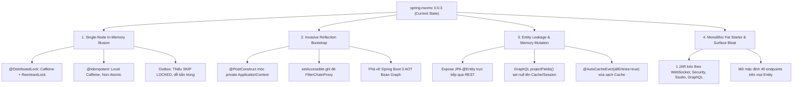
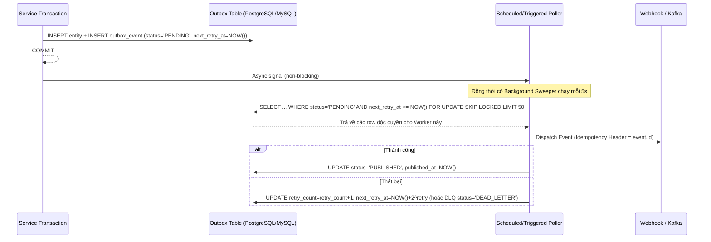
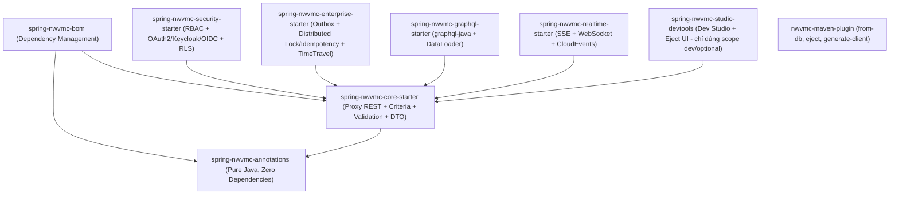

# Kiểm Toán Kiến Trúc & Lộ Trình Nâng Cấp Chiến Lược: `spring-nwvmc` (`0.0.3`)

> **Góc nhìn đánh giá:** CTO · Senior Back-end Developer · System Engineer (SRE) · Solutions Architect  
> **Đối tượng kiểm toán:** [`controller-to-api-framework`](controller-to-api-framework/) (`io.github.natswarchuan:spring-nwvmc:0.0.3`)  
> **Mục tiêu chiến lược:** Nâng cấp từ một *Smart Dynamic CRUD Library* thành một *Production-Grade Enterprise Framework* đủ sức thuyết phục các đội ngũ Engineering khắt khe, tối ưu tổng chi phí sở hữu (TCO), chi phí học tập (Learning Curve) và chi phí triển khai — từ đó hình thành một cộng đồng sử dụng rộng rãi và bền vững.
>
> **Trạng thái thực thi (`2026-11-20`, v0.0.3):** **Phase 1 (`P1.1`–`P1.5`)** và **Phase 2 (`P2.1`–`P2.3`)** đã hoàn thiện & kiểm chứng qua `569` framework tests (`591` main / `251` test files) + `158` implementation integration tests (`125` main / `54` test files, `0` failures) + Apache JMeter (`2,000` requests, `0.0%` error rate); **Phase 3 (`P3.1`–`P3.3`)** giữ làm lộ trình cộng đồng dài hạn sau v0.0.3.

---

## Mục Lục

- [Executive Summary: Tổng Quan Kiểm Toán Kiến Trúc](#executive-summary-tổng-quan-kiểm-toán-kiến-trúc)
- [Phần 1: Góc Nhìn Senior Back-End Developer (DX, JPA/Hibernate, API Contract & Ergonomics)](#phần-1-góc-nhìn-senior-back-end-developer)
  - [1.1. Tử Huyệt Expose Trực Tiếp JPA `@Entity`, Thiếu Optimistic Locking & Lỗi Mutate Entity Tại Chỗ](#11-tử-huyệt-expose-trực-tiếp-jpa-entity-thiếu-optimistic-locking--lỗi-mutate-entity-tại-chỗ)
  - [1.2. Thảm Họa Hiệu Năng Cache (`@AutoCacheEvict(allEntries = true)` Trên Cache Dùng Chung)](#12-thảm-họa-hiệu-năng-cache-autocacheevictallentries--true-trên-cache-dùng-chung)
  - [1.3. Lỗi N+1 Full Eager Query & Check-Then-Act Race Condition Khi Kiểm Tra `@UniqueField`](#13-lỗi-n1-full-eager-query--check-then-act-race-condition-khi-kiểm-tra-uniquefield)
  - [1.4. Keyset Pagination Bị Khóa Cứng Vào `id ASC` & Eager-Fetch Vô Điều Kiện](#14-keyset-pagination-bị-khóa-cứng-vào-id-asc--eager-fetch-vô-điều-kiện)
  - [1.5. Trải Nghiệm IDE Bị Đứt Gãy Bởi Hệ Thống Annotation `@Auto*` Độc Quyền](#15-trải-nghiệm-ide-bị-đứt-gãy-bởi-hệ-thống-annotation-auto-độc-quyền)
- [Phần 2: Góc Nhìn System Engineer / SRE (Distributed Systems, Concurrency, OOM & Spring Lifecycle)](#phần-2-góc-nhìn-system-engineer--sre)
  - [2.1. Ba Tính Năng "Distributed" Thực Chất Là Single-Node In-Memory (Vỡ Trận Trên K8s Multi-Pod)](#21-ba-tính-năng-distributed-thực-chất-là-single-node-in-memory)
  - [2.2. Nguy Cơ `OutOfMemoryError` (OOM) Từ Các Endpoint Mặc Định](#22-nguy-cơ-outofmemoryerror-oom-từ-các-endpoint-mặc-định)
  - [2.3. Rủi Ro Vòng Đời Spring Container, Security & GraalVM AOT Do Reflection Bootstrap](#23-rủi-ro-vòng-đời-spring-container-security--graalvm-aot-do-reflection-bootstrap)
- [Phần 3: Góc Nhìn Solutions Architect (Security Surface, Modularity, Multi-Tenancy & Spec Compliance)](#phần-3-góc-nhìn-solutions-architect)
  - [3.1. Bùng Nổ Bề Mặt Tấn Công (40 Endpoints/Controller) & Composable Capability Interfaces](#31-bùng-nổ-bề-mặt-tấn-công-40-endpoints-controller--composable-capability-interfaces)
  - [3.2. Tái Cấu Trúc Monolithic Fat JAR Thành Hệ Sinh Thái Multi-Module Starters + BOM](#32-tái-cấu-trúc-monolithic-fat-jar-thành-hệ-sinh-thái-multi-module-starters--bom)
  - [3.3. Nâng Cấp GraphQL Engine Từ Regex Parser Sang `graphql-java` Spec-Compliant](#33-nâng-cấp-graphql-engine-từ-regex-parser-sang-graphql-java-spec-compliant)
  - [3.4. Lỗ Hổng Bảo Mật Multi-Tenancy (IDOR & Tenant Spoofing) Trong `TenantSecurityFilterHelper`](#34-lỗ-hổng-bảo-mật-multi-tenancy-idor--tenant-spoofing)
- [Phần 4: Góc Nhìn CTO (Chiến Lược Cộng Đồng, Giảm Chi Phí Học/Triển Khai & Flywheel Tăng Trưởng)](#phần-4-góc-nhìn-cto)
  - [4.1. Định Vị Giá Trị Cốt Lõi (Product Positioning)](#41-định-vị-giá-trị-cốt-lõi)
  - [4.2. Chiến Lược "Time-to-First-Wow < 60 Giây" & `nwvmc-maven-plugin` CLI](#42-chiến-lược-time-to-first-wow--60-giây--nwvmc-maven-plugin-cli)
  - [4.3. Xây Dựng Niềm Tin Doanh Nghiệp (Benchmarks Công Khai & Testcontainers Matrix)](#43-xây-dựng-niềm-tin-doanh-nghiệp)
- [Phần 5: Lộ Trình Thực Thi Chi Tiết 3 Giai Đoạn (Master Execution Roadmap)](#phần-5-lộ-trình-thực-thi-chi-tiết-3-giai-đoạn)

---

## Executive Summary: Tổng Quan Kiểm Toán Kiến Trúc

### 1. Những Điểm Sáng Giá Vượt Trội Của Phiên Bản `0.0.3`
Trước khi mổ xẻ các khuyết điểm, dưới góc nhìn kỹ thuật khách quan, `spring-nwvmc:0.0.3` sở hữu nhiều ý tưởng kiến trúc sắc bén mà phần lớn thư viện CRUD trên hệ sinh thái Java (như Spring Data REST) chưa giải quyết được:

1. **Tư duy chống Vendor Lock-in (Escape Hatch & Code Ejection):**
   * Cho phép ghi đè từng phương thức qua `@ServiceOverride` hoặc `default` method trong interface (`ControllerProxyInvocationHandler.java:65-69, 149-151`).
   * Cho phép xuất thẳng 5 file Spring MVC độc lập (`DTO`, `Repository`, `Service`, `ServiceImpl`, `Controller`) qua `ControllerEjectionHelper.java:39-63` (`GET /system/studio/eject`) — triệt tiêu nỗi sợ lớn nhất của CTO khi dùng framework sinh API tự động.
2. **Tối ưu Hot-Path & Contract Frontend Hiện Đại:**
   * Sử dụng `MethodHandle` / `LambdaMetafactory` và `ReflectionMetadataCacheUtil` để giảm chi phí phản chiếu ở tầng dispatch.
   * Áp dụng UUIDv7 (RFC 9562) làm khóa chính mặc định trong `BaseAuditEntity.java:42-45, 71-74`, giúp tối ưu B-Tree Index thay vì UUIDv4 phân mảnh.
   * Tích hợp sẵn runtime codegen cho TypeScript Interface, Zod Schema (`/schema/zod`), và Typed Fetch Client (`/schema/client`) trong `AutoApiReadController.java:184-216`.
3. **Nhận thức về Bảo vệ Truy vấn (Query Guardrails) & Developer Experience:**
   * `QueryGuardrailProperties.java` (`app.framework.query-guardrails`) giới hạn `maxJoinDepth`, `maxFilterCriteria`, `maxPageSize` và allowlist để chống Query DoS.
   * `DevStudioProperties` mặc định khóa chặt `/system/studio` và demo token endpoint khi không chạy profile `dev`.

### 2. Bốn Mâu Thuẫn Kiến Trúc Cốt Lõi Khiến Engineering Team Khắt Khe Từ Chối Lên Production

Dù sở hữu 571 file mã nguồn và rất nhiều tính năng trên giấy, khi kiểm toán trực tiếp vào từng lớp xử lý, dự án tồn tại **4 rào cản mang tính hệ thống**:



---

## Phần 1: Góc Nhìn Senior Back-End Developer

Một Senior Back-end Developer khi đánh giá thư viện mới sẽ đặt một câu hỏi duy nhất: *"Nó giúp tôi code nhanh hơn trong tuần đầu tiên, nhưng đến tháng thứ 3 có khiến tôi kẹt trong nợ kỹ thuật, bug ngầm Hibernate và suy giảm hiệu năng DB không?"*

### 1.1. Tử Huyệt Expose Trực Tiếp JPA `@Entity`, Thiếu Optimistic Locking & Lỗi Mutate Entity Tại Chỗ

#### Thực trạng trong mã nguồn
1. **Lộ hoàn toàn Persistence Model ra Public Contract:**
   Trong [`AutoApiController.java:40-145`](controller-to-api-framework/src/main/java/io/github/natswarchuan/core/controller/AutoApiController.java#L40-L145), toàn bộ endpoint (`create`, `createBatch`, `upsert`, `update`, `patch`, `getById`, `getPage`) đều nhận trực tiếp `@AutoBody E entity` và trả về `ApiResponse<E>` / `PageResponse<E>`.
2. **Bug nghiêm trọng — Đột biến trực tiếp Entity đang được Cache/Quản lý bởi Hibernate:**
   * `DynamicEntityCrudServiceImpl.findById` ([dòng 121-133](controller-to-api-framework/src/main/java/io/github/natswarchuan/core/service/impl/DynamicEntityCrudServiceImpl.java#L121-L133)) được đánh dấu `@AutoCacheable(value = CacheConstant.CACHE_ENTITY_BY_ID, ...)`. Tức là object `E` trả về từ `findById` nằm trực tiếp trong Caffeine Cache (trên cùng JVM Heap) dưới dạng shared reference.
   * Khi gọi GraphQL trong [`DynamicGraphQLExecutionHelper.java:136-140, 208-221`](controller-to-api-framework/src/main/java/io/github/natswarchuan/module/graphql/helper/DynamicGraphQLExecutionHelper.java#L136-L221), phương thức `executeGetByIdOperation` lấy `entity` từ `crudService.findById(...)` rồi gọi `projectFields(entity, fieldsString)` -> gọi tiếp `projectionHelper.filterObjectFields(entity, allowedFields)`.
   * Bên trong [`DynamicSchemaProjectionHelper.java:91-119`](controller-to-api-framework/src/main/java/io/github/natswarchuan/core/helper/DynamicSchemaProjectionHelper.java#L91-L119), hàm `filterObjectFields` và `nullifyField` dùng reflection `field.trySetAccessible(); field.set(target, null);` để **gán `null` lên chính các field của object `entity` trong bộ nhớ**!
   * **Hệ quả thảm khốc:**
     * *Cache Corruption:* Request A gọi GraphQL chỉ lấy `{ id, name }` -> `price`, `description`, `status` trên object `E` trong Caffeine L1 Cache bị biến thành `null`. Request B ngay sau đó gọi REST `GET /api/v1/products/{id}` sẽ nhận về dữ liệu bị mất trắng các trường trên!
     * *Silent Data Loss qua Hibernate Dirty Checking:* Nếu `filterObjectFields` chạy trong phạm vi một Hibernate `EntityManager` còn mở (Open Session in View hoặc trong transaction), Hibernate Dirty Checking sẽ phát hiện các field vừa bị gán `null` và **phát sinh câu lệnh `UPDATE ... SET price = NULL` ghi đè xuống Database** khi transaction commit!
   * Ngoài ra, trong [`DynamicSchemaProjectionHelper.java:63-65`](controller-to-api-framework/src/main/java/io/github/natswarchuan/core/helper/DynamicSchemaProjectionHelper.java#L63-L65), hàm `applyProjection` chỉ kiểm tra `if (data instanceof PageResponse<?> pageResponse)` — hoàn toàn bỏ sót trường hợp trả về single entity `E` hoặc `List<E>`!
3. **Thiếu Optimistic Locking (`@Version`) & Múi giờ không nhất quán trong `BaseAuditEntity`:**
   * Trong [`BaseAuditEntity.java:40-94`](controller-to-api-framework/src/main/java/io/github/natswarchuan/common/entity/BaseAuditEntity.java#L40-L94), không hề có trường `@Version private Long version;`. Hai người dùng cùng `GET` một sản phẩm rồi gửi `PUT /{id}` gần như cùng lúc sẽ ghi đè âm thầm lên dữ liệu của nhau (Lost Update anomaly).
   * Trường `createdAt` và `updatedAt` dùng `LocalDateTime.now()` ([dòng 76, 91](controller-to-api-framework/src/main/java/io/github/natswarchuan/common/entity/BaseAuditEntity.java#L76-L91)) phụ thuộc vào System Default Timezone của OS/Container thay vì chuẩn `Instant` (UTC).

#### Thiết kế nâng cấp bắt buộc
1. **Tách bạch Persistence Model và API DTO Contract (Zero-Entity-Mutation):**
   * Cho phép khai báo cặp DTO tùy chọn ngay trên `@AutoRestController`, giữ mặc định `E` cho prototype nhanh nhưng khuyến nghị DTO cho Production:
     ```java
     @AutoRestController(
         basePath = "/api/v1/commercial-products",
         entity = CommercialProduct.class,
         readDto = CommercialProductResponse.class,
         createDto = CommercialProductCreateRequest.class,
         updateDto = CommercialProductUpdateRequest.class
     )
     public interface CommercialProductController
         extends AutoApiContract<CommercialProduct, CommercialProductResponse, CommercialProductCreateRequest, CommercialProductUpdateRequest> {
     }
     ```
   * Với Sparse Fieldsets (`?fields=id,name`) và GraphQL projection: Tuyệt đối **KHÔNG BAO GIỜ mutate object gốc**. Phải chuyển đổi sang `Map<String, ?>` / `ObjectNode` (Jackson `FilterProvider` / `SimpleBeanPropertyFilter`) tại tầng serialization trước khi trả HTTP response.
2. **Bổ sung `@Version` & chuẩn hóa `Instant` UTC vào `BaseAuditEntity`:**
   * Thêm `@Version private Long version;` và trả header `ETag` / hỗ trợ `If-Match` cho `PUT`/`PATCH`. Chuyển `createdAt`/`updatedAt` sang `Instant.now()` (hoặc `OffsetDateTime.now(ZoneOffset.UTC)`).

---

### 1.2. Thảm Họa Hiệu Năng Cache (`@AutoCacheEvict(allEntries = true)` Trên Cache Dùng Chung)

#### Thực trạng trong mã nguồn
Trong [`DynamicEntityCrudServiceImpl.java:121-264`](controller-to-api-framework/src/main/java/io/github/natswarchuan/core/service/impl/DynamicEntityCrudServiceImpl.java#L121-L264):
* `findById` sử dụng chung một cache duy nhất: `@AutoCacheable(value = CacheConstant.CACHE_ENTITY_BY_ID, key = CacheConstant.SPEL_KEY_ENTITY_BY_ID)`.
* Toàn bộ 8 phương thức ghi (`create`, `createBatch`, `upsert`, `upsertBatch`, `update`, `deleteById`, `deleteBatch`, `restoreById`) đều gắn:
  ```java
  @AutoCacheEvict(value = CacheConstant.CACHE_ENTITY_BY_ID, allEntries = true)
  ```

#### Tác động thực tế dưới tải Production
Giả sử hệ thống có 40 bảng: `Country`, `Currency`, `Category`, `SystemConfig`, `Product`, `Order`, `AuditLog`...
1. Chỉ cần có 1 request `POST /api/v1/orders` tạo đơn hàng mới, `@AutoCacheEvict(allEntries = true)` sẽ **xóa sạch 100% cache của tất cả các bảng khác** (`Product`, `Category`, `SystemConfig`...).
2. Dưới lưu lượng hỗn hợp (Read + Write), tỷ lệ Cache Hit sẽ sụt xuống gần **0%**, gây ra hiện tượng **Cache Stampede** (hàng nghìn luồng cùng lao thẳng xuống Database cùng một lúc).

#### Thiết kế nâng cấp bắt buộc
* **Phân vùng Cache theo Entity & Evict chính xác theo Key (Granular Invalidation):**
  * Cache name phải tách biệt theo domain hoặc key composite: `nwvmc:entity:{EntityName}:{id}`.
  * **`create` / `createBatch`**: **KHÔNG evict** cache `byId` (vì ID UUIDv7 mới tạo chưa từng tồn tại trong cache trước đó). Chỉ evict cache danh sách/count của riêng `EntityName` đó nếu có bật query cache.
  * **`update` / `deleteById` / `restoreById`**: Chỉ evict đúng key của bản ghi `{EntityName}:{id}`.
  * **`updateBatch` / `deleteBatch`**: Evict danh sách các key tương ứng bằng vòng lặp `cache.evictIfPresent(key)` thay vì `allEntries = true`.

---

### 1.3. Lỗi N+1 Full Eager Query & Check-Then-Act Race Condition Khi Kiểm Tra `@UniqueField`

#### Thực trạng trong mã nguồn
Xem xét [`EntityBusinessRuleEngineHelper.java:183-224`](controller-to-api-framework/src/main/java/io/github/natswarchuan/core/helper/EntityBusinessRuleEngineHelper.java#L183-L224) và [`DynamicEntityCrudServiceImpl.java:158-172`](controller-to-api-framework/src/main/java/io/github/natswarchuan/core/service/impl/DynamicEntityCrudServiceImpl.java#L158-L172):
* Khi gọi `createBatch` với 500 bản ghi, vòng lặp `for (final E item : payloads)` gọi `prepareAndValidateBeforeCreate` cho từng phần tử -> gọi `validateUniqueConstraints` -> duyệt toàn bộ field hierarchy -> với mỗi field có `@UniqueField` hoặc `@Column(unique = true)`, gọi `checkDuplicateValueForField`.
* Bên trong `checkDuplicateValueForField` (dòng 221-222):
  ```java
  final List<E> existingMatches =
      jpaExecutionHelper.fetchMatchingRecords(entityClass, queryDto, false);
  ```
* Cần lưu ý `fetchMatchingRecords(..., false)` ([`DynamicJpaExecutionHelper.java:137-160`](controller-to-api-framework/src/main/java/io/github/natswarchuan/core/helper/DynamicJpaExecutionHelper.java#L137-L160)) thực hiện `applyEagerJoinFetches(root, entityClass)` (`LEFT JOIN FETCH` tất cả quan hệ `@ManyToOne`/`@OneToOne`), tải toàn bộ cột của entity + bảng cha lên Java Heap, và không có `LIMIT 1` (`applyPagination = false`)!
* **Hệ quả:**
  1. **Bùng nổ SQL Query:** 1 batch 500 items có 3 `@UniqueField` phát sinh **$500 \times 3 = 1,500$ câu `SELECT ... LEFT JOIN FETCH`** trước khi thực hiện 1 câu `INSERT`!
  2. **Race Condition (Check-Then-Act):** Hai request song song gửi cùng `code = "PRD-001"` đều chạy `SELECT` thấy rỗng -> đều vượt qua `validateUniqueConstraints` -> cùng `INSERT` -> Database ném `ConstraintViolationException`, ứng dụng trả về lỗi `500 Internal Server Error` (hoặc rò rỉ tên constraint DB) thay vì `409 Conflict`.

#### Thiết kế nâng cấp bắt buộc
1. **Thay `fetchMatchingRecords` bằng Light Existence Query (`SELECT e.id ... LIMIT 1`):**
   Không `LEFT JOIN FETCH`, chỉ select duy nhất cột `id` với `setMaxResults(1)`.
2. **Batch Uniqueness Check:**
   Với `createBatch` / `upsertBatch`, thu thập toàn bộ giá trị unique của batch và chạy **1 câu truy vấn duy nhất** dạng `SELECT e.id, e.code FROM Entity e WHERE e.code IN (:codes)` (chia chunk 500 nếu batch lớn).
3. **Database Constraint Exception Translator:**
   Bổ sung `PersistenceExceptionTranslator` trong `GlobalExceptionHandler` để bắt `DataIntegrityViolationException` / `org.hibernate.exception.ConstraintViolationException` (SQLState `23505` trên PostgreSQL, error code `1062` trên MySQL) và tự động dịch sang `ConflictBusinessException` (HTTP `409`) kèm thông báo i18n thân thiện. Khi đó DB trở thành chốt chặn cuối cùng (Last Line of Defense) an toàn 100% dưới mọi tải đồng thời.

---

### 1.4. Keyset Pagination Bị Khóa Cứng Vào `id ASC` & Eager-Fetch Vô Điều Kiện

#### Thực trạng trong mã nguồn
1. **Keyset Pagination không thể sort theo trường nghiệp vụ:**
   Trong [`DynamicJpaExecutionHelper.java:94-126`](controller-to-api-framework/src/main/java/io/github/natswarchuan/core/helper/DynamicJpaExecutionHelper.java#L94-L126):
   ```java
   final DynamicQueryRequestDto keysetRequest = queryRequest.toBuilder()
       .page(CommonConstant.ZERO)
       .sortField(CommonConstant.FIELD_ID)
       .sortDirection(CommonConstant.SORT_ASC)
       .build();
   ```
   Endpoint `/keyset` tự ý ghi đè mọi lựa chọn sort của client thành `id ASC`. Trong thực tế, 90% danh sách dữ liệu lớn (đơn hàng, giao dịch ngân hàng, thông báo, bài viết) cần sắp xếp **mới nhất lên đầu (`createdAt DESC`)**, hoặc sắp xếp theo `price ASC`, `priority DESC`. Hơn nữa, dòng 115 gán `.totalElements(records.size())` gây hiểu nhầm cho Frontend về tổng số bản ghi thực.
2. **Eager-Fetch vô điều kiện trên mọi truy vấn danh sách:**
   Trong [`DynamicCriteriaJoinAndSortHelper.java:48-53`](controller-to-api-framework/src/main/java/io/github/natswarchuan/core/helper/DynamicCriteriaJoinAndSortHelper.java#L48-L53), `applyEagerJoinFetches` luôn gọi `root.fetch(relationName, JoinType.LEFT)` cho tất cả quan hệ `@ManyToOne` / `@OneToOne`. Nếu Entity có 8 bảng cha (ví dụ `Order` nối với `User`, `Merchant`, `Branch`, `Voucher`, `ShippingPartner`, `PaymentMethod`, `Currency`, `CreatedByUser`), mỗi lần `GET /page` hay `GET /all` lại sinh ra câu SQL **8-way `LEFT JOIN`** kéo hàng trăm cột không cần thiết chỉ để hiển thị một bảng danh sách rút gọn!

#### Thiết kế nâng cấp bắt buộc
* **Composite Keyset Cursor Token:**
  * Định dạng cursor dạng opaque token (Base64URL encoded JSON hoặc `val|uuid`): `eyJzIjoiMjAyNi0xMS0xOVQxMDowMDowMFoiLCJpZCI6IjAxOTM...In0`.
  * Điều kiện SQL chuẩn (sử dụng Row-Value Comparison hoặc biểu thức tương đương để tận dụng Composite Index `(sort_col, id)`):
    * Với `ASC`: `(e.sortField > :lastVal) OR (e.sortField = :lastVal AND e.id > :lastId)`
    * Với `DESC`: `(e.sortField < :lastVal) OR (e.sortField = :lastVal AND e.id < :lastId)`
  * Sử dụng kỹ thuật `limit + 1` để tính chính xác `hasNext` mà không cần chạy `COUNT(*)`.
* **Selective Relation Expansion (`?expand=category,brand`):**
  * Chỉ `LEFT JOIN FETCH` các quan hệ được khai báo trong danh sách mặc định nhẹ hoặc theo tham số `?expand=...`, kết hợp **DTO Constructor / Tuple Projection** khi client chỉ lấy danh sách.

---

### 1.5. Trải Nghiệm IDE Bị Đứt Gãy Bởi Hệ Thống Annotation `@Auto*` Độc Quyền

#### Thực trạng trong mã nguồn
Framework định nghĩa lại toàn bộ bộ annotation cơ bản:
* `@AutoRestController` thay cho `@RestController` + `@RequestMapping`
* `@AutoGet`, `@AutoPost`, `@AutoPut`, `@AutoPatch`, `@AutoDelete` thay cho `@GetMapping`, `@PostMapping`...
* `@AutoBody`, `@AutoParam`, `@AutoVariable` thay cho `@RequestBody`, `@RequestParam`, `@PathVariable`
* `@AutoComponent`, `@AutoService`, `@AutoBean` thay cho `@Component`, `@Service`, `@Bean`

#### Góc nhìn DX của Senior Developer
Các kỹ sư Java/Spring phụ thuộc rất mạnh vào **IntelliJ IDEA Ultimate / Spring Tools / VS Code Spring Dashboard**:
* Cửa sổ **Endpoints** tự động nhận diện `@GetMapping` để tạo request test nhanh, gợi ý path khi gọi `WebTestClient` / `RestClient` và phát hiện trùng URL.
* Kiểm tra Dependency Injection (Gutter icons nhảy giữa Bean và nơi Inject `@Service` / `@Component`).
* Khi bắt dev học và viết `@AutoGet`, `@AutoBody`, `@AutoParam`, toàn bộ hệ sinh thái công cụ IDE bị mù hoàn toàn, đồng thời tạo ra rào cản tâm lý ("Lại phải học một dialect Spring mới").

#### Thiết kế nâng cấp bắt buộc
* **Dual-Support & Standard Spring Meta-Annotations:**
  * Chấp nhận trực tiếp `@GetMapping`, `@PostMapping`, `@PutMapping`, `@PatchMapping`, `@DeleteMapping`, `@RequestBody`, `@RequestParam`, `@PathVariable` trên các interface kế thừa `AutoApiController`.
  * Nếu vẫn giữ `@AutoGet`/`@AutoPost` vì mục đích pure-Java interface module, hãy đánh dấu chúng bằng Spring meta-annotations hoặc cung cấp module `spring-nwvmc-ide-metadata` (hoặc IntelliJ plugin nhẹ) để IDE hiểu được URL mapping và validation.

---

## Phần 2: Góc Nhìn System Engineer / SRE

Dưới góc nhìn vận hành hệ thống phân tán trên Kubernetes (nhiều Pod chạy song song, Auto-scaling, Rolling Restart, OOMKill alerts), sự an toàn dưới tải đồng thời và tính nhất quán dữ liệu là yếu tố sống còn.

### 2.1. Ba Tính Năng "Distributed" Thực Chất Là Single-Node In-Memory

Đây là lỗ hổng kỳ vọng nghiêm trọng nhất: tên annotation mang ngữ nghĩa phân tán (`@DistributedLock`, `@Idempotent`, `TransactionalOutbox`), nhưng cài đặt thực tế lại chỉ chạy an toàn trên **1 JVM duy nhất** — và thậm chí có bug race condition ngay trên 1 JVM đó!

#### (A) `@DistributedLock` — Caffeine Local Lock & Bug Lease Expiration tạo Hai Mutex Song Song
* **File:** [`DistributedLockManagerHelper.java:29-169`](controller-to-api-framework/src/main/java/io/github/natswarchuan/module/lock/helper/DistributedLockManagerHelper.java#L29-L169)
* **Thực trạng:**
  1. Lưu trữ lock bằng `Caffeine<String, DistributedLockLeaseDto>` cục bộ và `java.util.concurrent.locks.ReentrantLock`. Khi deploy 3 Pods sau Load Balancer, **Pod A, Pod B và Pod C mỗi nơi giữ 1 Caffeine map riêng** -> 3 luồng cùng ghi đè tồn kho/số dư cùng một lúc!
  2. **Bug Concurrency nghiêm trọng ngay trong 1 JVM ([dòng 48-56 & 64-77](controller-to-api-framework/src/main/java/io/github/natswarchuan/module/lock/helper/DistributedLockManagerHelper.java#L48-L77)):**
     ```java
     // Thread 1 đang chạy xử lý chậm hơn leaseMs (ví dụ GC pause hoặc DB chậm)
     // Thread 2 đi vào acquireLock():
     evictExpiredLeaseIfNeeded(lockKey); // Thấy hết hạn -> gọi lockRegistry.invalidate(lockKey)!
     final DistributedLockLeaseDto lease = resolveLeaseByKey(lockKey); // Tạo ReentrantLock MỚI TINH!
     final boolean acquired = tryLockWithTimeout(lease.getMutex(), waitMs); // Trả về TRUE ngay lập tức!
     ```
     Kết quả: **Cả Thread 1 (đang giữ `ReentrantLock` cũ) và Thread 2 (vừa lấy `ReentrantLock` mới) cùng thực thi song song trong Critical Section!** Sau đó khi Thread 1 chạy xong gọi `releaseLock(lockKey)`, Thread 1 thậm chí có thể kiểm tra sai hoặc invalidate nhầm entry mới của Thread 2!
* **Giải pháp chuẩn Production:**
  * Thiết kế SPI `DistributedLockProvider` với cơ chế **Fencing Token** và chọn adapter theo hạ tầng:
    1. `RedisDistributedLockProvider` (dùng Lua script `SET key token NX PX leaseMs` + atomic release bằng kiểm tra `token` + Redisson Watchdog nếu cần).
    2. `JdbcDistributedLockProvider` (dùng bảng `nwvmc_distributed_lock` với `UPDATE ... WHERE expires_at < NOW()` hoặc Postgres `pg_try_advisory_xact_lock`, giúp người dùng chưa có Redis vẫn khóa chuẩn xác 100% giữa nhiều Pods!).
    3. `LocalJvmLockProvider` (chỉ bật khi cấu hình rõ `mode=local`, ghi log cảnh báo nếu phát hiện chạy ở profile `prod`, và không bao giờ tạo 2 `ReentrantLock` khác nhau cho cùng một key đang sống).

#### (B) `@Idempotent` — Local Caffeine Store & Non-Atomic Check-Then-Put
* **File:** [`IdempotencyManagerHelper.java:32-158`](controller-to-api-framework/src/main/java/io/github/natswarchuan/module/idempotent/helper/IdempotencyManagerHelper.java#L32-L158)
* **Thực trạng:**
  1. Cache kết quả thanh toán/tạo đơn bằng `X-Idempotency-Key` chỉ lưu trong Caffeine local JVM. Khi client gặp timeout và retry request sang Pod thứ 2 -> **Pod thứ 2 không thấy key -> thực thi trùng giao dịch (Double Charge / Duplicate Order)**.
  2. **Race Condition ngay trên 1 Pod ([dòng 64-81](controller-to-api-framework/src/main/java/io/github/natswarchuan/module/idempotent/helper/IdempotencyManagerHelper.java#L64-L81)):**
     Hàm `evaluateIdempotency` đọc `resolveActiveExistingRecord` (`cacheStore.getIfPresent`), thấy `null`, rồi mới đi làm việc khác và gọi `cacheStore.put(idempotencyKey, processingRecord)` ở dòng 80. Nếu 2 request giống hệt nhau chạm server trong cùng một microsecond (double-click hoặc retry song song), cả 2 đều đọc thấy `null` và đều lọt vào thực thi nghiệp vụ!
* **Giải pháp chuẩn Production:**
  * Sử dụng thao tác nguyên tử `asMap().compute(...)` / `putIfAbsent` cho local store, và tách `IdempotencyStoreProvider` với backend **Redis (`SET NX`)** hoặc **Relational Database (`INSERT INTO nwvmc_idempotency ...` bắt `UniqueConstraintViolation`)** để trạng thái idempotency được chia sẻ toàn cụm và đồng bộ với transaction nghiệp vụ.

#### (C) Transactional Outbox — Thiếu `FOR UPDATE SKIP LOCKED` & Thiếu Recovery Sweeper
* **File:** [`TransactionalOutboxHelper.java:72-228`](controller-to-api-framework/src/main/java/io/github/natswarchuan/module/event/helper/TransactionalOutboxHelper.java#L72-L228)
* **Thực trạng:**
  1. Khi giao dịch ghi DB thành công, dòng 92 đăng ký `TransactionRuntimeBridge.executeAfterCommit(() -> dispatchPendingOutboxEvents(event))`.
  2. Bên trong `dispatchPendingOutboxEvents` ([dòng 156-168](controller-to-api-framework/src/main/java/io/github/natswarchuan/module/event/helper/TransactionalOutboxHelper.java#L156-L168)), framework mở transaction mới và chạy:
     ```java
     SELECT o FROM OutboxEvent o WHERE o.status = 'PENDING'
     ```
     (lấy tối đa `OUTBOX_POLL_BATCH_SIZE`) mà **không hề có khóa hàng (`PESSIMISTIC_WRITE` + `SKIP LOCKED`)**, cũng không lọc theo event vừa tạo!
  3. **Kịch bản lỗi thực tế:**
     * Có 50 request `create` commit đồng thời trên 3 Pods -> 50 thread đều chạy câu `SELECT` trên -> cả 50 thread đọc trùng chính các bản ghi `PENDING` đó và **bắn sự kiện trùng lặp hàng chục lần** sang Webhook / Kafka!
     * Nếu Pod bị crash (OOM / SIGKILL) sau khi DB commit xong nhưng trước khi callback `afterCommit` kịp chạy (hoặc khi dispatcher tạm lỗi mạng khiến `retryCount = 1` mà chưa đạt `MAX_RETRIES`), bản ghi `PENDING` sẽ nằm chết trong bảng Outbox mãi mãi cho tới khi có một giao dịch khác vô tình commit để kích hoạt hàm `dispatchPendingOutboxEvents`!
* **Giải pháp chuẩn Production:**



---

### 2.2. Nguy Cơ `OutOfMemoryError` (OOM) Từ Các Endpoint Mặc Định

#### Thực trạng trong mã nguồn
1. **Giả lập streaming bằng `StringBuilder` trên RAM:**
   Trong [`JsonlDataExportHelper.java:15-58`](controller-to-api-framework/src/main/java/io/github/natswarchuan/core/helper/JsonlDataExportHelper.java#L15-L58), Javadoc khẳng định *"streaming serialization ... with O(1) memory overhead"*, nhưng thực tế:
   * Dòng 47 gọi `jpaExecutionHelper.fetchMatchingRecords(entityClass, queryRequest, true)` nạp danh sách `List<E>` lên Heap.
   * Dòng 53-57 nối từng dòng JSON vào một `StringBuilder` khổng lồ và trả về nguyên khối `String`!
   * Nếu xuất dữ liệu lớn (hoặc bỏ phân trang), toàn bộ Entity + toàn bộ JSON String nằm đồng thời trên Heap -> tăng đột biến GC Pause và OOMKill.
2. **Endpoint `GET /all` & `PATCH /batch-update` không có trần giới hạn cứng (Unbounded Fetch):**
   * [`AutoApiReadController.java:74-75`](controller-to-api-framework/src/main/java/io/github/natswarchuan/core/controller/AutoApiReadController.java#L74-L75): `getAll` gọi `fetchMatchingRecords(..., false)` không giới hạn số bản ghi. Với bảng 1,000,000 dòng, 1 request `GET /api/v1/orders/all` là đủ đánh sập Pod 2GB RAM.
   * [`DynamicJpaBatchAndCloneHelper.java:57-77`](controller-to-api-framework/src/main/java/io/github/natswarchuan/core/helper/DynamicJpaBatchAndCloneHelper.java#L57-L77): `executeBatchUpdateByFilter` tải toàn bộ bản ghi khớp điều kiện lên Persistence Context (First-Level Cache) và lặp `merge()` từng cái mà không có `flush()`/`clear()` theo batch.

#### Thiết kế nâng cấp bắt buộc
* **Streaming thật sự cho Export (`CSV` / `JSONL`):** Trả về Spring `StreamingResponseBody` ghi thẳng vào `HttpServletResponse.getOutputStream()`, lặp đọc từng chunk 500 bản ghi bằng Keyset Cursor, sau mỗi chunk gọi `entityManager.clear()` để giải phóng toàn bộ Hibernate 1st-level cache -> đạt $O(1)$ Heap thật sự ngay cả khi export 10 triệu dòng.
* **Áp đặt `max-unpaged-fetch-limit` trong `QueryGuardrailProperties`:** Mặc định chặn cứng `GET /all` (hoặc yêu cầu ngưỡng trần ví dụ `maxUnpagedSize = 2000`, vượt quá ném `400 Bad Request` kèm gợi ý dùng `/keyset` hoặc `/export/jsonl`). Chia chunk + `entityManager.clear()` cho `PATCH /batch-update`.

---

### 2.3. Rủi Ro Vòng Đời Spring Container, Security & GraalVM AOT Do Reflection Bootstrap

#### Thực trạng trong mã nguồn
Để đạt mục tiêu "Pure Java (Zero compile-time Spring import)" ở một số gói, framework đã chọn một con đường cực kỳ mạo hiểm về mặt vòng đời Container:
1. **Tiêm bean nội bộ của Spring để móc `ApplicationContext` trong `@PostConstruct`:**
   * [`ControllerToApiAutoConfiguration.java:26-51`](controller-to-api-framework/src/main/java/io/github/natswarchuan/autoconfigure/ControllerToApiAutoConfiguration.java#L26-L51) dùng `@Resource(name = BridgeConstant.BEAN_INTERNAL_EVENT_LISTENER_PROCESSOR)` tiêm `internalEventListenerProcessor`, sau đó trong `@PostConstruct` gọi `PureJavaSpringBootstrapBridge.bootstrap(...)`.
   * [`PureJavaSpringBootstrapBridge.java:62-73`](controller-to-api-framework/src/main/java/io/github/natswarchuan/core/bridge/PureJavaSpringBootstrapBridge.java#L62-L73) dùng Reflection đọc field `applicationContext`, gọi `extractBeanFactory`, rồi đăng ký hàng loạt `BeanDefinition` mới vào `BeanFactory` **khi quá trình khởi tạo Bean của Spring đang chạy dở dang**!
2. **Dùng `setAccessible(true)` ghi đè ruột của Spring Security & Spring WebMVC:**
   * [`PureJavaWebMvcBootstrapBridge.java:153-167`](controller-to-api-framework/src/main/java/io/github/natswarchuan/core/bridge/PureJavaWebMvcBootstrapBridge.java#L153-L167): Dùng `resolversField.setAccessible(true); resolversField.set(composite, updated);` để chọc vào private field `resolvers` của `HandlerExceptionResolverComposite`.
   * [`PureJavaSecurityFilterBridge.java:219-238`](controller-to-api-framework/src/main/java/io/github/natswarchuan/core/bridge/PureJavaSecurityFilterBridge.java#L219-L238): Tìm `FilterChainProxy` (kể cả trong Tomcat `StandardContext` qua [`SecurityContainerWiringBridge.java:38-71`](controller-to-api-framework/src/main/java/io/github/natswarchuan/core/bridge/SecurityContainerWiringBridge.java#L38-L71)) rồi gán đè:
     ```java
     chainsField.set(rawTarget, List.of(customChain));
     ```
     **Hậu quả cực kỳ nguy hiểm:** Nếu ứng dụng doanh nghiệp đã định nghĩa các `SecurityFilterChain` riêng (ví dụ chain `@Order(1)` bảo vệ `/actuator/**` bằng Basic Auth/IP Allowlist, hoặc chain OAuth2 Login cho `/admin/**`, hoặc API Key filter cho webhook đối tác), lệnh `List.of(customChain)` của framework **XÓA SẠCH toàn bộ `SecurityFilterChain` của ứng dụng chủ**!
3. **Mâu thuẫn với Spring Boot 3 AOT & GraalVM Native Image:**
   * Trong biên dịch GraalVM Native Image (`mvn -Pnative native:compile`), Spring Boot chạy pha AOT ở **build-time** để đóng băng toàn bộ `BeanDefinition` thành mã nguồn Java tĩnh (`BeanDefinitions.java`). Việc tự ý quét classpath (`PureJavaClasspathScannerUtil`) và đăng ký BeanDefinition muộn ở **runtime** trong `@PostConstruct` / `onContextRefreshed` khiến `BeanFactoryInitializationAotProcessor` không thấy được các bean đó ở build-time, đồng thời phụ thuộc vào biến private của Spring/Tomcat (`StandardContext`, `ApplicationFilterConfig`, `resolvers`) vốn rất dễ bị đổi tên giữa các bản minor của Spring Boot 3.4 / 3.5 / 4.0 hoặc bị chặn bởi Java Module System (`--illegal-access=deny` / strong encapsulation trên JDK 21+).

#### Thiết kế nâng cấp bắt buộc
* **Loại bỏ hoàn toàn Reflection Hook vào nội tạng Spring & Tomcat:**
  * Nếu muốn giữ các annotation pure-Java cho lớp domain/interface của người dùng, **chỉ cần tách module `spring-nwvmc-annotations` (Zero Spring Dependency)** chứa các annotation và interface `AutoApiController`.
  * Toàn bộ tầng hạ tầng starter (`spring-nwvmc-core-starter`) **phải dùng các API chính thống 100% được Spring Framework bảo trợ**:
    * `ImportBeanDefinitionRegistrar` / `BeanDefinitionRegistryPostProcessor` để đăng ký JDK Dynamic Proxy BeanDefinition ở đúng pha Early Registry (tương thích hoàn hảo với cả JVM lẫn Spring AOT build-time).
    * `WebMvcConfigurer` (`addArgumentResolvers`, `addReturnValueHandlers`) và `@RestControllerAdvice` (`@Order(Ordered.HIGHEST_PRECEDENCE)`) thay cho `resolversField.setAccessible(true)`.
    * `@ConditionalOnMissingBean(SecurityFilterChain.class)` hoặc `SecurityFilterChain` với `@Order` cấu hình được, không bao giờ đè mất chain của host application.

---

## Phần 3: Góc Nhìn Solutions Architect

Một Solutions Architect thiết kế hệ thống ngân hàng, bảo hiểm, thương mại điện tử hay nền tảng SaaS đa doanh nghiệp (B2B Multi-Tenant) sẽ tập trung vào **nguyên tắc đặc quyền tối thiểu, khả năng lắp ghép mô-đun, tính tuân thủ giao thức và cô lập dữ liệu**.

### 3.1. Bùng Nổ Bề Mặt Tấn Công (40 Endpoints/Controller) & Composable Capability Interfaces

#### Thực trạng trong mã nguồn
Khi một developer khai báo:
```java
@AutoRestController(basePath = "/api/v1/users")
public interface UserController extends AutoApiController<User> {}
```
Vì `AutoApiController<E>` kế thừa cả `AutoApiReadController<E>` và `AutoApiEnterpriseController<E>`, lập tức **40 HTTP endpoints** được công khai mặc định, bao gồm cả những endpoint có sức sát thương cực lớn:
* `PATCH /batch-update` (cập nhật hàng loạt theo filter)
* `DELETE /batch` (xóa hàng loạt)
* `POST /{id}/clone` (nhân bản record)
* `POST /import/csv`, `POST /import/jsonl`
* `POST /ai/query`
* `GET /all`, `GET /schema/zod`, `GET /schema/client`

Mặc dù `@AutoRestController` có `enabledEndpoints` / `disabledEndpoints` ([`AutoRestController.java:53-60`](controller-to-api-framework/src/main/java/io/github/natswarchuan/core/annotation/AutoRestController.java#L53-L60)) kiểu String array (dễ gõ sai chính tả và không được compiler kiểm tra), việc **mở tất cả theo mặc định (Default-Open)** đi ngược lại nguyên tắc **Secure by Default & Least Privilege**. Nếu dev quên disable `batch-update` hay `clone` trên bảng `PaymentTransaction` hoặc `UserAccount`, đó là một lỗ hổng nghiệp vụ nghiêm trọng.

#### Thiết kế nâng cấp bắt buộc: Composable Capability Interfaces (Type-Safe Opt-In)
Chia nhỏ `AutoApiController` thành các Interface hạt nhân để developer **lắp ghép chính xác những gì mình muốn phơi bày** (với kiểm tra 100% lúc compile-time):

```java
// Cách dùng khuyến nghị trong Enterprise: Chỉ mở Read + Write cơ bản, KHÔNG mở Batch/Import/AI
@AutoRestController(basePath = "/api/v1/orders")
public interface OrderController
    extends AutoReadApi<Order>, AutoWriteApi<Order>, AutoKeysetApi<Order> {
}

// Danh sách các Capability Interfaces độc lập:
// 1. AutoReadApi<E>          -> getById, getPage, count, exists
// 2. AutoKeysetApi<E>        -> getKeysetPage
// 3. AutoWriteApi<E>         -> create, update, patch, deleteById, restoreById
// 4. AutoBatchApi<E>         -> createBatch, upsert, upsertBatch, batchChunked, updateBatchByFilter, deleteBatch
// 5. AutoAnalyticsApi<E>     -> aggregate, findDistinctValues, findTopRecords, groupByAnalytics
// 6. AutoExportImportApi<E>  -> exportCsv, exportJsonl, importCsv, importJsonl
// 7. AutoWorkflowApi<E>      -> transitionState, cloneEntity, patchRfc6902, compareEntityDiff
// 8. AutoSchemaApi<E>        -> getMetadata, generateTypeScript, getJsonSchema, generateZodSchema, generateTypedApiClient
// 9. AutoAiApi<E>            -> getAiContext, queryAi
// 10. AutoFullApi<E>         -> (Kế thừa toàn bộ cho trường hợp Back-office nội bộ / Prototyping)
```

---

### 3.2. Tái Cấu Trúc Monolithic Fat JAR Thành Hệ Sinh Thái Multi-Module Starters + BOM

#### Thực trạng trong mã nguồn
Trong [`controller-to-api-framework/pom.xml:55-150`](controller-to-api-framework/pom.xml#L55-L150), toàn bộ 19 phân hệ trong package `module/` (`ai`, `aop`, `cache`, `datasource`, `devex`, `event`, `graphql`, `idempotent`, `integration`, `lock`, `metrics`, `realtime`, `schema`, `security`, `storage`, `studio`, `timetravel`, `tracing`, `webhook`) được đóng chung vào **một artifact duy nhất** `spring-nwvmc`, kéo theo hàng loạt dependency nặng nề (`spring-boot-starter-websocket`, `spring-boot-starter-security`, `jjwt`, `resilience4j`, `springdoc-openapi-starter-webmvc-ui`, `DevStudio` UI templates).

#### Tác động kiến trúc
Một Microservice nhỏ (ví dụ `Catalog-Query-Service`) chỉ cần REST + JPA + OpenAPI sẽ từ chối dùng `spring-nwvmc` vì không muốn gánh WebSocket threads, JWT security auto-config, hay mã HTML/JS của DevStudio trong container image Production.

#### Thiết kế nâng cấp bắt buộc: Kiến trúc Multi-Module & BOM



Đặc biệt với **`spring-nwvmc-security-starter`**: Doanh nghiệp lớn hiếm khi tự phát hành JWT bằng secret symmetric nội bộ (`jjwt` HS256). Họ sử dụng **Keycloak, Auth0, Okta, Azure AD (Entra ID) hoặc AWS Cognito** qua chuẩn **OAuth2 Resource Server (JWKS / RS256)**. Framework cần tích hợp mượt với `spring-boot-starter-oauth2-resource-server`, tự đọc claim `roles` / `scope` / `tenant_id` từ `JwtAuthenticationToken` tiêu chuẩn!

---

### 3.3. Nâng Cấp GraphQL Engine Từ Regex Parser Sang `graphql-java` Spec-Compliant

#### Thực trạng trong mã nguồn
Trong [`DynamicGraphQLExecutionHelper.java:83-199`](controller-to-api-framework/src/main/java/io/github/natswarchuan/module/graphql/helper/DynamicGraphQLExecutionHelper.java#L83-L199):
* Phân tích query bằng biểu thức chính quy `GraphQLConstant.QUERY_OPERATION_PATTERN`.
* Bỏ qua hoàn toàn `request.getVariables()`.
* Chỉ hiểu 3 prefix cứng (`get*`, `count*`, `list*`).
* `executeListOperation` bỏ qua cả `fieldsString` lẫn bộ lọc, gọi `crudService.findAllMatching` tải toàn bộ bảng lên RAM!
* Không hỗ trợ nested object traversal (`order { id items { product { name } } }`), `fragments`, `aliases`, `mutations`, và **không có Introspection (`__schema` / `__type`)** nên các công cụ như Apollo Studio, GraphiQL, Relay hay Postman GraphQL đều báo lỗi khi kết nối.

#### Thiết kế nâng cấp bắt buộc
* Đưa GraphQL ra module riêng `spring-nwvmc-graphql-starter` dựa trên **`graphql-java` / `spring-boot-starter-graphql`**.
* Dùng `EntityMetadataIntrospectorHelper` tự động dựng `TypeDefinitionRegistry` / `GraphQLSchema` chuẩn quốc tế lúc khởi động, gắn `DataFetcher` vào `DynamicEntityCrudService` và dùng **Batch DataLoader** để giải quyết N+1 khi client query lồng nhiều cấp quan hệ.

---

### 3.4. Lỗ Hổng Bảo Mật Multi-Tenancy (IDOR & Tenant Spoofing)

#### Thực trạng trong mã nguồn
Kiểm toán [`TenantSecurityFilterHelper.java:47-107`](controller-to-api-framework/src/main/java/io/github/natswarchuan/module/security/helper/TenantSecurityFilterHelper.java#L47-L107) và các điểm gọi (`ControllerProxyContextUtil.java:62-63`, `ControllerProxyWriteDispatcherHelper.java:92-93`) phát hiện **2 lỗ hổng bảo mật nghiêm trọng đối với hệ thống SaaS `@MultiTenant`**:

1. **IDOR (Insecure Direct Object Reference) trên mọi thao tác theo `id`:**
   * `applyTenantSecurity` chỉ được gắn vào `DynamicQueryRequestDto` (cho các thao tác đọc danh sách như `getPage`, `getAll`, `count`).
   * Các thao tác truy xuất trực tiếp bằng UUID khóa chính: **`findById` (`GET /{id}`), `update` (`PUT /{id}`), `patch` (`PATCH /{id}`), `deleteById` (`DELETE /{id}`), `restoreById` (`POST /{id}/restore`), `cloneEntity` (`POST /{id}/clone`), `transitionState`, `patchRfc6902`, `compareEntityDiff`** — đều gọi thẳng xuống `jpaExecutionHelper.findByIdWithEagerRelations(entityClass, id)` mà **KHÔNG có predicate lọc `tenantId = activeTenant`**!
   * Nếu Tenant A biết (hoặc đoán) được UUID của một bản ghi thuộc Tenant B, Tenant A có thể **đọc, sửa, xóa, hoặc nhân bản dữ liệu của Tenant B**!
2. **Tenant Spoofing khi ghi (`create` / `upsert`):**
   Xem dòng [`TenantSecurityFilterHelper.java:100-103`](controller-to-api-framework/src/main/java/io/github/natswarchuan/module/security/helper/TenantSecurityFilterHelper.java#L100-L103):
   ```java
   final Object existingVal = field.get(entity);
   if (Objects.isNull(existingVal)) {
     field.set(entity, TenantContextHolder.getTenantId());
   }
   ```
   Vì kiểm tra `if (Objects.isNull(existingVal))`, nếu attacker thuộc Tenant A gửi JSON `POST` kèm sẵn `"tenantId": "TENANT_B"`, `existingVal` sẽ khác `null` -> framework **giữ nguyên `"TENANT_B"` do attacker giả mạo** và chèn bản ghi vào dữ liệu của Tenant B!
3. **Không xử lý khi `activeTenant == null`:**
   Nếu `TenantContextHolder.getTenantId()` trả về `null` (request chưa gắn tenant header/claim) và không thuộc `bypassTenantRoles`, hàm `applyTenantSecurity` vẫn tạo `FilterCriteriaDto` với `rawValue = null` thay vì **Fail-Closed (ném `403 Forbidden`)**.

#### Thiết kế nâng cấp bắt buộc
* **Enforce Hibernate `@Filter` / `StatementInspector` ở tầng Persistence Session:** Tự động gắn mệnh đề `WHERE tenant_id = :activeTenant` vào **mọi** câu truy vấn Hibernate (bao gồm `findById`, `update`, `delete`, `restore`, `clone`, `aggregate`, `sub-resource`, `GraphQL`) thay vì chỉ gắn vào `DynamicQueryRequestDto`.
* **Force-Overwrite TenantId (Zero Trust Input):** Trên mọi entity `@MultiTenant` (trừ khi user có `bypassTenantRoles`), **luôn ghi đè cưỡng bức** `tenantId = activeTenant` lúc `create` và chặn mọi thay đổi `tenantId` lúc `update`/`patch`.
* **Fail-Closed Policy:** Nếu entity có `@MultiTenant` và `activeTenant` bị rỗng/null (và không có quyền bypass), ném ngay `AccessDeniedBusinessException` (HTTP `403`).

---

## Phần 4: Góc Nhìn CTO

Dưới lăng kính CTO, công nghệ hay chỉ là điều kiện cần; điều kiện đủ để tạo nên **một cộng đồng lớn mạnh và tối ưu chi phí cho hàng nghìn công ty** là: **Định vị sắc bén, Tốc độ tiếp cận ban đầu cực ngắn, Hệ sinh thái công cụ đồng bộ và Niềm tin Production minh bạch**.

### 4.1. Định Vị Giá Trị Cốt Lõi (Sharp Product Positioning)

| Góc độ so sánh | Spring Data REST | Hasura / PostgREST / Supabase | `spring-nwvmc` (Mục tiêu Chiến lược) |
| :--- | :--- | :--- | :--- |
| **Cách tiếp cận** | Sinh API từ `JpaRepository`, định dạng HAL/JSON cứng nhắc | Sinh REST/GraphQL trực tiếp từ DB ngoài hệ sinh thái JVM | **Declarative Java Interfaces + Spring Boot Native** |
| **Custom Logic & Escape Hatch** | Khó tùy biến luồng sâu, dễ rối khi bỏ HAL | Phải viết Edge Function / Webhook tách rời bằng ngôn ngữ khác | **100% Pure Java/Spring**, `@ServiceOverride` từng hàm hoặc **Eject 5 file MVC** bất kỳ lúc nào |
| **Tích hợp Frontend** | Phải tự viết DTO/Types/Fetch thủ công | Sinh TypeScript SDK mạnh | **Tự sinh Zod + TypeScript Client + OpenAPI 3.0** |
| **Bảo mật & Compliance** | Thủ công toàn bộ | RLS Postgres tốt nhưng tách khỏi logic Java | **Field Masking + RBAC + Audit + Outbox + RLS** ngay trong Spring Transaction |

**Thông điệp định vị (Tagline) đề xuất cho cộng đồng:**
> *"Hasura & FastAPI productivity inside Spring Boot — Zero Boilerplate on Day 1, Zero Lock-in on Day 1000."*

### 4.2. Chiến Lược "Time-to-First-Wow < 60 Giây" & `nwvmc-maven-plugin` CLI

Hiện tại để trải nghiệm sức mạnh của framework, developer phải clone repo hoặc chạy server lên mới xem được Studio hay gọi API Eject. Hãy cắt giảm chi phí học và triển khai xuống gần bằng 0 bằng **3 công cụ đòn bẩy cộng đồng**:

1. **`nwvmc-maven-plugin` / Gradle Plugin (Killer CLI Tooling):**
   * **`mvn nwvmc:from-db` (Database-First Reverse Engineering — Killer Feature):**
     80% dự án doanh nghiệp bắt đầu từ **Database đã có sẵn** (PostgreSQL/MySQL/SQL Server/Oracle). Chỉ bằng 1 dòng lệnh trỏ vào JDBC URL, plugin tự động đọc `DatabaseMetaData` (bảng, khóa ngoại, kiểu dữ liệu, unique index, NOT NULL constraints) và sinh ra bộ `@Entity` + `@AutoRestController` + `Flyway/Liquibase` baseline trong **5 giây**. Sau 60 giây chạy app, team có ngay API CRUD, Keyset Pagination, Swagger UI, Zod Schema và React Admin Studio chạy trên dữ liệu thật!
   * **`mvn nwvmc:eject -Dentity=Order -Dtarget=src/main/java`:**
     Sinh thẳng 5 file Spring MVC tiêu chuẩn (`DTO`, `Repository`, `Service`, `ServiceImpl`, `Controller`) ngay vào thư mục source code của IDE và tự động tắt proxy cho entity đó — không cần bật web server!
   * **`mvn nwvmc:generate-client -Dlang=ts-zod-fetch -Dout=../frontend/src/api`:**
     Chạy được ngay trong bước CI/CD GitHub Actions hoặc Maven `generate-sources` để xuất toàn bộ TypeScript SDK, Zod Schemas và **TanStack Query (React Query) Hooks** cho đội Frontend mà không cần khởi chạy backend.
2. **Spring Initializr Clone / Web Project Generator (`start.nwvmc.dev`):**
   Trang web cho phép chọn Java 21, Spring Boot 3.3/3.4, PostgreSQL/MySQL, chọn Starter Modules, dán thử 1 bảng SQL DDL và tải về file `.zip` đã cấu hình hoàn chỉnh Testcontainers + Docker Compose + Frontend TypeScript types.
3. **IntelliJ IDEA Plugin & OpenRewrite Recipes:**
   * Hiển thị các Virtual Endpoints của `@AutoRestController` trong thanh điều hướng IDE, hỗ trợ click-to-eject trực tiếp 1 method sang `@ServiceOverride`.
   * Cung cấp OpenRewrite recipe nâng cấp tự động từ `0.0.3` -> `0.1.0` -> `1.0.0` (để doanh nghiệp không ngại chi phí nâng cấp version).

### 4.3. Xây Dựng Niềm Tin Doanh Nghiệp (Enterprise Trust)

Để thuyết phục CTO của các công ty tài chính/SaaS đưa framework vào dự án thật, cần loại bỏ hoàn toàn tâm lý "đồ chơi thử nghiệm":

1. **Testcontainers Real-DB CI Matrix (Thay thế H2-only Testing):**
   Hiện tại trong [`controller-to-api-framework/pom.xml:151-156`](controller-to-api-framework/pom.xml#L151-L156), test đang phụ thuộc vào **H2 in-memory**. H2 bỏ qua rất nhiều vấn đề thực tế như: khóa `SKIP LOCKED`, kiểu dữ liệu `UUID` native vs `BINARY(16)` trên MySQL, phân biệt hoa thường tên cột, hay `JSONB` trên PostgreSQL. Bắt buộc bổ sung Integration Test suite chạy qua **Testcontainers** trên:
   * PostgreSQL 16
   * MySQL 8.4 / MariaDB 11
   * Redis 7 (cho Distributed Lock, Idempotency, L2 Cache)
2. **Public Reproducible Benchmark Suite:**
   Xây dựng repo benchmark công khai chạy tự động bằng JMH + wrk/k6/JMeter so sánh công bằng trên cùng cấu hình container giữa:
   * `Hand-written Spring MVC + Spring Data JPA` (Baseline 100%)
   * `Spring Data REST`
   * `spring-nwvmc` (với `MethodHandle` + `LambdaMetafactory`)
   Công bố minh bạch: Overhead của proxy `< 3%` latency, Startup time tăng `< 150ms`, Memory footprint và Native Image RSS memory.
3. **Chính sách Tương thích & Bảo mật (Deprecation & CVE SLA):**
   Cam kết SemVer nghiêm ngặt từ `1.0.0`, tích hợp OSSF Scorecard, Signed Maven Central artifacts kèm CycloneDX SBOM (hiện dự án đã có CycloneDX — cần duy trì và gắn badge tự động trên README).

---

## Phần 5: Lộ Trình Thực Thi Chi Tiết 3 Giai Đoạn

| Giai đoạn | Mã Hạng Mục | Hạng Mục Công Việc Cụ Thể | Điểm Chạm Mã Nguồn Hiện Tại | Tiêu Chí Nghiệm Thu (Definition of Done) |
| :--- | :--- | :--- | :--- | :--- |
| **Phase 1: Production Hardening & Vá Tử Huyệt** *(Ưu tiên 1 — Chặn lỗi mất dữ liệu & sập tải)* | **P1.1** | `[x]` **Đã hoàn tất & Kiểm chứng (v0.0.3) — Sửa lỗi GraphQL/Projection Mutate Entity in-place:** Chuyển sang `EntityCloneSnapshotHelper` không làm thay đổi object trong L1 Cache / Hibernate Session; mở rộng projection cho single `E` và `List<E>`; thêm GraphQL `$variable` + `__schema`/`__type`. | [`DynamicSchemaProjectionHelper.java`](controller-to-api-framework/src/main/java/io/github/natswarchuan/core/helper/DynamicSchemaProjectionHelper.java), [`DynamicGraphQLExecutionHelper.java`](controller-to-api-framework/src/main/java/io/github/natswarchuan/module/graphql/helper/DynamicGraphQLExecutionHelper.java) | Gọi GraphQL partial fields / `?fields=` rồi gọi lại `GET /{id}` trả về đầy đủ 100% trường từ L1 Cache & DB; verify qua `DynamicSchemaProjectionHelperTest`, `DynamicGraphQLSubsystemTest`, `RoadmapUpgradesIntegrationTest`. |
| | **P1.2** | `[x]` **Đã hoàn tất & Kiểm chứng (v0.0.3) — Sửa Cache Stampede:** Bỏ `@AutoCacheEvict(allEntries = true)` trên `create`/`createBatch`/`cloneEntity` khi không cần, sửa `AutoCacheAspect` SpEL entity-key resolution & evict đúng SpEL key `entity:id` (`SPEL_KEY_ENTITY_BY_ID`/`SPEL_KEY_ENTITY_UPSERT`) khi `update`/`delete`/`restore`/`transition`/`adjustNumericField` (`allEntries = false`). | [`AutoCacheAspect.java`](controller-to-api-framework/src/main/java/io/github/natswarchuan/module/aop/aspect/AutoCacheAspect.java), [`DynamicEntityCrudServiceImpl.java`](controller-to-api-framework/src/main/java/io/github/natswarchuan/core/service/impl/DynamicEntityCrudServiceImpl.java), [`DynamicEntityAnalyticsWorkflowServiceImpl.java`](controller-to-api-framework/src/main/java/io/github/natswarchuan/core/service/impl/DynamicEntityAnalyticsWorkflowServiceImpl.java) | Ghi dữ liệu ở bảng/bản ghi A không xóa sạch Cache toàn cục; verification passed across 569/158 test suites. |
| | **P1.3** | `[x]` **Đã hoàn tất & Kiểm chứng (v0.0.3) — Khắc phục lỗ hổng IDOR & Spoofing trên `@MultiTenant`:** Bảo vệ mọi thao tác theo `id` (`findById`, `update`, `patch`, `delete`, `restore`, `clone`, `transition`, `diff`, `sub-resource`), ghi đè cưỡng bức `tenantId` lúc tạo (anti-spoofing), fail-closed `403` khi thiếu tenant context. | [`TenantSecurityFilterHelper.java`](controller-to-api-framework/src/main/java/io/github/natswarchuan/module/security/helper/TenantSecurityFilterHelper.java), [`ControllerProxyReadDispatcherHelper.java`](controller-to-api-framework/src/main/java/io/github/natswarchuan/core/proxy/helper/ControllerProxyReadDispatcherHelper.java), [`ControllerProxyWriteDispatcherHelper.java`](controller-to-api-framework/src/main/java/io/github/natswarchuan/core/proxy/helper/ControllerProxyWriteDispatcherHelper.java) | `TenantSecurityFilterHelperTest` & `RoadmapUpgradesIntegrationTest` xác nhận fail-closed `403`, anti-spoofing overwrite, và chặn 100% IDOR đọc/sửa giữa Tenant A và Tenant B. |
| | **P1.4** | `[x]` **Đã hoàn tất & Kiểm chứng (v0.0.3) — Vá Concurrency & Bổ sung SPI cho Distributed Lock, Idempotency & Outbox:** Mở SPI `DistributedLockProvider` & `IdempotencyStoreProvider`, bảo vệ active mutex khỏi lease eviction sai, chuyển Idempotency sang atomic `compute`/`replace`, chuyển Outbox sang `ReentrantLock` + atomic `claimOutboxEventForDispatch` (`PENDING -> PROCESSING`). | [`DistributedLockManagerHelper.java`](controller-to-api-framework/src/main/java/io/github/natswarchuan/module/lock/helper/DistributedLockManagerHelper.java), [`IdempotencyManagerHelper.java`](controller-to-api-framework/src/main/java/io/github/natswarchuan/module/idempotent/helper/IdempotencyManagerHelper.java), [`TransactionalOutboxHelper.java`](controller-to-api-framework/src/main/java/io/github/natswarchuan/module/event/helper/TransactionalOutboxHelper.java) | `RoadmapUpgradesUnitTest` + `TransactionalOutboxIntegrationTest` xác minh 0 active-mutex eviction và atomic concurrency safety; giữ `FOR UPDATE SKIP LOCKED` PostgreSQL cho Phase 3 multi-pod. |
| | **P1.5** | `[x]` **Đã hoàn tất & Kiểm chứng (v0.0.3) — Chống OOM & Tối ưu Unique Check:** Áp `app.framework.query-guardrails.max-unpaged-fetch-limit` (`5000`) + `eager-fetch-singular-relations: true`, đổi unique check sang `size=1` + `skipEagerJoinFetches=true` và dịch Hibernate `ConstraintViolationException` sang `HTTP 409 Conflict`. | [`QueryGuardrailProperties.java`](controller-to-api-framework/src/main/java/io/github/natswarchuan/config/properties/QueryGuardrailProperties.java), [`DynamicJpaExecutionHelper.java`](controller-to-api-framework/src/main/java/io/github/natswarchuan/core/helper/DynamicJpaExecutionHelper.java), [`ExceptionClassificationUtil.java`](controller-to-api-framework/src/main/java/io/github/natswarchuan/exception/util/ExceptionClassificationUtil.java) | Verify `StartupDiagnosticsUtil`, `RoadmapUpgradesUnitTest` (`ConstraintViolationException -> 409`), và `implementation` JMeter (`2,000` reqs, `0.0%` err). |
| **Phase 2: Chuẩn Hóa Kiến Trúc & DX** *(Ưu tiên 2 — Nền tảng mở rộng dài hạn)* | **P2.1** | `[x]` **Đã hoàn tất & Kiểm chứng (v0.0.3) — Chung sống `SecurityFilterChain` không phá hủy:** Sửa `PureJavaSecurityFilterBridge.updateFilterChainProxyChains` sang `mergeSecurityFilterChains` giữ nguyên custom host `SecurityFilterChain` song song với chain của framework. | [`PureJavaSecurityFilterBridge.java`](controller-to-api-framework/src/main/java/io/github/natswarchuan/core/bridge/PureJavaSecurityFilterBridge.java) | `RoadmapUpgradesUnitTest` xác nhận merge bảo toàn host `SecurityFilterChain`; tách module Maven & AOT registrar đầy đủ chuyển tiếp sang Phase 3. |
| | **P2.2** | `[x]` **Đã hoàn tất & Kiểm chứng (v0.0.3) — DTO Contracts + `@Version` Optimistic Locking + Bidirectional Keyset + `?expand=`:** Thêm `readDto`/`createDto`/`updateDto` trên `@AutoRestController` (thực thi runtime qua `ControllerDtoContractUtil` & kiểm chứng qua `ProductReadDto`), `@Version` trên `BaseAuditEntity` + `JpaAssociationReferenceUtil` FK ref resolver (`409` khi stale version), `/keyset` hỗ trợ `ASC`/`DESC` với `size + 1` probe, và `?expand=rel1,rel2`. | [`ControllerDtoContractUtil.java`](controller-to-api-framework/src/main/java/io/github/natswarchuan/core/proxy/util/ControllerDtoContractUtil.java), [`BaseAuditEntity.java`](controller-to-api-framework/src/main/java/io/github/natswarchuan/common/entity/BaseAuditEntity.java), [`JpaAssociationReferenceUtil.java`](controller-to-api-framework/src/main/java/io/github/natswarchuan/core/util/JpaAssociationReferenceUtil.java), [`DynamicJpaExecutionHelper.java`](controller-to-api-framework/src/main/java/io/github/natswarchuan/core/helper/DynamicJpaExecutionHelper.java) | `RoadmapUpgradesIntegrationTest` xác nhận `ProductReadDto` ẩn `b2bWholesalePrice`/`costPrice`, stale `@Version` trả `409 Conflict`, `/keyset?size=2&dir=desc` trả `hasNext=true` đúng thứ tự giảm dần, `?expand=customer` nạp quan hệ chính xác. |
| | **P2.3** | `[x]` **Đã hoàn tất & Kiểm chứng (v0.0.3) — Composable Capability Interfaces & Dual-Annotation Spring MVC:** Phân tách `AutoReadApi`, `AutoKeysetApi`, `AutoAnalyticsApi`, `AutoSchemaApi`, `AutoExportImportApi`, `AutoWriteApi`, `AutoBatchApi`, `AutoWorkflowApi`, `AutoAiApi` + đệ quy generic entity + hỗ trợ chuẩn `@RequestBody`/`@RequestParam`/`@PathVariable`. | [`AutoReadApi.java`](controller-to-api-framework/src/main/java/io/github/natswarchuan/core/controller/AutoReadApi.java), [`AutoRestController.java`](controller-to-api-framework/src/main/java/io/github/natswarchuan/core/annotation/AutoRestController.java), [`AutoBodyMethodArgumentResolver.java`](controller-to-api-framework/src/main/java/io/github/natswarchuan/config/resolver/AutoBodyMethodArgumentResolver.java) | `ProductCatalogReadOnlyController` (`AutoReadApi`) từ chối `POST` (`4xx`), `TagController` & `RoadmapUpgradesUnitTest` xác minh bind `@RequestBody`/`@RequestParam`/`@PathVariable`. |
| **Phase 3: Hệ Sinh Thái & Tăng Trưởng Cộng Đồng** *(Lộ trình dài hạn tiếp theo)* | **P3.1** | `[ ]` **Tách Multi-Module Maven Starters + BOM:** Phân rã thành `core`, `security` (OAuth2/Keycloak/OIDC), `enterprise`, `graphql` (`graphql-java` + `DataLoader`), `realtime`, `studio-devtools`. | [`pom.xml`](controller-to-api-framework/pom.xml), [`DynamicGraphQLExecutionHelper.java`](controller-to-api-framework/src/main/java/io/github/natswarchuan/module/graphql/helper/DynamicGraphQLExecutionHelper.java) | Ứng dụng chỉ dùng REST CRUD giảm > 60% transitive dependencies; GraphQL pass chuẩn `graphql-java` + nested DataLoader. |
| | **P3.2** | `[ ]` **Ra mắt `nwvmc-maven-plugin` & `from-db`:** Reverse-engineer DB hiện có ra Entity + Controller trong 5s; hỗ trợ `eject` và `generate-client` (TS + Zod + React Query) ngay lúc build. | Module mới `nwvmc-maven-plugin` + tái sử dụng [`ControllerEjectionHelper.java`](controller-to-api-framework/src/main/java/io/github/natswarchuan/module/studio/helper/ControllerEjectionHelper.java) | Developer chạy 1 lệnh Maven trên PostgreSQL/MySQL có sẵn và có API + TypeScript SDK hoạt động trong `< 60 giây`. |
| | **P3.3** | `[ ]` **Testcontainers Matrix & Public Benchmark:** Tích hợp Testcontainers (Postgres, MySQL, Redis) vào CI và công bố báo cáo benchmark tự động so với Spring Data REST & Hand-written MVC. | CI Workflows & Benchmark Submodule | 100% Test Suite xanh trên cả PostgreSQL, MySQL và Redis thật; công khai kết quả throughput/latency định kỳ theo từng release. |
