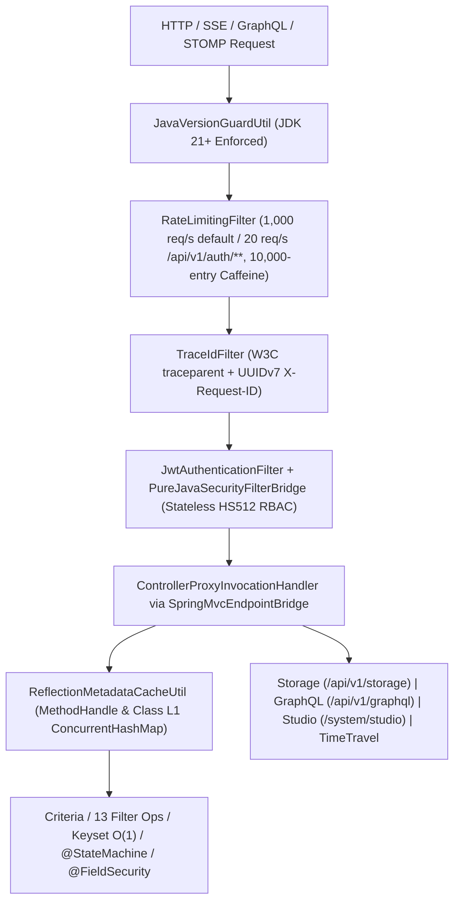

# Spring-NWVMC (`v0.0.2`)

[](https://jitpack.io/#NatswarChuan/Spring-NWVMC)
[](https://openjdk.org/projects/jdk/21/)
[](https://spring.io/projects/spring-boot)
[](#pure-java-core-and-bridging)
[](https://openjdk.org/jeps/444)

**Spring-NWVMC** (**Next-Wave Virtual Multi-Controller**) is an enterprise Spring Boot 3.3.5 framework that dynamically synthesizes REST APIs, GraphQL SDL/execution, OData-style filtering, keyset pagination, multi-cloud storage (`LOCAL` / AWS S3 SigV4 / GCS), CQRS/CloudEvents 1.0, and declarative security directly from JPA entity classes and marker controller interfaces (`@AutoRestController` extending `AutoApiController<E>`).

All **503** Java source files under `controller-to-api-framework/src/main/java` contain zero compile-time `import org.springframework.*` declarations; Spring integration occurs reflectively through dynamic proxy bridges at application bootstrap.

---

## Documentation Index

| Guide / Module | Path | Scope |
| :--- | :--- | :--- |
| **Multilingual Guides** | [`docs/GUIDE_EN.md`](docs/GUIDE_EN.md), [`docs/GUIDE_VI.md`](docs/GUIDE_VI.md), [`docs/GUIDE_JA.md`](docs/GUIDE_JA.md), [`docs/GUIDE_ZH.md`](docs/GUIDE_ZH.md) | Complete synchronized reference manuals in English, Vietnamese, Japanese, and Chinese |
| **Topic 01: Getting Started** | [`docs/topics/01_GETTING_STARTED.md`](docs/topics/01_GETTING_STARTED.md) \| [`en`](docs/topics/en/01_GETTING_STARTED.md) | Strict 2-directory contract, Maven/JitPack setup, YAML properties, Fail-Fast startup diagnostics |
| **Topic 02: REST API Catalog** | [`docs/topics/02_REST_API_CATALOG.md`](docs/topics/02_REST_API_CATALOG.md) \| [`en`](docs/topics/en/02_REST_API_CATALOG.md) | 38 `@Auto*` contracts, CSV/JSONL streaming, RFC 6902 JSON Patch, Diff, built-in platform APIs |
| **Topic 03: Query & GraphQL** | [`docs/topics/03_QUERY_AND_DATA_ACCESS.md`](docs/topics/03_QUERY_AND_DATA_ACCESS.md) \| [`en`](docs/topics/en/03_QUERY_AND_DATA_ACCESS.md) | 13 filter operators, O(1) Keyset pagination, eager JOIN FETCH, dynamic `/api/v1/graphql` |
| **Topic 04: Security, i18n & Cloud** | [`docs/topics/04_ADVANCED_ENTERPRISE_FEATURES.md`](docs/topics/04_ADVANCED_ENTERPRISE_FEATURES.md) \| [`en`](docs/topics/en/04_ADVANCED_ENTERPRISE_FEATURES.md) | Anti-scanner defenses, 20-language `/system/studio` & host `MessageSource`, Virtual Threads, S3/GCS storage |
| **Topic 05: Spring Ecosystem SPIs** | [`docs/topics/05_SPRING_ECOSYSTEM_SPIS.md`](docs/topics/05_SPRING_ECOSYSTEM_SPIS.md) \| [`en`](docs/topics/en/05_SPRING_ECOSYSTEM_SPIS.md) | 8 SPI Customizer interfaces, custom endpoints (`@CustomEndpoint`), `ThirdPartyRestClientHelper` |
| **Topic 06: Declarative Annotations** | [`docs/topics/06_DECLARATIVE_ANNOTATIONS.md`](docs/topics/06_DECLARATIVE_ANNOTATIONS.md) \| [`en`](docs/topics/en/06_DECLARATIVE_ANNOTATIONS.md) | Complete specification of framework annotations and `default` attributes |
| **Framework Core Library** | [`controller-to-api-framework/README.md`](controller-to-api-framework/README.md) | Core engine architecture, Pure Java bridges, L1 caches, and unit verification |
| **Reference Implementation** | [`controller-to-api-implementation/README.md`](controller-to-api-implementation/README.md) | Multi-domain enterprise sample app consuming `Spring-NWVMC:v0.0.2` via JitPack + JMeter harness |
| **Interactive Web Portal** | [`docs/index.html`](docs/index.html) (`npm run preview -- --port 3001`) | 4-language React/Vite reference portal with live endpoint explorer |

---

## Repository Workspace Modules

1. [`controller-to-api-framework`](controller-to-api-framework/): Core auto-configuration engine (`io.github.natswarchuan:controller-to-api-framework:0.0.2`), 503 Pure Java files, zero compile-time Spring imports.
2. [`controller-to-api-implementation`](controller-to-api-implementation/): Consumer verification project built against JitPack coordinate `com.github.NatswarChuan:Spring-NWVMC:v0.0.2`, multi-domain entities, custom helpers, integration suites, and Apache JMeter load plan.
3. [`controller-to-api-ui`](controller-to-api-ui/): Frontend client testing harness targeting `/api/v1/**` endpoints.
4. [`docs`](docs/): Multilingual Markdown guides, topic specifications, and 4-language (`vi`, `en`, `ja`, `zh`) interactive Vite/React documentation portal.

---

## Quickstart (`pom.xml` + Strict 2-Directory Contract)

### 1. Maven & JitPack Dependencies

```xml
<properties>
  <java.version>21</java.version>
</properties>

<repositories>
  <repository>
    <id>jitpack.io</id>
    <url>https://jitpack.io</url>
  </repository>
</repositories>

<dependencies>
  <dependency>
    <groupId>com.github.NatswarChuan</groupId>
    <artifactId>Spring-NWVMC</artifactId>
    <version>v0.0.2</version>
  </dependency>
</dependencies>
```

### 2. Minimal Configuration (`application.yml`)

```yaml
spring:
  threads:
    virtual:
      enabled: true
  jpa:
    open-in-view: false

app:
  framework:
    base-path-prefix: /api/v1
    default-page-size: 20
    max-page-size: 100
    security:
      jwt-secret: ${JWT_SECRET:Enterprise-Strong-HS512-Key-Must-Be-At-Least-32-Bytes-Long!}
      fail-fast-weak-jwt-secret: true
    i18n:
      default-locale: en
      cache-seconds: 3600
    studio:
      enabled: true                     # Production default: false
      demo-token-endpoint-enabled: true # Production default: false
      show-i18n-diagnostics: true       # Enables #studioI18nDiagBar
      hide-framework-fingerprint: true  # Production default: true
```

> Bound `@AutoConfigurationBean` root prefix is `app.framework.*`. Sub-configuration prefixes: `app.framework.storage.*` (`FileStorageProperties`) and `spring-nwvmc.human-policies.*` (`HumanPolicyConfigurationProperties`).

### 3. Entity + Interface Controller (2 Directories Only)

```java
// src/main/java/com/example/app/entity/CommercialProduct.java
package com.example.app.entity;

import io.github.natswarchuan.common.constant.RoleConstant;
import io.github.natswarchuan.common.entity.BaseAuditEntity;
import io.github.natswarchuan.core.annotation.AutoCode;
import io.github.natswarchuan.core.annotation.EntitySecurity;
import io.github.natswarchuan.core.annotation.FieldSecurity;
import io.github.natswarchuan.core.annotation.StateMachine;
import io.github.natswarchuan.core.annotation.UniqueField;
import jakarta.persistence.Column;
import jakarta.persistence.Entity;
import jakarta.persistence.Table;
import jakarta.validation.constraints.DecimalMin;
import jakarta.validation.constraints.NotBlank;
import jakarta.validation.constraints.NotNull;
import java.math.BigDecimal;
import lombok.AllArgsConstructor;
import lombok.Getter;
import lombok.NoArgsConstructor;
import lombok.Setter;
import lombok.experimental.SuperBuilder;

@Entity
@Table(name = "tbl_commercial_products")
@Getter
@Setter
@NoArgsConstructor
@AllArgsConstructor
@SuperBuilder(toBuilder = true)
@EntitySecurity(
    readRoles = {RoleConstant.ROLE_USER, RoleConstant.ROLE_ADMIN},
    writeRoles = {RoleConstant.ROLE_ADMIN},
    deleteRoles = {RoleConstant.ROLE_ADMIN}
)
public class CommercialProduct extends BaseAuditEntity {

  @UniqueField
  @AutoCode(prefix = "PRD-")
  @Column(name = "product_code", nullable = false, length = 32)
  private String productCode;

  @NotBlank
  @Column(name = "name", nullable = false, length = 200)
  private String name;

  @NotNull
  @DecimalMin("0.00")
  @Column(name = "price", precision = 12, scale = 2)
  private BigDecimal price;

  @FieldSecurity(viewRoles = {RoleConstant.ROLE_ADMIN}, maskPattern = "PROTECTED_DATA")
  @Column(name = "cost_price", precision = 12, scale = 2)
  private BigDecimal costPrice;

  @StateMachine(
      initial = "DRAFT",
      transitions = {"DRAFT:ACTIVE,DISCONTINUED", "ACTIVE:SUSPENDED,DISCONTINUED"},
      deletableStates = {"DRAFT", "DISCONTINUED"}
  )
  @Column(name = "status", nullable = false, length = 32)
  private String status;
}
```

```java
// src/main/java/com/example/app/controller/CommercialProductController.java
package com.example.app.controller;

import com.example.app.entity.CommercialProduct;
import io.github.natswarchuan.core.annotation.AutoRestController;
import io.github.natswarchuan.core.controller.AutoApiController;

@AutoRestController(
    path = "/api/v1/commercial-products",
    disabledEndpoints = {"batchChunked", "importCsv"}
)
public interface CommercialProductController extends AutoApiController<CommercialProduct> {
}
```

---

## Pure Java Core and Bridging



- **Zero Compile-Time Spring Coupling**: `PureJavaSpringBootstrapBridge`, `PureJavaBeanRegistrarBridge`, `PureJavaPropertiesBinderBridge`, `PureJavaSecurityFilterBridge`, `SecurityFilterChainBridge`, `SecurityHeadersPolicyBridge`, `SecurityExposurePolicyBridge`, and `SpringMvcEndpointBridge` bind `@AutoRestController`, `@AutoComponent`, `@AutoService`, and `@AutoConfigurationBean` into host `BeanFactory` and `RequestMappingHandlerMapping` at runtime.
- **L1 Reflection & `MethodHandle` Caching**: `ReflectionMetadataCacheUtil` and `ReflectionCacheConstant` pre-index resolved metadata in 13 `ConcurrentHashMap` caches (`CLASS_CACHE(256)`, `METHOD_CACHE(1024)`, `CONSTRUCTOR_CACHE(256)`, `DECLARED_FIELDS_CACHE(256)`, `FIELD_BY_NAME_CACHE(256)`, `PROPERTY_DESCRIPTOR_CACHE(256)`, `ANNOTATED_FIELDS_CACHE(512)`, `UNIQUE_FIELDS_CACHE(256)`, `READ_METHOD_HANDLE_CACHE(1024)`, `WRITE_METHOD_HANDLE_CACHE(1024)`, `KEBAB_CASE_CACHE(256)`, `REST_ENDPOINT_PATH_CACHE(256)`, `PACKAGE_CLASS_NAMES_CACHE(64)`).

---

## Endpoint Synthesis & Platform Modules

`AutoApiController<E>` inherits `AutoApiReadController<E>` (**15** read contracts) and `AutoApiEnterpriseController<E>` (**12** enterprise contracts), plus **11** write contracts directly on `AutoApiController<E>` = **38 declared `@Auto*` contracts** (`36` visible by default in Swagger/Studio since `streamEvents` (`/events`) carries `@Hidden` and `navigateSubResources` (`/{id}/**`) requires `enableNestedSubResources = true` or `app.framework.sub-resource.enabled-by-default=true`).

| Contract Group | Count | HTTP Methods & Relative Paths | Capabilities |
| :--- | :---: | :--- | :--- |
| **`AutoApiReadController<E>`** | 15 | `GET /`, `GET /keyset`, `GET /all`, `GET /count`, `GET /exists`, `GET /aggregate`, `GET /distinct`, `GET /top`, `GET /group-by`, `GET /export/csv`, `GET /export/jsonl`, `GET /metadata`, `GET /schema/typescript`, `GET /schema/json`, `GET /{id}` | 13 filter operators (`field.op=val`), `afterId` Keyset O(1) cursor, CSV/NDJSON streaming, TypeScript & JSON Schema export |
| **`AutoApiController<E>`** | 11 | `POST /`, `POST /batch`, `POST /upsert`, `POST /upsert-batch`, `POST /batch-chunked`, `PATCH /{id}/increment`, `PATCH /batch-update`, `PUT /{id}`, `PATCH /{id}`, `DELETE /{id}`, `POST /{id}/restore` | Chunked transactions (`chunkSize=100`), atomic numeric deltas, upsert, soft-delete/restore with `@StateMachine` guard |
| **`AutoApiEnterpriseController<E>`** | 12 | `POST /{id}/transition`, `POST /{id}/clone`, `GET /events` (`@Hidden` SSE), `GET /ai/context`, `POST /ai/query`, `GET /human-policy`, `GET /health`, `POST /import/csv`, `POST /import/jsonl`, `PATCH /{id}/patch-rfc6902`, `GET /{id}/diff`, `GET /{id}/**` | State transitions (`?targetState=`), UUIDv7 cloning, SSE events, AI schema & NL query, RFC-4180 CSV/NDJSON import, RFC 6902 patch, `?targetId=` diff, sub-resources |
| **Built-In Platform Controllers** | 15 | `/api/v1/storage/*` (6), `/api/v1/graphql*` (3), `/system/studio` (`@Hidden`), `/api/v1/auth/token`, `/api/v1/system/time-travel/{entityName}/{id}`, `/api/v1/system/databases/health`, `/api/v1/system/resilience/circuit-breakers`, `/api/v1/system/customizers`, `/api/v1/system/trace-context`, `/error` (`@Hidden`) | `FileStorageController`, `GraphQLDynamicApiController`, `DevStudioController`, `AuthController`, `TimeTravelDynamicApiController`, `MultiDatabaseHealthCheckController`, `CircuitBreakerTelemetryApiController`, `CustomizerTelemetryApiController`, `TraceContextSystemApiController`, `CustomContainerErrorController` |

---

## Security Hardening, Anti-Scanner Defense & i18n

- **Secure-by-Default Production Lock**: `app.framework.studio.enabled=false` and `app.framework.studio.demo-token-endpoint-enabled=false` exclude `/system/**` from public matchers (`SecurityExposurePolicyBridge`) and return opaque HTTP `404` on `/system/studio` and `/api/v1/auth/token`. When demo auth is disabled and the JWT key matches the factory placeholder, `StartupDiagnosticsUtil.validateAndHardenSecurity` rotates it to an ephemeral 64-byte `SecureRandom` secret.
- **Anti-Timing & Anti-Injection Guards**: `ConstantTimeComparisonUtil` uses `MessageDigest.isEqual`; `QueryFilterParameterUtil` blocks SQLi/XSS literals and caps filters at `MAX_DYNAMIC_FILTERS=30` and sort depth at `MAX_SORT_RELATION_DEPTH=4`; `StoragePathSanitizerHelper` blocks CWE-22 traversal and null bytes; `SecurityHeadersPolicyBridge` enforces `X-Frame-Options: DENY`, `Content-Security-Policy`, `Permissions-Policy`, `Referrer-Policy`, and `Strict-Transport-Security`.
- **20-Language i18n & `/system/studio`**: Precedence is `?lang=` > `X-Language` > `NWVMC_LANG` cookie > `Accept-Language` > `app.framework.i18n.default-locale` (`en`). RTL (`dir="rtl"`) applies automatically for `ar`, `ur`, `fa`. `LocaleResolutionUtil` validates bundle keys (`^[A-Za-z0-9._-]+$`, max 128 chars, rejects `..`), caches up to `8192` translations, and records up to `128` missing keys in `#studioI18nDiagBar` (`DevStudioDiagnosticsUtil`). Host apps extend bundles via `classpath:i18n/messages_{lang}.properties` or `new MessageHelper(hostMessageSource)`.

---

## Verified Acceptance Metrics (`v0.0.2`)

| Verification Gate | Command / Target | Observed Result |
| :--- | :--- | :--- |
| **Framework Unit Suite** | `mvn clean install -f controller-to-api-framework/pom.xml` | **473 / 473 PASS** (`0 Failures, 0 Errors, 0 Skipped`) |
| **Consumer Suite (JitPack `v0.0.2`)** | `mvn clean verify -U -f controller-to-api-implementation/pom.xml` | **140 / 140 PASS** (`0 Failures, 0 Errors, 0 Skipped`) |
| **Apache JMeter Load Test** | `implementation_load_test.jmx` (`jmeter-maven-plugin`) | **2,000 requests**, **0 failures (`0.0%` error rate)**, **151.0 req/s**, Avg **91 ms** (Min **3 ms**, Max **2,107 ms**) |
| **Chrome DevTools E2E** | `/system/studio` & `/swagger-ui/index.html` | **0 JS console errors**; 20-lang selector, `ar` RTL, `NWVMC_LANG`, `?lang=../../etc/passwd` fallback, `743` Swagger paths, `@Hidden` exclusion verified |
