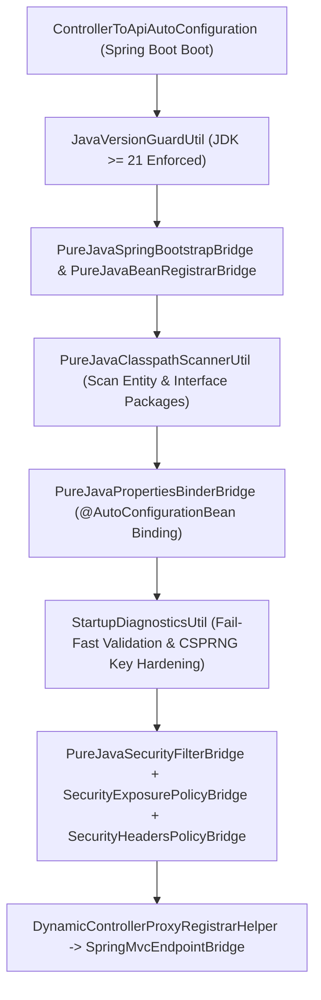

# Spring-NWVMC `v0.0.2` — Technical Reference Manual (English)

> **Other Languages**: [Tiếng Việt](GUIDE_VI.md) | [日本語](GUIDE_JA.md) | [中文](GUIDE_ZH.md)  
> **Artifact Coordinates**: `com.github.NatswarChuan:Spring-NWVMC:v0.0.2` (`https://jitpack.io`) | `io.github.natswarchuan:controller-to-api-framework:0.0.2`  
> **Runtime Requirements**: Java 21 LTS or higher (`JavaVersionGuardUtil`), Spring Boot 3.3.5, Jakarta EE 10

---

## 1. Pure Java Architecture & Core Internals

Every class inside `controller-to-api-framework/src/main/java` (503 source files) compiles without static `import org.springframework.*` dependencies. Framework initialization, bean registration, configuration property binding, MVC routing, and Spring Security filter-chain wiring execute reflectively at bootstrap.

### 1.1 Runtime Bridging Sequence



1. **Zero Compile Coupling**: `PureJavaSpringBootstrapBridge`, `PureJavaBeanRegistrarBridge`, `PureJavaPropertiesBinderBridge`, `PureJavaSecurityFilterBridge`, `SecurityFilterChainBridge`, `SecurityHeadersPolicyBridge`, `SecurityExposurePolicyBridge`, and `SpringMvcEndpointBridge` isolate core logic from Spring API signature changes across minor versions.
2. **L1 Lock-Free Reflection Caching (`ReflectionMetadataCacheUtil` / `ReflectionCacheConstant`)**: Pre-indexes resolved `Class<?>` (`CLASS_CACHE`, cap `256`), `Method` (`METHOD_CACHE`, cap `1024`), `Constructor<?>` (`CONSTRUCTOR_CACHE`, cap `256`), field maps (`DECLARED_FIELDS_CACHE` & `FIELD_BY_NAME_CACHE`, cap `256`), `PropertyDescriptor` (`PROPERTY_DESCRIPTOR_CACHE`, cap `256`), annotation-filtered fields (`ANNOTATED_FIELDS_CACHE`, cap `512`), unique business keys (`UNIQUE_FIELDS_CACHE`, cap `256`), kebab paths (`KEBAB_CASE_CACHE` & `REST_ENDPOINT_PATH_CACHE`, cap `256`), package scans (`PACKAGE_CLASS_NAMES_CACHE`, cap `64`), and unreflected `MethodHandle` accessors (`READ_METHOD_HANDLE_CACHE` & `WRITE_METHOD_HANDLE_CACHE`, cap `1024`).
3. **Architecture Trade-offs & Virtual Thread Tuning**:
   - *Dynamic JDK Proxy & `MethodHandle` Dispatch*: Avoids generating CGLIB subclasses per entity controller (lower metaspace footprint and startup allocation) while keeping hot-path invocation near direct-call speed after initial `MethodHandle` unreflection.
   - *Virtual Threads + `open-in-view=false` + HikariCP*: Java 21 virtual threads scale concurrent request parking across network/DB waits without platform thread exhaustion, while setting `spring.jpa.open-in-view=false` and enabling `app.framework.eager-fetch-singular-relations=true` releases JDBC connections immediately after query execution inside a bounded HikariCP pool (e.g. `maximum-pool-size: 30`) and prevents connection starvation.

---

## 2. Quickstart & Strict Two-Directory Contract

Application developers maintain only **two domain directories**: `entity/` (JPA models + validation + declarative annotations) and `controller/` (marker interfaces extending `AutoApiController<E>`). Non-CRUD custom workflows decompose into `Service` interfaces and `@AutoService` / `@AutoComponent` `public final class` `Helper` beans with zero `private` methods and zero `static` helper methods.

### 2.1 Maven Dependency (`pom.xml`)

```xml
<properties>
  <java.version>21</java.version>
</properties>

<repositories>
  <repository>
    <id>jitpack.io</id>
    <url>https://jitpack.io</url>
  </repository>
</repositories>

<dependencies>
  <dependency>
    <groupId>com.github.NatswarChuan</groupId>
    <artifactId>Spring-NWVMC</artifactId>
    <version>v0.0.2</version>
  </dependency>
</dependencies>
```

### 2.2 Entity Declaration (`entity/CommercialProduct.java`)

```java
package com.example.app.entity;

import io.github.natswarchuan.common.constant.RoleConstant;
import io.github.natswarchuan.common.entity.BaseAuditEntity;
import io.github.natswarchuan.core.annotation.AutoCode;
import io.github.natswarchuan.core.annotation.EntitySecurity;
import io.github.natswarchuan.core.annotation.FieldSecurity;
import io.github.natswarchuan.core.annotation.StateMachine;
import io.github.natswarchuan.core.annotation.UniqueField;
import jakarta.persistence.Column;
import jakarta.persistence.Entity;
import jakarta.persistence.Table;
import jakarta.validation.constraints.DecimalMin;
import jakarta.validation.constraints.NotBlank;
import jakarta.validation.constraints.NotNull;
import java.math.BigDecimal;
import lombok.AllArgsConstructor;
import lombok.Getter;
import lombok.NoArgsConstructor;
import lombok.Setter;
import lombok.experimental.SuperBuilder;

@Entity
@Table(name = "tbl_commercial_products")
@Getter
@Setter
@NoArgsConstructor
@AllArgsConstructor
@SuperBuilder(toBuilder = true)
@EntitySecurity(
    readRoles = {RoleConstant.ROLE_USER, RoleConstant.ROLE_ADMIN},
    writeRoles = {RoleConstant.ROLE_ADMIN},
    deleteRoles = {RoleConstant.ROLE_ADMIN}
)
public class CommercialProduct extends BaseAuditEntity {

  @UniqueField
  @AutoCode(prefix = "PRD-")
  @Column(name = "product_code", nullable = false, length = 32)
  private String productCode;

  @NotBlank
  @Column(name = "name", nullable = false, length = 200)
  private String name;

  @NotNull
  @DecimalMin("0.00")
  @Column(name = "price", precision = 12, scale = 2)
  private BigDecimal price;

  @FieldSecurity(viewRoles = {RoleConstant.ROLE_ADMIN}, maskPattern = "PROTECTED_DATA")
  @Column(name = "cost_price", precision = 12, scale = 2)
  private BigDecimal costPrice;

  @StateMachine(
      initial = "DRAFT",
      transitions = {"DRAFT:ACTIVE,DISCONTINUED", "ACTIVE:SUSPENDED,DISCONTINUED"},
      deletableStates = {"DRAFT", "DISCONTINUED"}
  )
  @Column(name = "status", nullable = false, length = 32)
  private String status;
}
```

### 2.3 Marker Controller Interface (`controller/CommercialProductController.java`)

```java
package com.example.app.controller;

import com.example.app.entity.CommercialProduct;
import io.github.natswarchuan.core.annotation.AutoRestController;
import io.github.natswarchuan.core.controller.AutoApiController;

@AutoRestController(
    path = "/api/v1/commercial-products",
    disabledEndpoints = {"batchChunked", "importCsv"}
)
public interface CommercialProductController extends AutoApiController<CommercialProduct> {
}
```

> `EndpointFeatureFilterHelper` matches entries in `enabledEndpoints` / `disabledEndpoints` case-insensitively against exact interface method names (`getPage`, `deleteById`, `batchChunked`, `exportCsv`, `importCsv`, etc.) or functional group tokens (`READ`, `WRITE`, `DELETE`, `BATCH`, `ANALYTICS`, `EXPORT`, `AI`, `STREAM`, `SCHEMA`, `SUB_RESOURCE`).

### 2.4 End-to-End Request Workflow

```bash
# 1. Obtain Admin JWT (requires app.framework.studio.demo-token-endpoint-enabled=true)
TOKEN=$(curl -s -X POST http://localhost:8080/api/v1/auth/token \
  -H "Content-Type: application/json" \
  -d '{"username":"admin","roles":["ROLE_ADMIN"]}' | jq -r '.data.token')

# 2. Create entity record (AutoCode generates productCode="PRD-...", BaseAuditEntity generates UUIDv7 id)
curl -s -X POST http://localhost:8080/api/v1/commercial-products \
  -H "Authorization: Bearer $TOKEN" \
  -H "Content-Type: application/json" \
  -d '{"name":"Enterprise Server X1","price":4999.00,"costPrice":3200.00}'

# 3. Execute filtered query with O(1) keyset pagination & sparse fieldsets
curl -s "http://localhost:8080/api/v1/commercial-products/keyset?price.gte=1000&fields=id,productCode,name,price&size=20" \
  -H "Authorization: Bearer $TOKEN"
```

---

## 3. REST Endpoint Matrix (38 Synthesized Contracts) & Built-In Subsystems

`AutoApiController<E>` inherits **15** contracts from `AutoApiReadController<E>` and **12** contracts from `AutoApiEnterpriseController<E>`, adding **11** direct mutation contracts (**38 declared `@Auto*` contracts total**; **36 visible by default** in OpenAPI/Studio since `streamEvents` carries `@Hidden` and `navigateSubResources` is opt-in via `enableNestedSubResources = true` or `app.framework.sub-resource.enabled-by-default=true`).

### 3.1 Read, Analytics, Streaming Export & Schema (`AutoApiReadController<E>` — 15 Contracts)

| # | Method | Path | Method Name | Behavior |
| :-: | :--- | :--- | :--- | :--- |
| 1 | `GET` | `/` | `getPage` | Offset pagination (`page`, `size`), multi-field `sort`, `dir`, `search`, `searchFields`, `include`, `fields`, and 13 filter operators |
| 2 | `GET` | `/keyset` | `getKeysetPage` | O(1) cursor pagination via `afterId` (UUIDv7 timestamp-monotonic index scan) |
| 3 | `GET` | `/all` | `getAll` | Filtered unpaginated list query |
| 4 | `GET` | `/count` | `count` | Total record count matching dynamic filter criteria |
| 5 | `GET` | `/exists` | `exists` | Boolean existence check for matching criteria |
| 6 | `GET` | `/aggregate` | `aggregate` | Returns `count`, `sum`, `avg`, `min`, `max` for `field` (`SUM`, `AVG`, `MIN`, `MAX`, `COUNT`) |
| 7 | `GET` | `/distinct` | `findDistinctValues` | Distinct non-duplicate scalar values for `field` |
| 8 | `GET` | `/top` | `findTopRecords` | Bounded top-N records sorted by `sort` / `dir` (`limit`) |
| 9 | `GET` | `/group-by` | `groupByAnalytics` | Aggregated buckets grouped by `groupField` over `valueField` |
| 10 | `GET` | `/export/csv` | `exportCsv` | O(1)-RAM chunked RFC-4180 CSV streaming export |
| 11 | `GET` | `/export/jsonl` | `exportJsonl` | O(1)-RAM newline-delimited JSON streaming export |
| 12 | `GET` | `/metadata` | `getMetadata` | Reflects entity schema metadata, sortable/filterable fields, and state machine graph |
| 13 | `GET` | `/schema/typescript` | `generateTypeScript` | Generates TypeScript interface definitions from JPA field metadata |
| 14 | `GET` | `/schema/json` | `getJsonSchema` | Generates JSON Schema Draft-07 object descriptor |
| 15 | `GET` | `/{id}` | `getById` | Fetch single entity by UUIDv7 `id` with optional eager `include` & `@FieldSecurity` masking |

### 3.2 Write, Upsert & Chunked Batch (`AutoApiController<E>` — 11 Contracts)

| # | Method | Path | Method Name | Behavior |
| :-: | :--- | :--- | :--- | :--- |
| 16 | `POST` | `/` | `create` | Creates entity with `@Valid`, `@UniqueField`, `@AutoCode`, `@AutoSlug`, `@ComputedField` |
| 17 | `POST` | `/batch` | `createBatch` | Transactional multi-record creation list |
| 18 | `POST` | `/upsert` | `upsert` | Inserts or updates single entity matched on `@UniqueField` keys |
| 19 | `POST` | `/upsert-batch` | `upsertBatch` | Batch insert-or-update by `@UniqueField` keys |
| 20 | `POST` | `/batch-chunked` | `batchChunked` | Splits large batch payloads across `chunkSize` (default `100`) transactional slices |
| 21 | `PATCH` | `/{id}/increment` | `adjustNumericField` | Atomic database delta adjustment (`?field=...&delta=...`) |
| 22 | `PATCH` | `/batch-update` | `updateBatchByFilter` | Bulk partial updates across records matching query parameters |
| 23 | `PUT` | `/{id}` | `update` | Full record replacement by UUIDv7 `id` |
| 24 | `PATCH` | `/{id}` | `patch` | Partial attribute merge preserving omitted fields |
| 25 | `DELETE` | `/{id}` | `deleteById` | Logical soft-delete validated against `@StateMachine.deletableStates` |
| 26 | `POST` | `/{id}/restore` | `restoreById` | Reverses soft-delete flag and restores active visibility |

### 3.3 State Workflow, AI, Import, Diff & Sub-Resources (`AutoApiEnterpriseController<E>` — 12 Contracts)

| # | Method | Path | Method Name | Behavior |
| :-: | :--- | :--- | :--- | :--- |
| 27 | `POST` | `/{id}/transition` | `transitionState` | Validates and commits `?targetState=...` via `@StateMachine` (returns HTTP `422` on invalid transition) |
| 28 | `POST` | `/{id}/clone` | `cloneEntity` | Duplicates existing entity with newly minted UUIDv7 ID and regenerated `@AutoCode` |
| 29 | `GET` | `/events` | `streamEvents` | `@Hidden` real-time Server-Sent Events stream (`text/event-stream`) |
| 30 | `GET` | `/ai/context` | `getAiContext` | Exports structured schema prompt context for Spring AI `ChatClient` |
| 31 | `POST` | `/ai/query` | `queryAi` | Executes safe natural-language Criteria query via `AiQueryRequestDto` |
| 32 | `GET` | `/human-policy` | `getPolicySummary` | Returns active parsed `@HumanPolicy` / YAML policy summary |
| 33 | `GET` | `/health` | `getEntityHealth` | Entity resilience & circuit breaker health metrics |
| 34 | `POST` | `/import/csv` | `importCsv` | Streaming multipart RFC-4180 CSV bulk ingestion |
| 35 | `POST` | `/import/jsonl` | `importJsonl` | Streaming newline-delimited JSON bulk ingestion |
| 36 | `PATCH` | `/{id}/patch-rfc6902` | `patchRfc6902` | Applies RFC 6902 `add`/`replace`/`remove` JSON Patch operations |
| 37 | `GET` | `/{id}/diff` | `compareEntityDiff` | Compares `{id}` against `?targetId={uuid}` reporting `MODIFIED`, `ADDED`, `REMOVED` fields |
| 38 | `GET` | `/{id}/**` | `navigateSubResources` | Arbitrary-depth relational traversal (requires `enableNestedSubResources=true` or `@EnableNestedSubResource`) |

### 3.4 13 Dynamic Query Filter Operators (`FilterOperatorConstant`)

Syntax: `field.op=value` or nested relationship `relation.field.op=value`:
`eq`, `ne`, `like`, `gt`, `gte`, `lt`, `lte`, `in`, `notIn`, `between` (`min,max`), `null` (`true`/`false`), `startsWith`, `endsWith`.

### 3.5 Built-In Platform Subsystems

| Controller Class | Endpoints | Function |
| :--- | :--- | :--- |
| `FileStorageController` | `POST /api/v1/storage/upload`, `GET /api/v1/storage/download/{fileId}`, `GET /api/v1/storage/metadata/{fileId}`, `DELETE /api/v1/storage/{fileId}`, `POST /api/v1/storage/presigned-url`, `GET /api/v1/storage/exists/{fileId}` | Unified multi-cloud binary storage (`LOCAL`, AWS S3 SigV4, GCS) protected by `StoragePathSanitizerHelper` |
| `GraphQLDynamicApiController` | `POST /api/v1/graphql`, `GET /api/v1/graphql/schema`, `GET /api/v1/graphql/explorer` (`@Hidden`) | Runtime GraphQL SDL synthesis (`get*`, `list*`, `count*`) and GraphiQL explorer |
| `DevStudioController` | `GET /system/studio` (`@Hidden`) | Interactive 20-language Live API Studio (`app.framework.studio.enabled=true` required) |
| `AuthController` | `POST /api/v1/auth/token` | Demo JWT token issuer (`app.framework.studio.demo-token-endpoint-enabled=true` required) |
| `TimeTravelDynamicApiController` | `GET /api/v1/system/time-travel/{entityName}/{id}?timestamp=...` | Historical state reconstruction via CDC inverse delta replay ($O(K)$) |
| `CustomizerTelemetryApiController` | `GET /api/v1/system/customizers` | Reports active Spring Ecosystem Customizer SPI beans |
| `CircuitBreakerTelemetryApiController` | `GET /api/v1/system/resilience/circuit-breakers` | Exposes entity circuit breaker states and trip metrics |
| `MultiDatabaseHealthCheckController` | `GET /api/v1/system/databases/health` | Primary/replica datasource pool diagnostics |
| `TraceContextSystemApiController` | `GET /api/v1/system/trace-context` | Returns current W3C `traceparent` / UUIDv7 `X-Request-ID` MDC context |
| `CustomContainerErrorController` | `GET/POST /error` (`@Hidden`) | Normalizes Tomcat container errors (`400`, `404`, `405`, `413`, `431`, `500`) into `ApiResponse<Void>` |

---

## 4. Configuration Properties Reference (`application.yml`)

| Property Key | Binding Class | Default Value | Description |
| :--- | :--- | :--- | :--- |
| `app.framework.base-path-prefix` | `ControllerToApiProperties` | `/api/v1` | Global URI prefix for synthesized routes |
| `app.framework.default-page-size` | `ControllerToApiProperties` | `20` | Default pagination limit (`1..200`) |
| `app.framework.max-page-size` | `ControllerToApiProperties` | `200` | Maximum allowed page size (`@Max(200)`) |
| `app.framework.eager-fetch-singular-relations` | `ControllerToApiProperties` | `true` | Proactive `@ManyToOne` / `@OneToOne` JOIN FETCH |
| `app.framework.security.enabled` | `SecurityPolicyProperties` | `true` | Activates stateless JWT & RBAC enforcement |
| `app.framework.security.data-masking-enabled` | `SecurityPolicyProperties` | `true` | Enables `@FieldSecurity` response masking |
| `app.framework.security.row-level-security-enabled` | `SecurityPolicyProperties` | `true` | Enables `@MultiTenant` & ownership query filtering |
| `app.framework.security.jwt-secret` | `SecurityPolicyProperties` | Dev placeholder | HS512 signing secret (min 32 UTF-8 bytes required) |
| `app.framework.security.jwt-expiration-seconds` | `SecurityPolicyProperties` | `315360000` | JWT TTL in seconds (`> 0` enforced at boot) |
| `app.framework.security.fail-fast-weak-jwt-secret` | `SecurityPolicyProperties` | `true` | Fails startup if custom key `< 32` UTF-8 bytes |
| `app.framework.studio.enabled` | `DevStudioProperties` | `false` | Enables `/system/studio` & `/system/**` (`404` when `false`) |
| `app.framework.studio.demo-token-endpoint-enabled` | `DevStudioProperties` | `false` | Enables `POST /api/v1/auth/token` (`404` when `false`) |
| `app.framework.studio.show-i18n-diagnostics` | `DevStudioProperties` | `false` | Renders `#studioI18nDiagBar` inside `/system/studio` |
| `app.framework.studio.hide-framework-fingerprint` | `DevStudioProperties` | `true` | Suppresses verbose framework headers/metadata |
| `app.framework.i18n.default-locale` | `I18nLocalizationProperties` | `en` | Fallback BCP-47 locale tag |
| `app.framework.i18n.supported-locales` | `I18nLocalizationProperties` | 20 languages | Active allowlist of supported locale codes |
| `app.framework.i18n.cache-seconds` | `I18nLocalizationProperties` | `3600` | `ReloadableResourceBundleMessageSource` cache TTL |
| `app.framework.cache.type` | `CacheEngineProperties` | `CAFFEINE` | Cache backend (`CAFFEINE`, `REDIS`, `TWO_TIER`, `NONE`) |
| `app.framework.ai.enabled` | `AiEngineProperties` | `true` | Enables `/ai/context` and Spring AI endpoints |
| `app.framework.ai.natural-language-query-enabled` | `AiEngineProperties` | `true` | Enables `POST /ai/query` |
| `app.framework.realtime.sse-enabled` | `RealtimeStreamingProperties` | `true` | Enables SSE event broadcasters |
| `app.framework.realtime.heartbeat-seconds` | `RealtimeStreamingProperties` | `15` | SSE keepalive interval (`> 0` enforced at boot) |
| `app.framework.realtime.max-emitters-per-entity` | `RealtimeStreamingProperties` | `1000` | Bounded concurrent SSE subscriber limit per entity |
| `app.framework.sub-resource.enabled-by-default` | `SubResourceRoutingProperties` | `false` | Global toggle for `/{id}/**` deep navigation |
| `app.framework.date-time.default-timezone` | `DateTimeFormatProperties` | `UTC` | Default zone for ISO-8601 serialization |
| `app.framework.storage.enabled` | `FileStorageProperties` | `true` | Enables `/api/v1/storage/*` subsystem |
| `app.framework.storage.provider` | `FileStorageProperties` | `LOCAL` | Active storage driver (`LOCAL`, `S3`, `GCS`) |
| `app.framework.storage.max-file-size` | `FileStorageProperties` | `52428800` | Upload payload cap in bytes (50 MB) |
| `spring-nwvmc.human-policies.<Entity>` | `HumanPolicyConfigurationProperties` | `{}` | External YAML overrides for `lifecycle`, `security`, `masking` |

---

## 5. Multilingual Localization (`i18n`), `/system/studio` & Host Extension

### 5.1 Supported Languages & Precedence

Framework bundles (`classpath:i18n/messages*.properties`) ship **20 languages**: `en`, `zh`, `hi`, `es`, `fr`, `ar`, `bn`, `pt`, `ru`, `ur`, `id`, `de`, `ja`, `vi`, `ko`, `tr`, `it`, `th`, `fa`, `pl`. Arabic (`ar`), Urdu (`ur`), and Persian (`fa`) automatically render `dir="rtl"` in `/system/studio`.

`LocaleResolutionUtil.resolveBestMatchLocale` resolves locale per request in strict priority order:
1. Query parameter `?lang=vi` (`I18nContextConstant.PARAM_LANG`)
2. Custom HTTP header `X-Language: vi`
3. Browser cookie `NWVMC_LANG=vi`
4. Standard HTTP header `Accept-Language: vi,en;q=0.9` (`MAX_ACCEPT_HEADER_LENGTH=256`, `MAX_ACCEPT_RANGES=8`)
5. Configured fallback `app.framework.i18n.default-locale` (`en`)

### 5.2 Path-Traversal Defense & Bounded Caching (`MessageHelper` & `DevStudioDiagnosticsUtil`)

- **Key Validation (`LocaleResolutionUtil.isSafeMessageKey`)**: Rejects null/blank keys, length `> 128` (`MAX_MESSAGE_CODE_LENGTH`), `..` traversal sequences, and characters outside `^[A-Za-z0-9._-]+$`. Invalid locale tags or injection strings such as `?lang=../../etc/passwd` normalize safely back to `en`.
- **Bounded Caches**: `BUNDLE_TRANSLATION_CACHE` / `MessageHelper.hostTranslationCache` cap entries at `8192` (`MAX_TRANSLATION_CACHE_SIZE`). Unresolved keys record at most `128` distinct keys (`MAX_MISSING_KEY_RECORDS`) rendered inside `/system/studio` as `#studioI18nDiagBar` when `app.framework.studio.show-i18n-diagnostics=true`.

### 5.3 Extending Messages in Host Applications

1. Override or add keys in `src/main/resources/i18n/messages_{lang}.properties` (e.g. `studio.hero.subtitle`, `error.resource.not.found`, or domain validation keys referenced via `{validation...}`).
2. For custom Spring `MessageSource` beans (e.g. multi-basename host bundles), instantiate `new MessageHelper(hostMessageSource)` in custom helpers so host translations resolve cleanly with automatic framework `ResourceBundle` fallback.

---

## 6. Security Hardening & Anti-AI-Scanner Defense Matrix

| Threat Vector / Automated AI Recon | Enforcing Class | Implemented Technical Control |
| :--- | :--- | :--- |
| **Exposed Admin Studio / System Enumeration** | `DevStudioController`, `SecurityExposurePolicyBridge`, `DevStudioProperties` | `app.framework.studio.enabled=false` omits `/system/**` from permit-all Ant matchers and rejects requests with opaque HTTP `404`. |
| **Forged Demo Token Abuse in Production** | `AuthController`, `StartupDiagnosticsUtil` | `app.framework.studio.demo-token-endpoint-enabled=false` returns HTTP `404` on `/api/v1/auth/token` and rotates placeholder JWT keys to a 64-byte CSPRNG secret. |
| **Timing Side-Channel Attacks** | `ConstantTimeComparisonUtil` | Wraps `MessageDigest.isEqual` over UTF-8 digests for `@Idempotent` request payload hashes and `@EntityWebhook` HMAC-SHA256 verification (`WebhookHmacSignerHelper`). |
| **Brute-Force & Volumetric Fuzzing** | `RateLimitingFilter` | Sliding-window buckets bounded by a `10,000`-entry Caffeine cache: default `1,000 req/s` per key, hardened `20 req/s` on `/api/v1/auth/**` (plus declarative `@RateLimit`). |
| **Dynamic Filter SQLi / XSS & Query Exhaustion** | `QueryFilterParameterUtil` | Blocks SQL injection keywords and XSS tags (throws `error.security.malicious.query`), caps predicates at `MAX_DYNAMIC_FILTERS=30`, and caps join sort depth at `MAX_SORT_RELATION_DEPTH=4`. |
| **Path Traversal in File Storage (`CWE-22`)** | `StoragePathSanitizerHelper` | Strips null bytes (`\0`), normalizes segments, and enforces containment within the configured storage root. |
| **Clickjacking & Browser Script Injection** | `SecurityHeadersPolicyBridge` | Applies `X-Frame-Options: DENY`, `Content-Security-Policy`, `Permissions-Policy`, `Referrer-Policy: STRICT_ORIGIN_WHEN_CROSS_ORIGIN`, and HSTS (`Strict-Transport-Security`). |
| **Exception & Container Stacktrace Leakage** | `GlobalExceptionHandler`, `ServletFilterExceptionHandler`, `CustomContainerErrorController` | Replaces Tomcat Whitelabel pages across HTTP `400`, `404`, `405`, `413`, `431`, `500` with standardized `ApiResponse<Void>` + UUIDv7 `traceId`. |

---

## 7. Fail-Fast Startup Diagnostics Lookup Table

| Exception Class | Error Code / Constant | Trigger Condition | Resolution Action |
| :--- | :--- | :--- | :--- |
| `UnsupportedJavaVersionException` | `JavaVersionGuardUtil` (`HTTP 500`) | Active JVM major version `< 21` | Install and configure JDK 21 LTS (`java.version=21`) |
| `InvalidConfigurationException` | `error.configuration.jwt` | `fail-fast-weak-jwt-secret=true` and custom key `< 32` UTF-8 bytes or blank | Set `app.framework.security.jwt-secret` / `${JWT_SECRET}` to >= 32 characters |
| `InvalidConfigurationException` | `StartupDiagnosticsUtil.validateAndHardenProperties` | `defaultPageSize <= 0` or `defaultPageSize > maxPageSize` | Configure `default-page-size <= max-page-size` (`1..200`) |
| `InvalidConfigurationException` | `StartupDiagnosticsUtil.validateAndHardenProperties` | `jwtExpirationSeconds <= 0` or `heartbeatSeconds <= 0` | Set positive integer durations for JWT and SSE heartbeats |
| `InvalidConfigurationException` | `error.configuration.entity` (`DevExConstant.ERR_ENTITY_CONFIGURATION`) | Managed entity missing `@Id` field or missing public/protected no-arg constructor | Annotate primary key with `@Id` (or extend `BaseAuditEntity`) and add `@NoArgsConstructor` |
| `InvalidConfigurationException` | Storage Validation (`FileStorageProperties`) | Active storage provider credentials or root path invalid | Supply valid `LOCAL` directory, AWS S3 credentials/bucket, or GCS configuration |

---

## 8. SPI Extensibility (`8` Customizer Interfaces) & Outbound HTTP

### 8.1 Registered Spring Ecosystem Customizers (`@AutoComponent` / Spring Bean)

Implement any of the **8** `io.github.natswarchuan.customization.customizer.*` interfaces (each defines non-breaking `default` methods and reports live status at `GET /api/v1/system/customizers`):

1. `SpringCoreCustomizer` (`CoreCustomizerContextDto`) — Core container hooks, `TaskExecutor`, task scheduling
2. `PlatformAiCustomizer` (`PlatformAiCustomizerContextDto`) — Spring AI `ChatClient` prompts, RAG context, vector hooks
3. `SecurityIdentityCustomizer` (`SecurityCustomizerContextDto`) — Custom RBAC rules, OAuth2 claim mappings, masking overrides
4. `DataAccessCustomizer` (`DataCustomizerContextDto`) — JPA criteria predicates, custom datasource & tenancy hooks
5. `SpringCloudCustomizer` (`CloudCustomizerContextDto`) — Distributed locks, circuit breakers, retry & cloud event bridges
6. `MessagingIntegrationCustomizer` (`MessagingCustomizerContextDto`) — Webhook signing, WebSocket/STOMP, third-party client interceptors
7. `ArchitectureExtensionCustomizer` (`ArchitectureCustomizerContextDto`) — Custom endpoint registration, GraphQL extensions, i18n hooks
8. `StorageCustomizer` (`StorageCustomizerContextDto`) — Custom storage buckets, pre-signed URL policies, upload constraints

### 8.2 Custom Controller Endpoints & Outbound RestClient

- **`@CustomEndpoint`**: Annotate domain methods inside an `AutoApiController<E>` interface to route arbitrary paths to named delegate Spring beans (`delegateBean`, `delegateMethod`, `httpMethod`, `path`).
- **`ThirdPartyRestClientHelper`**: Inject as a Spring bean to dispatch external REST calls via Spring 6 `RestClient` reflectively (with automatic Java 21 `java.net.http.HttpClient` fallback) and propagate `X-Request-ID` / `traceparent` headers.

---

## 9. Verified `v0.0.2` Test & Benchmark Evidence

| Verification Suite | Scope | Measured Outcome |
| :--- | :--- | :--- |
| **Framework Core Unit Tests** | `mvn clean install -f controller-to-api-framework/pom.xml` | **473 / 473 PASS** (`0 Failures, 0 Errors, 0 Skipped`) |
| **Reference Integration & Helpers (JitPack `v0.0.2`)** | `mvn clean verify -U -f controller-to-api-implementation/pom.xml` | **140 / 140 PASS** (`0 Failures, 0 Errors, 0 Skipped`) |
| **Apache JMeter Concurrency Benchmark** | `implementation_load_test.jmx` | **2,000 requests**, **0 failed (`0.0%` Error Rate)**, **151.0 req/s**, Avg **91 ms** (Min **3 ms**, Max **2,107 ms**) |
| **Chrome DevTools Live E2E** | `/system/studio` & `/swagger-ui/index.html` | **0 JS console errors**; 20-language selector, `ar` RTL (`dir="rtl"`), `NWVMC_LANG`, `?lang=../../etc/passwd` safe fallback, `#studioI18nDiagBar`, `743` Swagger paths, `@Hidden` exclusion |
