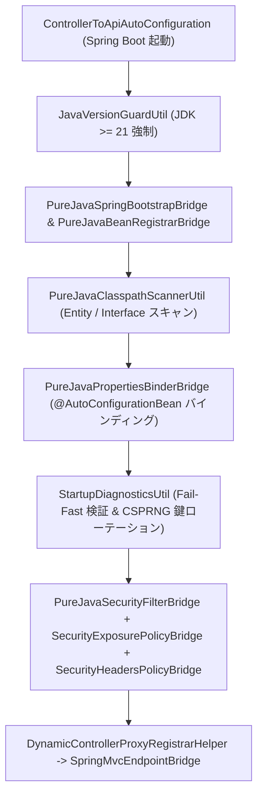

# Spring-NWVMC `v0.0.2` — 技術リファレンスマニュアル（日本語）

> **他言語版**: [English](GUIDE_EN.md) | [Tiếng Việt](GUIDE_VI.md) | [中文](GUIDE_ZH.md)  
> **アーティファクト座標**: `com.github.NatswarChuan:Spring-NWVMC:v0.0.2` (`https://jitpack.io`) | `io.github.natswarchuan:controller-to-api-framework:0.0.2`  
> **実行要件**: Java 21 LTS 以上 (`JavaVersionGuardUtil`)、Spring Boot 3.3.5、Jakarta EE 10

---

## 1. Pure Java アーキテクチャとコア内部構造

`controller-to-api-framework/src/main/java` 配下の全 **503** ファイルはコンパイル時の `import org.springframework.*` 宣言を含みません。フレームワーク初期化、Bean 登録、設定バインディング、WebMVC ルーティング、Spring Security フィルタ構築は起動時に動的リフレクションブリッジ経由で実行されます。

### 1.1 実行時ブリッジ初期化シーケンス



1. **コンパイル時 Spring 非依存設計**: `PureJavaSpringBootstrapBridge`、`PureJavaBeanRegistrarBridge`、`PureJavaPropertiesBinderBridge`、`PureJavaSecurityFilterBridge`、`SecurityFilterChainBridge`、`SecurityHeadersPolicyBridge`、`SecurityExposurePolicyBridge`、`SpringMvcEndpointBridge` により、コアロジックを Spring マイナーバージョンの API 変更から分離します。
2. **L1 ロックフリー・リフレクションキャッシュ (`ReflectionMetadataCacheUtil` / `ReflectionCacheConstant`)**: 初回解決済みの `Class<?>` (`CLASS_CACHE`, 256)、`Method` (`METHOD_CACHE`, 1024)、`Constructor<?>` (`CONSTRUCTOR_CACHE`, 256)、フィールドマップ (`DECLARED_FIELDS_CACHE` / `FIELD_BY_NAME_CACHE`, 256)、`PropertyDescriptor` (`PROPERTY_DESCRIPTOR_CACHE`, 256)、アノテーション抽出フィールド (`ANNOTATED_FIELDS_CACHE`, 512)、一意業務キー (`UNIQUE_FIELDS_CACHE`, 256)、ケバブケース・パス (`KEBAB_CASE_CACHE` / `REST_ENDPOINT_PATH_CACHE`, 256)、パッケージスキャン結果 (`PACKAGE_CLASS_NAMES_CACHE`, 64)、アンリフレクト済み `MethodHandle` (`READ_METHOD_HANDLE_CACHE` / `WRITE_METHOD_HANDLE_CACHE`, 1024) を `ConcurrentHashMap` に保持します。
3. **アーキテクチャ上のトレードオフと仮想スレッド最適化**:
   - *JDK 動的プロキシ & `MethodHandle`*: エンティティごとの CGLIB サブクラス生成（Metaspace 消費と起動時メモリ割り当て増大）を回避し、初回アンリフレクト後の実行コストを直接呼び出し水準に抑えます。
   - *Virtual Threads + `open-in-view=false` + HikariCP*: Java 21 仮想スレッドによりプラットフォームスレッドを枯渇させず高同時接続 I/O を処理します。`spring.jpa.open-in-view=false` と `app.framework.eager-fetch-singular-relations=true` の併用により、クエリ完了直後に JDBC コネクションを有界 HikariCP プール（例: `maximum-pool-size: 30`）へ返却します。

---

## 2. クイックスタートと厳格な 2 ディレクトリ構成

開発者は **`entity/`**（JPA エンティティ・バリデーション・宣言的アノテーション）と **`controller/`**（`AutoApiController<E>` を継承したインターフェース）の **2 ディレクトリのみ** を記述します。CRUD 以外の独自業務フローは、`Service` インターフェースと `@AutoService` / `@AutoComponent` を付与した `public final class` `Helper`（`private` メソッド 0 件、`static` ヘルパーメソッド 0 件）へ分離します。

### 2.1 Maven 依存関係 (`pom.xml`)

```xml
<properties>
  <java.version>21</java.version>
</properties>

<repositories>
  <repository>
    <id>jitpack.io</id>
    <url>https://jitpack.io</url>
  </repository>
</repositories>

<dependencies>
  <dependency>
    <groupId>com.github.NatswarChuan</groupId>
    <artifactId>Spring-NWVMC</artifactId>
    <version>v0.0.2</version>
  </dependency>
</dependencies>
```

### 2.2 エンティティ定義 (`entity/CommercialProduct.java`)

```java
package com.example.app.entity;

import io.github.natswarchuan.common.constant.RoleConstant;
import io.github.natswarchuan.common.entity.BaseAuditEntity;
import io.github.natswarchuan.core.annotation.AutoCode;
import io.github.natswarchuan.core.annotation.EntitySecurity;
import io.github.natswarchuan.core.annotation.FieldSecurity;
import io.github.natswarchuan.core.annotation.StateMachine;
import io.github.natswarchuan.core.annotation.UniqueField;
import jakarta.persistence.Column;
import jakarta.persistence.Entity;
import jakarta.persistence.Table;
import jakarta.validation.constraints.DecimalMin;
import jakarta.validation.constraints.NotBlank;
import jakarta.validation.constraints.NotNull;
import java.math.BigDecimal;
import lombok.AllArgsConstructor;
import lombok.Getter;
import lombok.NoArgsConstructor;
import lombok.Setter;
import lombok.experimental.SuperBuilder;

@Entity
@Table(name = "tbl_commercial_products")
@Getter
@Setter
@NoArgsConstructor
@AllArgsConstructor
@SuperBuilder(toBuilder = true)
@EntitySecurity(
    readRoles = {RoleConstant.ROLE_USER, RoleConstant.ROLE_ADMIN},
    writeRoles = {RoleConstant.ROLE_ADMIN},
    deleteRoles = {RoleConstant.ROLE_ADMIN}
)
public class CommercialProduct extends BaseAuditEntity {

  @UniqueField
  @AutoCode(prefix = "PRD-")
  @Column(name = "product_code", nullable = false, length = 32)
  private String productCode;

  @NotBlank
  @Column(name = "name", nullable = false, length = 200)
  private String name;

  @NotNull
  @DecimalMin("0.00")
  @Column(name = "price", precision = 12, scale = 2)
  private BigDecimal price;

  @FieldSecurity(viewRoles = {RoleConstant.ROLE_ADMIN}, maskPattern = "PROTECTED_DATA")
  @Column(name = "cost_price", precision = 12, scale = 2)
  private BigDecimal costPrice;

  @StateMachine(
      initial = "DRAFT",
      transitions = {"DRAFT:ACTIVE,DISCONTINUED", "ACTIVE:SUSPENDED,DISCONTINUED"},
      deletableStates = {"DRAFT", "DISCONTINUED"}
  )
  @Column(name = "status", nullable = false, length = 32)
  private String status;
}
```

### 2.3 コントローラ・インターフェース (`controller/CommercialProductController.java`)

```java
package com.example.app.controller;

import com.example.app.entity.CommercialProduct;
import io.github.natswarchuan.core.annotation.AutoRestController;
import io.github.natswarchuan.core.controller.AutoApiController;

@AutoRestController(
    path = "/api/v1/commercial-products",
    disabledEndpoints = {"batchChunked", "importCsv"}
)
public interface CommercialProductController extends AutoApiController<CommercialProduct> {
}
```

> `EndpointFeatureFilterHelper` は `enabledEndpoints` / `disabledEndpoints` の要素を、実際のインターフェースメソッド名（`getPage`, `deleteById`, `batchChunked`, `exportCsv`, `importCsv` 等）または機能グループ名（`READ`, `WRITE`, `DELETE`, `BATCH`, `ANALYTICS`, `EXPORT`, `AI`, `STREAM`, `SCHEMA`, `SUB_RESOURCE`）と大文字・小文字を区別せず照合します。

### 2.4 実行例 (`curl` E2E ワークフロー)

```bash
# 1. Admin JWT 取得（app.framework.studio.demo-token-endpoint-enabled=true が必要）
TOKEN=$(curl -s -X POST http://localhost:8080/api/v1/auth/token \
  -H "Content-Type: application/json" \
  -d '{"username":"admin","roles":["ROLE_ADMIN"]}' | jq -r '.data.token')

# 2. レコード作成（@AutoCode により PRD-... 生成、UUIDv7 主キー自動採番）
curl -s -X POST http://localhost:8080/api/v1/commercial-products \
  -H "Authorization: Bearer $TOKEN" \
  -H "Content-Type: application/json" \
  -d '{"name":"Enterprise Server X1","price":4999.00,"costPrice":3200.00}'

# 3. 動的フィルタ + O(1) Keyset カーソル + Sparse Fieldsets 射影
curl -s "http://localhost:8080/api/v1/commercial-products/keyset?price.gte=1000&fields=id,productCode,name,price&size=20" \
  -H "Authorization: Bearer $TOKEN"
```

---

## 3. 38 の `@Auto*` REST エンドポイント仕様と内蔵モジュール

`AutoApiController<E>` は `AutoApiReadController<E>` (15) と `AutoApiEnterpriseController<E>` (12) を継承し、さらに 11 の更新契約を加えて **合計 38 契約** を宣言します（うち OpenAPI/Studio の標準可視数は `streamEvents` (`@Hidden`) とオプトイン `navigateSubResources` (`/{id}/**`) を除く **36**）。

### 3.1 参照・集計・エクスポート・スキーマ (`AutoApiReadController<E>` — 15 契約)

| # | HTTP | パス | メソッド名 | 仕様概要 |
| :-: | :--- | :--- | :--- | :--- |
| 1 | `GET` | `/` | `getPage` | オフセットページング (`page`, `size`)、`sort`、`dir`、`search`、`searchFields`、`include`、`fields`、13 演算子 |
| 2 | `GET` | `/keyset` | `getKeysetPage` | UUIDv7 単調増加インデックスを用いた $O(1)$ Keyset カーソルページング (`afterId`) |
| 3 | `GET` | `/all` | `getAll` | 動的フィルタ適用済み全件リスト取得 |
| 4 | `GET` | `/count` | `count` | フィルタ条件一致レコード数カウント |
| 5 | `GET` | `/exists` | `exists` | レコード存在有無チェック (`Boolean`) |
| 6 | `GET` | `/aggregate` | `aggregate` | 指定 `field` に対する `COUNT`, `SUM`, `AVG`, `MIN`, `MAX` 集計 |
| 7 | `GET` | `/distinct` | `findDistinctValues` | 指定 `field` の重複排除済み値一覧取得 |
| 8 | `GET` | `/top` | `findTopRecords` | `sort`, `dir`, `limit` に基づく上位 N 件抽出 |
| 9 | `GET` | `/group-by` | `groupByAnalytics` | `groupField` ごとの `valueField` グルーピング統計 |
| 10 | `GET` | `/export/csv` | `exportCsv` | O(1) RAM チャンクストリーミングによる RFC-4180 CSV 出力 |
| 11 | `GET` | `/export/jsonl` | `exportJsonl` | O(1) RAM ストリーミングによる NDJSON 出力 |
| 12 | `GET` | `/metadata` | `getMetadata` | エンティティ項目メタデータおよびステートマシン定義返却 |
| 13 | `GET` | `/schema/typescript` | `generateTypeScript` | TypeScript `interface` 定義の動的出力 |
| 14 | `GET` | `/schema/json` | `getJsonSchema` | JSON Schema Draft-07 スキーマ出力 |
| 15 | `GET` | `/{id}` | `getById` | UUIDv7 主キー検索、`include` イーガーロード、`@FieldSecurity` マスキング適用 |

### 3.2 登録・一括処理・論理削除 (`AutoApiController<E>` — 11 契約)

| # | HTTP | パス | メソッド名 | 仕様概要 |
| :-: | :--- | :--- | :--- | :--- |
| 16 | `POST` | `/` | `create` | 新規登録（`@Valid`, `@UniqueField`, `@AutoCode`, `@AutoSlug`, `@ComputedField` 実行） |
| 17 | `POST` | `/batch` | `createBatch` | 単一トランザクション一括登録 |
| 18 | `POST` | `/upsert` | `upsert` | `@UniqueField` キー照合による単件 Upsert |
| 19 | `POST` | `/upsert-batch` | `upsertBatch` | `@UniqueField` キー照合による一括 Upsert |
| 20 | `POST` | `/batch-chunked` | `batchChunked` | `chunkSize`（既定 `100`）単位で分割コミットする大容量バッチ登録 |
| 21 | `PATCH` | `/{id}/increment` | `adjustNumericField` | 数値項目のアトミック増減 (`?field=...&delta=...`) |
| 22 | `PATCH` | `/batch-update` | `updateBatchByFilter` | クエリ条件一致レコードに対する一括部分更新 |
| 23 | `PUT` | `/{id}` | `update` | UUIDv7 `id` による完全置換更新 |
| 24 | `PATCH` | `/{id}` | `patch` | 指定フィールドのみの部分更新 |
| 25 | `DELETE` | `/{id}` | `deleteById` | `@StateMachine.deletableStates` 検証付き論理削除 |
| 26 | `POST` | `/{id}/restore` | `restoreById` | 論理削除済みレコードの復元 |

### 3.3 業務フロー・AI・インポート・差分・サブリソース (`AutoApiEnterpriseController<E>` — 12 契約)

| # | HTTP | パス | メソッド名 | 仕様概要 |
| :-: | :--- | :--- | :--- | :--- |
| 27 | `POST` | `/{id}/transition` | `transitionState` | `?targetState=...` による状態遷移（規則違反時は HTTP `422`） |
| 28 | `POST` | `/{id}/clone` | `cloneEntity` | 新規 UUIDv7 および `@AutoCode` 再採番による複製作成 |
| 29 | `GET` | `/events` | `streamEvents` | リアルタイム SSE ストリーム（`@Hidden` 指定） |
| 30 | `GET` | `/ai/context` | `getAiContext` | Spring AI `ChatClient` 向けスキーマプロンプト出力 |
| 31 | `POST` | `/ai/query` | `queryAi` | `AiQueryRequestDto` を安全な Criteria クエリへ変換実行 |
| 32 | `GET` | `/human-policy` | `getPolicySummary` | `@HumanPolicy` および YAML ポリシーサマリー取得 |
| 33 | `GET` | `/health` | `getEntityHealth` | サーキットブレーカー状態およびヘルス指標取得 |
| 34 | `POST` | `/import/csv` | `importCsv` | RFC-4180 CSV ストリーミング取込 |
| 35 | `POST` | `/import/jsonl` | `importJsonl` | NDJSON ストリーミング取込 |
| 36 | `PATCH` | `/{id}/patch-rfc6902` | `patchRfc6902` | RFC 6902 JSON Patch (`add`/`replace`/`remove`) 適用 |
| 37 | `GET` | `/{id}/diff` | `compareEntityDiff` | `?targetId={uuid}` との項目単位差分 (`MODIFIED`, `ADDED`, `REMOVED`) |
| 38 | `GET` | `/{id}/**` | `navigateSubResources` | 多階層リレーション辿り（`enableNestedSubResources=true` または `@EnableNestedSubResource` 必須） |

### 3.4 13 の動的フィルタ演算子 (`FilterOperatorConstant`)

形式: `field.op=value` または関連先 `relation.field.op=value`:
`eq`, `ne`, `like`, `gt`, `gte`, `lt`, `lte`, `in`, `notIn`, `between` (`min,max`), `null` (`true`/`false`), `startsWith`, `endsWith`.

### 3.5 組込プラットフォーム・コントローラ一覧

| コントローラ | パス | 役割 |
| :--- | :--- | :--- |
| `FileStorageController` | `POST /api/v1/storage/upload`, `GET /api/v1/storage/download/{fileId}`, `GET /api/v1/storage/metadata/{fileId}`, `DELETE /api/v1/storage/{fileId}`, `POST /api/v1/storage/presigned-url`, `GET /api/v1/storage/exists/{fileId}` | マルチクラウドストレージ (`LOCAL`, AWS S3 SigV4, GCS) と `StoragePathSanitizerHelper` パス検査 |
| `GraphQLDynamicApiController` | `POST /api/v1/graphql`, `GET /api/v1/graphql/schema`, `GET /api/v1/graphql/explorer` (`@Hidden`) | 動的 GraphQL SDL (`get*`, `list*`, `count*`) 生成と GraphiQL Explorer |
| `DevStudioController` | `GET /system/studio` (`@Hidden`) | 20 言語対応 Live API Studio (`app.framework.studio.enabled=true` 時のみ有効) |
| `AuthController` | `POST /api/v1/auth/token` | デモ用 JWT 発行 (`app.framework.studio.demo-token-endpoint-enabled=true` 時のみ有効) |
| `TimeTravelDynamicApiController` | `GET /api/v1/system/time-travel/{entityName}/{id}?timestamp=...` | CDC 監査差分の逆適用による過去時点スナップショット復元 ($O(K)$) |
| `CustomizerTelemetryApiController` | `GET /api/v1/system/customizers` | 登録済み SPI カスタマイザ Bean の稼働状況返却 |
| `CircuitBreakerTelemetryApiController` | `GET /api/v1/system/resilience/circuit-breakers` | サーキットブレーカー状態・遮断統計出力 |
| `MultiDatabaseHealthCheckController` | `GET /api/v1/system/databases/health` | プライマリ／レプリカ DB 接続健全性検査 |
| `TraceContextSystemApiController` | `GET /api/v1/system/trace-context` | 現在の W3C `traceparent` と UUIDv7 `X-Request-ID` MDC コンテキスト返却 |
| `CustomContainerErrorController` | `GET/POST /error` (`@Hidden`) | Servlet コンテナエラー (`400`, `404`, `405`, `413`, `431`, `500`) を `ApiResponse<Void>` へ統一変換 |

---

## 4. 設定プロパティリファレンス (`application.yml`)

| プロパティキー | バインド先クラス | 既定値 | 説明 |
| :--- | :--- | :--- | :--- |
| `app.framework.base-path-prefix` | `ControllerToApiProperties` | `/api/v1` | 自動生成 API の基本 URI プレフィックス |
| `app.framework.default-page-size` | `ControllerToApiProperties` | `20` | 既定ページサイズ (`1..200`) |
| `app.framework.max-page-size` | `ControllerToApiProperties` | `200` | 許容最大ページサイズ (`@Max(200)`) |
| `app.framework.eager-fetch-singular-relations` | `ControllerToApiProperties` | `true` | `@ManyToOne` / `@OneToOne` の JOIN FETCH イーガーロード有効化 |
| `app.framework.security.enabled` | `SecurityPolicyProperties` | `true` | ステートレス JWT & RBAC 制御有効化 |
| `app.framework.security.data-masking-enabled` | `SecurityPolicyProperties` | `true` | `@FieldSecurity` レスポンスマスキング有効化 |
| `app.framework.security.row-level-security-enabled` | `SecurityPolicyProperties` | `true` | テナント／所有者単位の行レベルフィルタ有効化 |
| `app.framework.security.jwt-secret` | `SecurityPolicyProperties` | 開発用初期値 | HS512 署名鍵（UTF-8 32 バイト以上必須） |
| `app.framework.security.jwt-expiration-seconds` | `SecurityPolicyProperties` | `315360000` | JWT 有効期限秒数 (`> 0`) |
| `app.framework.security.fail-fast-weak-jwt-secret` | `SecurityPolicyProperties` | `true` | 32 バイト未満のカスタム署名鍵で起動を中断 |
| `app.framework.studio.enabled` | `DevStudioProperties` | `false` | `/system/studio` および `/system/**` 公開制御 (`false` 時は `404`) |
| `app.framework.studio.demo-token-endpoint-enabled` | `DevStudioProperties` | `false` | `POST /api/v1/auth/token` 公開制御 (`false` 時は `404`) |
| `app.framework.studio.show-i18n-diagnostics` | `DevStudioProperties` | `false` | Studio 上に欠落キー診断バー `#studioI18nDiagBar` を表示 |
| `app.framework.studio.hide-framework-fingerprint` | `DevStudioProperties` | `true` | フレームワーク内部バナー・フィンガープリント情報の抑止 |
| `app.framework.i18n.default-locale` | `I18nLocalizationProperties` | `en` | フォールバック BCP-47 ロケールタグ |
| `app.framework.i18n.supported-locales` | `I18nLocalizationProperties` | 20 言語 | 許可された言語コード一覧 |
| `app.framework.i18n.cache-seconds` | `I18nLocalizationProperties` | `3600` | `ReloadableResourceBundleMessageSource` キャッシュ秒数 |
| `app.framework.cache.type` | `CacheEngineProperties` | `CAFFEINE` | キャッシュエンジン種別 (`CAFFEINE`, `REDIS`, `TWO_TIER`, `NONE`) |
| `app.framework.ai.enabled` | `AiEngineProperties` | `true` | `/ai/context` および Spring AI 機能有効化 |
| `app.framework.ai.natural-language-query-enabled` | `AiEngineProperties` | `true` | `POST /ai/query` 自然言語検索有効化 |
| `app.framework.realtime.sse-enabled` | `RealtimeStreamingProperties` | `true` | SSE イベント配信有効化 |
| `app.framework.realtime.heartbeat-seconds` | `RealtimeStreamingProperties` | `15` | SSE ハートビート送信間隔 (`> 0`) |
| `app.framework.realtime.max-emitters-per-entity` | `RealtimeStreamingProperties` | `1000` | エンティティごとの最大同時 SSE エミッタ数 |
| `app.framework.sub-resource.enabled-by-default` | `SubResourceRoutingProperties` | `false` | `/{id}/**` 深層サブリソース既定公開フラグ |
| `app.framework.date-time.default-timezone` | `DateTimeFormatProperties` | `UTC` | ISO-8601 日時シリアライズ用既定タイムゾーン |
| `app.framework.storage.enabled` | `FileStorageProperties` | `true` | `/api/v1/storage/*` サブシステム有効化 |
| `app.framework.storage.provider` | `FileStorageProperties` | `LOCAL` | ストレージドライバ (`LOCAL`, `S3`, `GCS`) |
| `app.framework.storage.max-file-size` | `FileStorageProperties` | `52428800` | アップロード最大サイズ (50 MB) |
| `spring-nwvmc.human-policies.<Entity>` | `HumanPolicyConfigurationProperties` | `{}` | YAML による `lifecycle`, `security`, `masking` 上書き |

---

## 5. 多言語対応 (`i18n`)、`/system/studio` 及びホスト拡張

### 5.1 対応 20 言語とロケール解決優先順位

バンドル (`classpath:i18n/messages*.properties`) は **20 言語** を標準収録しています: `en`, `zh`, `hi`, `es`, `fr`, `ar`, `bn`, `pt`, `ru`, `ur`, `id`, `de`, `ja`, `vi`, `ko`, `tr`, `it`, `th`, `fa`, `pl`。アラビア語 (`ar`)・ウルドゥー語 (`ur`)・ペルシア語 (`fa`) 選択時は `/system/studio` が自動で `dir="rtl"` レイアウトへ切り替わります。

`LocaleResolutionUtil.resolveBestMatchLocale` の解決優先順位:
1. クエリパラメータ `?lang=ja` (`I18nContextConstant.PARAM_LANG`)
2. HTTP ヘッダ `X-Language: ja`
3. Cookie `NWVMC_LANG=ja`
4. HTTP ヘッダ `Accept-Language: ja,en;q=0.9` (`MAX_ACCEPT_HEADER_LENGTH=256`, `MAX_ACCEPT_RANGES=8`)
5. 設定値 `app.framework.i18n.default-locale` (`en`)

### 5.2 パストラバーサル防御と有界キャッシュ (`MessageHelper` & `DevStudioDiagnosticsUtil`)

- **メッセージキー検証 (`LocaleResolutionUtil.isSafeMessageKey`)**: null/空文字、`128` 文字超 (`MAX_MESSAGE_CODE_LENGTH`)、`..` シーケンス、および `^[A-Za-z0-9._-]+$` 以外の文字を遮断します。不正ロケール文字列（例: `?lang=../../etc/passwd`）は安全に `en` へフォールバックします。
- **キャッシュ上限と診断**: 翻訳キャッシュ上限は `8192` 件 (`MAX_TRANSLATION_CACHE_SIZE`)、未定義キー記録上限は `128` 件 (`MAX_MISSING_KEY_RECORDS`) です。`app.framework.studio.show-i18n-diagnostics=true` 設定時、欠落キー一覧が `/system/studio` の `#studioI18nDiagBar` に出力されます。

### 5.3 ホストアプリケーション側でのメッセージ拡張

1. アプリケーションの `src/main/resources/i18n/messages_{lang}.properties` にメッセージキーを追加または上書きします（Studio ラベル、`error.*`、Bean Validation `{validation...}` 等）。
2. アプリ独自の `MessageSource` Bean を利用する場合は、カスタムヘルパー内で `new MessageHelper(hostMessageSource)` を生成すると、ホスト翻訳解決後に自動でコア `ResourceBundle` フォールバックが行われます。

---

## 6. セキュリティ強化＆自動スキャナ防御マトリクス

| 攻撃ベクトル / AI 自動偵察 | 実装クラス | 技術的防御策 |
| :--- | :--- | :--- |
| **管理 Studio・システム一覧露出** | `DevStudioController`, `SecurityExposurePolicyBridge`, `DevStudioProperties` | `studio.enabled=false`（既定値）により `/system/**` を許可リストから除外し、HTTP `404` を返却 |
| **本番環境でのデモ認証トークン悪用** | `AuthController`, `StartupDiagnosticsUtil` | `demo-token-endpoint-enabled=false` 時に `/api/v1/auth/token` へ HTTP `404` を返却し、既定 JWT 鍵を 64 バイト CSPRNG 鍵へ置換 |
| **タイミング攻撃 (Side-Channel)** | `ConstantTimeComparisonUtil` | `MessageDigest.isEqual` により `@Idempotent` リクエストハッシュおよび `@EntityWebhook` HMAC-SHA256 署名を定数時間検証 |
| **総当たり・大量ファジング攻撃** | `RateLimitingFilter` | `10,000` 件上限の Caffeine スライディングバケットを適用（一般ルート `1,000 req/s`、`/api/v1/auth/**` `20 req/s`、さらに `@RateLimit` 対応） |
| **動的フィルタ SQLi / XSS・深部枯渇** | `QueryFilterParameterUtil` | SQL インジェクション構文・XSS タグを遮断 (`error.security.malicious.query`)、条件数上限 `MAX_DYNAMIC_FILTERS=30`、ソート関連深度上限 `MAX_SORT_RELATION_DEPTH=4` |
| **ファイルストレージ パストラバーサル (`CWE-22`)** | `StoragePathSanitizerHelper` | NULL バイト (`\0`) 除去およびルートディレクトリ封じ込め強制 |
| **クリックジャッキング・XSS 保護ヘッダ** | `SecurityHeadersPolicyBridge` | `X-Frame-Options: DENY`、`Content-Security-Policy`、`Permissions-Policy`、`Referrer-Policy`、HSTS を自動付与 |
| **Tomcat コンテナ例外スタック露出** | `GlobalExceptionHandler`, `ServletFilterExceptionHandler`, `CustomContainerErrorController` | Whitelabel ページを無効化し、HTTP `400`, `404`, `405`, `413`, `431`, `500` を `ApiResponse<Void>` + UUIDv7 `traceId` へ統一 |

---

## 7. Fail-Fast 起動時自己診断テーブル

| 送出例外クラス | エラーコード / 検証機構 | 発生条件 | 是正手順 |
| :--- | :--- | :--- | :--- |
| `UnsupportedJavaVersionException` | `JavaVersionGuardUtil` (`HTTP 500`) | JVM メジャーバージョン `< 21` | JDK 21 LTS 以上 (`java.version=21`) で起動 |
| `InvalidConfigurationException` | `error.configuration.jwt` | `fail-fast-weak-jwt-secret=true` で独自鍵が 32 バイト未満または空 | 32 文字以上の `${JWT_SECRET}` / `jwt-secret` を設定 |
| `InvalidConfigurationException` | `StartupDiagnosticsUtil.validateAndHardenProperties` | `defaultPageSize <= 0` または `defaultPageSize > maxPageSize` | `default-page-size <= max-page-size` (`1..200`) に修正 |
| `InvalidConfigurationException` | `StartupDiagnosticsUtil.validateAndHardenProperties` | `jwtExpirationSeconds <= 0` または `heartbeatSeconds <= 0` | 正の整数秒を設定 |
| `InvalidConfigurationException` | `error.configuration.entity` (`DevExConstant.ERR_ENTITY_CONFIGURATION`) | エンティティに `@Id` または引数なしコンストラクタが欠落 | `@Id`（または `BaseAuditEntity` 継承）と `@NoArgsConstructor` を付与 |
| `InvalidConfigurationException` | ストレージ設定検証 (`FileStorageProperties`) | ストレージ基底パスや S3/GCS 認証設定が不備 | `local`, `s3`, `gcs` 各ブロックを再確認 |

---

## 8. 8 つの SPI カスタマイザと外部 HTTP 連携

### 8.1 `io.github.natswarchuan.customization.customizer.*` (8 インターフェース)

Spring Bean として実装した各インターフェースは `default` メソッドで互換性を保ち、`GET /api/v1/system/customizers` で登録状況を確認できます:

1. `SpringCoreCustomizer` (`CoreCustomizerContextDto`) — コアコンテナ、タスク実行・スケジューラ拡張
2. `PlatformAiCustomizer` (`PlatformAiCustomizerContextDto`) — Spring AI `ChatClient` プロンプト・RAG・ベクトル連携拡張
3. `SecurityIdentityCustomizer` (`SecurityCustomizerContextDto`) — 独自 RBAC 判定、OAuth2 クレーム変換、マスキング上書き
4. `DataAccessCustomizer` (`DataCustomizerContextDto`) — 動的 Criteria 条件、マルチ DB／テナントルーティング拡張
5. `SpringCloudCustomizer` (`CloudCustomizerContextDto`) — 分散ロック、サーキットブレーカー、リトライ、CloudEvents 連携
6. `MessagingIntegrationCustomizer` (`MessagingCustomizerContextDto`) — Webhook HMAC 署名、STOMP、外部 REST インターセプタ
7. `ArchitectureExtensionCustomizer` (`ArchitectureCustomizerContextDto`) — `@CustomEndpoint` 登録・GraphQL・i18n 拡張
8. `StorageCustomizer` (`StorageCustomizerContextDto`) — ストレージバケット解決、Presigned URL、サイズ上限制御

### 8.2 `@CustomEndpoint` と `ThirdPartyRestClientHelper`

- **`@CustomEndpoint`**: `AutoApiController<E>` 上の独自メソッドへ付与し、`delegateBean`・`delegateMethod` で指定した Spring Bean へ処理を委譲します。
- **`ThirdPartyRestClientHelper`**: Spring 6 `RestClient`（未設定時は Java 21 `HttpClient`）を用いて外部 API を呼び出し、`X-Request-ID` と W3C `traceparent` を自動伝播します。

---

## 9. `v0.0.2` 受入テスト＆負荷試験実績

| 検証項目 | 対象・実行手段 | 観測結果 |
| :--- | :--- | :--- |
| **フレームワーク単体テスト** | `mvn clean install -f controller-to-api-framework/pom.xml` | **473 / 473 PASS** (`0 Failures, 0 Errors, 0 Skipped`) |
| **参照実装・統合テスト (JitPack `v0.0.2`)** | `mvn clean verify -U -f controller-to-api-implementation/pom.xml` | **140 / 140 PASS** (`0 Failures, 0 Errors, 0 Skipped`) |
| **Apache JMeter 負荷試験** | `implementation_load_test.jmx` | **2,000 リクエスト**、失敗 **0 (`0.0%` Error Rate)**、スループット **151.0 req/s**、平均 **91 ms** (最小 **3 ms**, 最大 **2,107 ms**) |
| **Chrome DevTools 実ブラウザ検証** | `/system/studio` & `/swagger-ui/index.html` | **0 JS エラー**; 20 言語切替、`ar` RTL (`dir="rtl"`)、`NWVMC_LANG` Cookie、`?lang=../../etc/passwd` フォールバック、`#studioI18nDiagBar`、Swagger `743` パス・`@Hidden` 除外確認済み |
