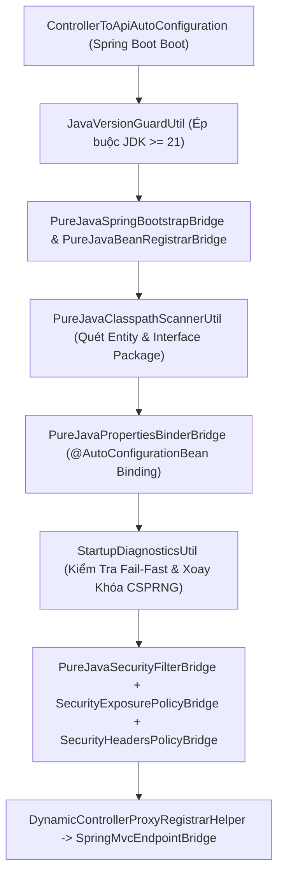

# Spring-NWVMC `v0.0.2` — Tài Liệu Tham Chiếu Kỹ Thuật (Tiếng Việt)

> **Ngôn Ngữ Khác**: [English](GUIDE_EN.md) | [日本語](GUIDE_JA.md) | [中文](GUIDE_ZH.md)  
> **Tọa Độ Artifact**: `com.github.NatswarChuan:Spring-NWVMC:v0.0.2` (`https://jitpack.io`) | `io.github.natswarchuan:controller-to-api-framework:0.0.2`  
> **Yêu Cầu Runtime**: Java 21 LTS trở lên (`JavaVersionGuardUtil`), Spring Boot 3.3.5, Jakarta EE 10

---

## 1. Kiến Trúc Pure Java & Cơ Chế Lõi

Toàn bộ **503** tệp mã nguồn Java trong `controller-to-api-framework/src/main/java` không sử dụng bất kỳ câu lệnh `import org.springframework.*` tĩnh nào lúc biên dịch. Quá trình đăng ký Bean, ánh xạ thuộc tính cấu hình, liên kết định tuyến WebMVC và lắp ghép chuỗi bộ lọc bảo mật đều vận hành động bằng reflection tại thời điểm khởi động ứng dụng.

### 1.1 Luồng Khởi Tạo & Điều Phối Runtime



1. **Cô Lập Biên Dịch Khỏi Spring Framework**: `PureJavaSpringBootstrapBridge`, `PureJavaBeanRegistrarBridge`, `PureJavaPropertiesBinderBridge`, `PureJavaSecurityFilterBridge`, `SecurityFilterChainBridge`, `SecurityHeadersPolicyBridge`, `SecurityExposurePolicyBridge` và `SpringMvcEndpointBridge` tách biệt lõi nghiệp vụ khỏi biến động API qua từng phiên bản Spring.
2. **Hệ Thống L1 Cache Reflection Không Khóa (`ReflectionMetadataCacheUtil` / `ReflectionCacheConstant`)**: Lưu sẵn siêu dữ liệu trên `ConcurrentHashMap`: `CLASS_CACHE` (`256`), `METHOD_CACHE` (`1024`), `CONSTRUCTOR_CACHE` (`256`), `DECLARED_FIELDS_CACHE` & `FIELD_BY_NAME_CACHE` (`256`), `PROPERTY_DESCRIPTOR_CACHE` (`256`), `ANNOTATED_FIELDS_CACHE` (`512`), `UNIQUE_FIELDS_CACHE` (`256`), `KEBAB_CASE_CACHE` & `REST_ENDPOINT_PATH_CACHE` (`256`), `PACKAGE_CLASS_NAMES_CACHE` (`64`), cùng con trỏ `MethodHandle` (`READ_METHOD_HANDLE_CACHE` & `WRITE_METHOD_HANDLE_CACHE`, sức chứa khởi tạo `1024`).
3. **Đánh Đổi Kiến Trúc & Tối Ưu Virtual Threads**:
   - *Dynamic JDK Proxy & `MethodHandle`*: Tránh phát sinh class CGLIB cho từng controller (giảm chiếm dụng Metaspace và bộ nhớ cấp phát khi khởi tạo), đồng thời duy trì chi phí gọi hàm tiệm cận gọi trực tiếp sau bước unreflect lần đầu.
   - *Virtual Threads + `open-in-view=false` + HikariCP*: Java 21 Virtual Threads gánh tải I/O đồng thời không giới hạn thread hệ điều hành; tắt OSIV (`spring.jpa.open-in-view=false`) và bật `app.framework.eager-fetch-singular-relations=true` giúp trả kết nối JDBC về HikariCP Pool (ví dụ `maximum-pool-size: 30`) ngay sau câu truy vấn thay vì giữ kết nối suốt vòng đời render JSON.

---

## 2. Triển Khai Nhanh & Quy Tắc 2 Thư Mục Nghiêm Ngặt

Ứng dụng tiêu thụ framework chỉ cần duy trì **đúng 2 thư mục nghiệp vụ**: `entity/` (JPA Entity + Validation + Annotations) và `controller/` (Interface kế thừa `AutoApiController<E>`). Với luồng xử lý đặc thù ngoài CRUD, tách thành cặp `Service` interface và lớp `Helper` (`public final class` gắn `@AutoService` / `@AutoComponent`, 100% phương thức `public`, không có `private` và không có `static` helper method).

### 2.1 Khai Báo Phụ Thuộc Maven (`pom.xml`)

```xml
<properties>
  <java.version>21</java.version>
</properties>

<repositories>
  <repository>
    <id>jitpack.io</id>
    <url>https://jitpack.io</url>
  </repository>
</repositories>

<dependencies>
  <dependency>
    <groupId>com.github.NatswarChuan</groupId>
    <artifactId>Spring-NWVMC</artifactId>
    <version>v0.0.2</version>
  </dependency>
</dependencies>
```

### 2.2 Khai Báo Thực Thể (`entity/CommercialProduct.java`)

```java
package com.example.app.entity;

import io.github.natswarchuan.common.constant.RoleConstant;
import io.github.natswarchuan.common.entity.BaseAuditEntity;
import io.github.natswarchuan.core.annotation.AutoCode;
import io.github.natswarchuan.core.annotation.EntitySecurity;
import io.github.natswarchuan.core.annotation.FieldSecurity;
import io.github.natswarchuan.core.annotation.StateMachine;
import io.github.natswarchuan.core.annotation.UniqueField;
import jakarta.persistence.Column;
import jakarta.persistence.Entity;
import jakarta.persistence.Table;
import jakarta.validation.constraints.DecimalMin;
import jakarta.validation.constraints.NotBlank;
import jakarta.validation.constraints.NotNull;
import java.math.BigDecimal;
import lombok.AllArgsConstructor;
import lombok.Getter;
import lombok.NoArgsConstructor;
import lombok.Setter;
import lombok.experimental.SuperBuilder;

@Entity
@Table(name = "tbl_commercial_products")
@Getter
@Setter
@NoArgsConstructor
@AllArgsConstructor
@SuperBuilder(toBuilder = true)
@EntitySecurity(
    readRoles = {RoleConstant.ROLE_USER, RoleConstant.ROLE_ADMIN},
    writeRoles = {RoleConstant.ROLE_ADMIN},
    deleteRoles = {RoleConstant.ROLE_ADMIN}
)
public class CommercialProduct extends BaseAuditEntity {

  @UniqueField
  @AutoCode(prefix = "PRD-")
  @Column(name = "product_code", nullable = false, length = 32)
  private String productCode;

  @NotBlank
  @Column(name = "name", nullable = false, length = 200)
  private String name;

  @NotNull
  @DecimalMin("0.00")
  @Column(name = "price", precision = 12, scale = 2)
  private BigDecimal price;

  @FieldSecurity(viewRoles = {RoleConstant.ROLE_ADMIN}, maskPattern = "PROTECTED_DATA")
  @Column(name = "cost_price", precision = 12, scale = 2)
  private BigDecimal costPrice;

  @StateMachine(
      initial = "DRAFT",
      transitions = {"DRAFT:ACTIVE,DISCONTINUED", "ACTIVE:SUSPENDED,DISCONTINUED"},
      deletableStates = {"DRAFT", "DISCONTINUED"}
  )
  @Column(name = "status", nullable = false, length = 32)
  private String status;
}
```

### 2.3 Khai Báo Interface Controller (`controller/CommercialProductController.java`)

```java
package com.example.app.controller;

import com.example.app.entity.CommercialProduct;
import io.github.natswarchuan.core.annotation.AutoRestController;
import io.github.natswarchuan.core.controller.AutoApiController;

@AutoRestController(
    path = "/api/v1/commercial-products",
    disabledEndpoints = {"batchChunked", "importCsv"}
)
public interface CommercialProductController extends AutoApiController<CommercialProduct> {
}
```

> `EndpointFeatureFilterHelper` so khớp không phân biệt hoa thường từng phần tử trong `enabledEndpoints` / `disabledEndpoints` theo đúng tên hàm interface (`getPage`, `deleteById`, `batchChunked`, `exportCsv`, `importCsv`...) hoặc tên nhóm chức năng (`READ`, `WRITE`, `DELETE`, `BATCH`, `ANALYTICS`, `EXPORT`, `AI`, `STREAM`, `SCHEMA`, `SUB_RESOURCE`).

### 2.4 Luồng Gọi HTTP Thực Tế

```bash
# 1. Cấp phát Admin JWT (khi bật app.framework.studio.demo-token-endpoint-enabled=true)
TOKEN=$(curl -s -X POST http://localhost:8080/api/v1/auth/token \
  -H "Content-Type: application/json" \
  -d '{"username":"admin","roles":["ROLE_ADMIN"]}' | jq -r '.data.token')

# 2. Tạo bản ghi mới (AutoCode sinh PRD-..., BaseAuditEntity sinh khóa chính UUIDv7)
curl -s -X POST http://localhost:8080/api/v1/commercial-products \
  -H "Authorization: Bearer $TOKEN" \
  -H "Content-Type: application/json" \
  -d '{"name":"Enterprise Server X1","price":4999.00,"costPrice":3200.00}'

# 3. Truy vấn lọc động kết hợp phân trang Keyset O(1) & chọn trường Sparse Fieldsets
curl -s "http://localhost:8080/api/v1/commercial-products/keyset?price.gte=1000&fields=id,productCode,name,price&size=20" \
  -H "Authorization: Bearer $TOKEN"
```

---

## 3. Danh Mục 38 Endpoint Hợp Đồng & Các Phân Hệ Tích Hợp Sẵn

`AutoApiController<E>` kế thừa **15** phương thức từ `AutoApiReadController<E>`, **12** phương thức từ `AutoApiEnterpriseController<E>`, cộng thêm **11** phương thức ghi dữ liệu trực tiếp = **38 hợp đồng `@Auto*`** (mặc định hiển thị **36** tuyến trên Swagger/Studio vì `streamEvents` (`/events`) gắn `@Hidden` và `navigateSubResources` (`/{id}/**`) chỉ kích hoạt khi bật `enableNestedSubResources = true` hoặc `app.framework.sub-resource.enabled-by-default=true`).

### 3.1 Nhóm Đọc, Thống Kê, Streaming Export & Schema (`AutoApiReadController<E>` — 15 Endpoint)

| # | HTTP | Đường Dẫn | Tên Phương Thức | Hành Vi Kỹ Thuật |
| :-: | :--- | :--- | :--- | :--- |
| 1 | `GET` | `/` | `getPage` | Phân trang offset (`page`, `size`), `sort`, `dir`, `search`, `searchFields`, `include`, `fields`, 13 toán tử lọc |
| 2 | `GET` | `/keyset` | `getKeysetPage` | Phân trang con trỏ O(1) qua `afterId` tận dụng B-Tree tăng đơn điệu của UUIDv7 |
| 3 | `GET` | `/all` | `getAll` | Trả danh sách đầy đủ theo bộ lọc động không chia trang |
| 4 | `GET` | `/count` | `count` | Đếm tổng số bản ghi khớp điều kiện lọc |
| 5 | `GET` | `/exists` | `exists` | Kiểm tra tồn tại bản ghi trả về boolean |
| 6 | `GET` | `/aggregate` | `aggregate` | Tính toán `COUNT`, `SUM`, `AVG`, `MIN`, `MAX` theo `field` |
| 7 | `GET` | `/distinct` | `findDistinctValues` | Truy xuất danh sách giá trị duy nhất của `field` |
| 8 | `GET` | `/top` | `findTopRecords` | Trích xuất N bản ghi đứng đầu theo `limit`, `sort`, `dir` |
| 9 | `GET` | `/group-by` | `groupByAnalytics` | Thống kê gom nhóm theo `groupField` tính trên `valueField` |
| 10 | `GET` | `/export/csv` | `exportCsv` | Xuất CSV chuẩn RFC-4180 theo cơ chế streaming O(1) RAM |
| 11 | `GET` | `/export/jsonl` | `exportJsonl` | Xuất JSON Lines (`application/x-ndjson`) streaming O(1) RAM |
| 12 | `GET` | `/metadata` | `getMetadata` | Phản chiếu metadata trường, đồ thị State Machine và cấu hình truy vấn |
| 13 | `GET` | `/schema/typescript` | `generateTypeScript` | Xuất định nghĩa `interface` TypeScript tương ứng JPA Entity |
| 14 | `GET` | `/schema/json` | `getJsonSchema` | Xuất JSON Schema Draft-07 chuẩn hóa |
| 15 | `GET` | `/{id}` | `getById` | Lấy chi tiết theo khóa chính UUIDv7 kèm `include` và che mờ `@FieldSecurity` |

### 3.2 Nhóm Ghi, Upsert & Xử Lý Lô Theo Chunk (`AutoApiController<E>` — 11 Endpoint)

| # | HTTP | Đường Dẫn | Tên Phương Thức | Hành Vi Kỹ Thuật |
| :-: | :--- | :--- | :--- | :--- |
| 16 | `POST` | `/` | `create` | Tạo bản ghi mới; tự động chạy `@Valid`, `@UniqueField`, `@AutoCode`, `@AutoSlug`, `@ComputedField` |
| 17 | `POST` | `/batch` | `createBatch` | Lưu danh sách bản ghi trong một giao dịch |
| 18 | `POST` | `/upsert` | `upsert` | Tự động cập nhật nếu trùng `@UniqueField`, ngược lại chèn mới |
| 19 | `POST` | `/upsert-batch` | `upsertBatch` | Xử lý upsert theo danh sách bản ghi |
| 20 | `POST` | `/batch-chunked` | `batchChunked` | Tách mảng lớn thành từng phân đoạn `chunkSize` (mặc định `100`) chống tràn Heap |
| 21 | `PATCH` | `/{id}/increment` | `adjustNumericField` | Tăng/giảm giá trị số nguyên tử (`?field=...&delta=...`) |
| 22 | `PATCH` | `/batch-update` | `updateBatchByFilter` | Cập nhật hàng loạt bản ghi thỏa mãn bộ lọc query |
| 23 | `PUT` | `/{id}` | `update` | Ghi đè toàn bộ trường thực thể theo UUIDv7 `id` |
| 24 | `PATCH` | `/{id}` | `patch` | Cập nhật từng phần giữ nguyên trường không truyền trong payload |
| 25 | `DELETE` | `/{id}` | `deleteById` | Xóa mềm (Soft Delete) có kiểm tra luật `@StateMachine.deletableStates` |
| 26 | `POST` | `/{id}/restore` | `restoreById` | Khôi phục bản ghi đã xóa mềm |

### 3.3 Nhóm State Machine, AI, Nhập Dữ Liệu, Diff & Sub-Resource (`AutoApiEnterpriseController<E>` — 12 Endpoint)

| # | HTTP | Đường Dẫn | Tên Phương Thức | Hành Vi Kỹ Thuật |
| :-: | :--- | :--- | :--- | :--- |
| 27 | `POST` | `/{id}/transition` | `transitionState` | Chuyển đổi trạng thái (`?targetState=...`), trả về HTTP `422` nếu vi phạm đồ thị `@StateMachine` |
| 28 | `POST` | `/{id}/clone` | `cloneEntity` | Nhân bản bản ghi với UUIDv7 mới và sinh lại `@AutoCode` |
| 29 | `GET` | `/events` | `streamEvents` | Luồng Server-Sent Events thời gian thực (`@Hidden` trên Swagger) |
| 30 | `GET` | `/ai/context` | `getAiContext` | Xuất ngữ cảnh schema chuẩn bị cho Spring AI `ChatClient` |
| 31 | `POST` | `/ai/query` | `queryAi` | Biên dịch truy vấn ngôn ngữ tự nhiên thành Criteria an toàn (`AiQueryRequestDto`) |
| 32 | `GET` | `/human-policy` | `getPolicySummary` | Trả về bảng tổng hợp luật `@HumanPolicy` / YAML đang kích hoạt |
| 33 | `GET` | `/health` | `getEntityHealth` | Trạng thái Circuit Breaker và chỉ số vận hành của thực thể |
| 34 | `POST` | `/import/csv` | `importCsv` | Nhập hàng loạt từ tệp CSV RFC-4180 theo luồng |
| 35 | `POST` | `/import/jsonl` | `importJsonl` | Nhập hàng loạt từ định dạng JSON Lines |
| 36 | `PATCH` | `/{id}/patch-rfc6902` | `patchRfc6902` | Áp dụng các phép toán `add`/`replace`/`remove` theo chuẩn RFC 6902 JSON Patch |
| 37 | `GET` | `/{id}/diff` | `compareEntityDiff` | So sánh sự khác biệt với `?targetId={uuid}` trả về trạng thái `MODIFIED`, `ADDED`, `REMOVED` |
| 38 | `GET` | `/{id}/**` | `navigateSubResources` | Điều hướng quan hệ lồng nhau đa tầng (yêu cầu `enableNestedSubResources=true` hoặc `@EnableNestedSubResource`) |

### 3.4 13 Toán Tử Lọc Động (`FilterOperatorConstant`)

Cú pháp: `field.op=value` hoặc xuyên quan hệ `relation.field.op=value`:
`eq`, `ne`, `like`, `gt`, `gte`, `lt`, `lte`, `in`, `notIn`, `between` (`min,max`), `null` (`true`/`false`), `startsWith`, `endsWith`.

### 3.5 Phân Hệ Nền Tảng Tích Hợp Sẵn

| Lớp Controller | Đường Dẫn | Chức Năng |
| :--- | :--- | :--- |
| `FileStorageController` | `POST /api/v1/storage/upload`, `GET /api/v1/storage/download/{fileId}`, `GET /api/v1/storage/metadata/{fileId}`, `DELETE /api/v1/storage/{fileId}`, `POST /api/v1/storage/presigned-url`, `GET /api/v1/storage/exists/{fileId}` | Lưu trữ đa đám mây (`LOCAL`, AWS S3 SigV4, GCS) kèm chống Path Traversal qua `StoragePathSanitizerHelper` |
| `GraphQLDynamicApiController` | `POST /api/v1/graphql`, `GET /api/v1/graphql/schema`, `GET /api/v1/graphql/explorer` (`@Hidden`) | Tự sinh GraphQL SDL (`get*`, `list*`, `count*`) và giao diện truy vấn GraphiQL |
| `DevStudioController` | `GET /system/studio` (`@Hidden`) | Giao diện kiểm thử Live Studio 20 ngôn ngữ (yêu cầu `app.framework.studio.enabled=true`) |
| `AuthController` | `POST /api/v1/auth/token` | Endpoint cấp phát JWT thử nghiệm (yêu cầu `app.framework.studio.demo-token-endpoint-enabled=true`) |
| `TimeTravelDynamicApiController` | `GET /api/v1/system/time-travel/{entityName}/{id}?timestamp=...` | Tái tạo trạng thái thực thể tại thời điểm quá khứ bằng cách áp dụng ngược delta CDC ($O(K)$) |
| `CustomizerTelemetryApiController` | `GET /api/v1/system/customizers` | Kiểm kê danh sách SPI Customizer Bean đang nạp |
| `CircuitBreakerTelemetryApiController` | `GET /api/v1/system/resilience/circuit-breakers` | Giám sát trạng thái đóng/mở của Circuit Breaker |
| `MultiDatabaseHealthCheckController` | `GET /api/v1/system/databases/health` | Kiểm tra sức khỏe cụm Primary/Replica Datasource |
| `TraceContextSystemApiController` | `GET /api/v1/system/trace-context` | Xuất W3C `traceparent` và `X-Request-ID` UUIDv7 hiện hành từ MDC |
| `CustomContainerErrorController` | `GET/POST /error` (`@Hidden`) | Chuẩn hóa mọi lỗi Servlet/Tomcat (`400`, `404`, `405`, `413`, `431`, `500`) về `ApiResponse<Void>` |

---

## 4. Tham Chiếu Thuộc Tính Cấu Hình (`application.yml`)

| Khóa Cấu Hình | Lớp Ánh Xạ | Mặc Định | Ý Nghĩa |
| :--- | :--- | :--- | :--- |
| `app.framework.base-path-prefix` | `ControllerToApiProperties` | `/api/v1` | Tiền tố URI gốc cho các API tự động |
| `app.framework.default-page-size` | `ControllerToApiProperties` | `20` | Kích thước trang mặc định (`1..200`) |
| `app.framework.max-page-size` | `ControllerToApiProperties` | `200` | Trần kích thước trang tối đa (`@Max(200)`) |
| `app.framework.eager-fetch-singular-relations` | `ControllerToApiProperties` | `true` | Tự động JOIN FETCH quan hệ đơn `@ManyToOne` / `@OneToOne` |
| `app.framework.security.enabled` | `SecurityPolicyProperties` | `true` | Bật/tắt bảo vệ JWT stateless và RBAC |
| `app.framework.security.data-masking-enabled` | `SecurityPolicyProperties` | `true` | Bật cơ chế che mờ `@FieldSecurity` |
| `app.framework.security.row-level-security-enabled` | `SecurityPolicyProperties` | `true` | Bật lọc dữ liệu theo tenant / quyền sở hữu dòng |
| `app.framework.security.jwt-secret` | `SecurityPolicyProperties` | Chuỗi dev mặc định | Khóa ký HS512 (tối thiểu 32 byte UTF-8) |
| `app.framework.security.jwt-expiration-seconds` | `SecurityPolicyProperties` | `315360000` | Thời gian sống token JWT tính bằng giây (`> 0`) |
| `app.framework.security.fail-fast-weak-jwt-secret` | `SecurityPolicyProperties` | `true` | Chặn khởi động nếu khóa tùy chỉnh ngắn hơn 32 byte |
| `app.framework.studio.enabled` | `DevStudioProperties` | `false` | Mở `/system/studio` & `/system/**` (`404` khi `false`) |
| `app.framework.studio.demo-token-endpoint-enabled` | `DevStudioProperties` | `false` | Mở `POST /api/v1/auth/token` (`404` khi `false`) |
| `app.framework.studio.show-i18n-diagnostics` | `DevStudioProperties` | `false` | Hiển thị thanh `#studioI18nDiagBar` trên `/system/studio` |
| `app.framework.studio.hide-framework-fingerprint` | `DevStudioProperties` | `true` | Ẩn tiêu đề và dấu vết kỹ thuật nội bộ |
| `app.framework.i18n.default-locale` | `I18nLocalizationProperties` | `en` | Mã ngôn ngữ dự phòng BCP-47 |
| `app.framework.i18n.supported-locales` | `I18nLocalizationProperties` | 20 ngôn ngữ | Danh sách mã locale hợp lệ được chấp nhận |
| `app.framework.i18n.cache-seconds` | `I18nLocalizationProperties` | `3600` | Thời hạn cache `ReloadableResourceBundleMessageSource` |
| `app.framework.cache.type` | `CacheEngineProperties` | `CAFFEINE` | Bộ đệm cache (`CAFFEINE`, `REDIS`, `TWO_TIER`, `NONE`) |
| `app.framework.ai.enabled` | `AiEngineProperties` | `true` | Kích hoạt `/ai/context` và phân hệ Spring AI |
| `app.framework.ai.natural-language-query-enabled` | `AiEngineProperties` | `true` | Kích hoạt `POST /ai/query` |
| `app.framework.realtime.sse-enabled` | `RealtimeStreamingProperties` | `true` | Kích hoạt kênh đẩy sự kiện SSE |
| `app.framework.realtime.heartbeat-seconds` | `RealtimeStreamingProperties` | `15` | Chu kỳ gửi xung giữ kết nối SSE (`> 0`) |
| `app.framework.realtime.max-emitters-per-entity` | `RealtimeStreamingProperties` | `1000` | Giới hạn số kết nối SSE đồng thời trên mỗi thực thể |
| `app.framework.sub-resource.enabled-by-default` | `SubResourceRoutingProperties` | `false` | Bật/tắt toàn cục định tuyến `/{id}/**` |
| `app.framework.date-time.default-timezone` | `DateTimeFormatProperties` | `UTC` | Múi giờ chuẩn hóa ISO-8601 |
| `app.framework.storage.enabled` | `FileStorageProperties` | `true` | Kích hoạt phân hệ `/api/v1/storage/*` |
| `app.framework.storage.provider` | `FileStorageProperties` | `LOCAL` | Driver lưu trữ (`LOCAL`, `S3`, `GCS`) |
| `app.framework.storage.max-file-size` | `FileStorageProperties` | `52428800` | Giới hạn dung lượng tải lên theo byte (50 MB) |
| `spring-nwvmc.human-policies.<Entity>` | `HumanPolicyConfigurationProperties` | `{}` | Khai báo đè `lifecycle`, `security`, `masking` bằng YAML |

---

## 5. Đa Ngôn Ngữ (`i18n`), `/system/studio` & Mở Rộng Từ Host App

### 5.1 20 Ngôn Ngữ & Thứ Tự Phân Giải Locale

Bộ tài nguyên tích hợp (`classpath:i18n/messages*.properties`) bao phủ **20 ngôn ngữ**: `en`, `zh`, `hi`, `es`, `fr`, `ar`, `bn`, `pt`, `ru`, `ur`, `id`, `de`, `ja`, `vi`, `ko`, `tr`, `it`, `th`, `fa`, `pl`. Các ngôn ngữ `ar`, `ur`, `fa` tự động áp dụng bố cục phải-sang-trái `dir="rtl"` trên `/system/studio`.

`LocaleResolutionUtil.resolveBestMatchLocale` phân giải ngôn ngữ theo đúng 5 tầng ưu tiên:
1. Tham số URL `?lang=vi` (`I18nContextConstant.PARAM_LANG`)
2. Tiêu đề HTTP `X-Language: vi`
3. Cookie trình duyệt `NWVMC_LANG=vi`
4. Tiêu đề HTTP `Accept-Language: vi,en;q=0.9` (`MAX_ACCEPT_HEADER_LENGTH=256`, tối đa `MAX_ACCEPT_RANGES=8`)
5. Giá trị cấu hình `app.framework.i18n.default-locale` (`en`)

### 5.2 Phòng Chống Path Traversal & Giới Hạn Bộ Nhớ (`MessageHelper` & `DevStudioDiagnosticsUtil`)

- **Kiểm Duyệt Khóa Thông Điệp (`LocaleResolutionUtil.isSafeMessageKey`)**: Từ chối chuỗi null/rỗng, độ dài vượt `128` ký tự (`MAX_MESSAGE_CODE_LENGTH`), chuỗi `..` và ký tự ngoài biểu thức chính quy `^[A-Za-z0-9._-]+$`. Chuỗi locale độc hại như `?lang=../../etc/passwd` bị loại bỏ an toàn và hồi quy về `en`.
- **Cache Giới Hạn**: `BUNDLE_TRANSLATION_CACHE` / `MessageHelper.hostTranslationCache` giới hạn ở mức `8192` mục (`MAX_TRANSLATION_CACHE_SIZE`). Danh sách khóa thiếu bản dịch được `DevStudioDiagnosticsUtil` ghi nhận tối đa `128` khóa (`MAX_MISSING_KEY_RECORDS`) và hiển thị tại `#studioI18nDiagBar` trên `/system/studio` khi `app.framework.studio.show-i18n-diagnostics=true`.

### 5.3 Mở Rộng Bản Dịch Trong Ứng Dụng Host

1. Đặt tệp `src/main/resources/i18n/messages_{lang}.properties` trong dự án ứng dụng để bổ sung hoặc ghi đè khóa thông điệp cho `/system/studio`, thông báo lỗi (`error.*`), hoặc thông điệp Hibernate Validation (`{validation...}`).
2. Với nhu cầu đọc từ `MessageSource` tùy chỉnh của host app, khởi tạo `new MessageHelper(hostMessageSource)` trong các lớp dịch vụ/helper để tận dụng cache có giới hạn và cơ chế tự động rơi về `ResourceBundle` lõi khi cần.

---

## 6. Ma Trận Bảo Mật & Phòng Chống Scanner AI Tự Động

| Bề Mặt Tấn Công / AI Recon | Lớp Thực Thi | Biện Pháp Kỹ Thuật Áp Dụng |
| :--- | :--- | :--- |
| **Lộ Trang Quản Trị & Rà Quét System API** | `DevStudioController`, `SecurityExposurePolicyBridge`, `DevStudioProperties` | Mặc định `studio.enabled=false` loại `/system/**` khỏi vùng public Ant matcher và trả HTTP `404` đồng nhất. |
| **Lạm Dụng Endpoint Cấp Token Thử Nghiệm** | `AuthController`, `StartupDiagnosticsUtil` | Mặc định `demo-token-endpoint-enabled=false` chặn `/api/v1/auth/token` với HTTP `404` và xoay khóa JWT mặc định thành khóa CSPRNG `SecureRandom` 64 byte. |
| **Tấn Công Đo Thời Gian (Timing Side-Channel)** | `ConstantTimeComparisonUtil` | Dùng `MessageDigest.isEqual` trên chuỗi UTF-8 để đối chiếu hash payload `@Idempotent` và chữ ký HMAC-SHA256 của `@EntityWebhook` (`WebhookHmacSignerHelper`). |
| **Quét Lỗ Hổng Tần Suất Cao & Brute-Force** | `RateLimitingFilter` | Cửa sổ trượt giới hạn bởi cache Caffeine `10,000` phần tử: `1,000 req/s` cho đường dẫn thường và siết còn `20 req/s` tại `/api/v1/auth/**` (kèm `@RateLimit`). |
| **Tấn Công Tiêm Nhiễm Bộ Lọc & Cạn Tài Nguyên** | `QueryFilterParameterUtil` | Từ chối từ khóa SQLi / thẻ XSS (ném `error.security.malicious.query`), khóa trần `MAX_DYNAMIC_FILTERS=30`, khóa độ sâu sắp xếp lồng nhau `MAX_SORT_RELATION_DEPTH=4`. |
| **Xâm Nhập Đường Dẫn Lưu Trữ (`CWE-22`)** | `StoragePathSanitizerHelper` | Loại bỏ null-byte (`\0`), chuẩn hóa đường dẫn và ràng buộc tệp nằm gọn trong thư mục gốc đã cấu hình. |
| **Tấn Công Trình Duyệt & Nhúng Frame** | `SecurityHeadersPolicyBridge` | Áp dụng đồng bộ `X-Frame-Options: DENY`, `Content-Security-Policy`, `Permissions-Policy`, `Referrer-Policy: STRICT_ORIGIN_WHEN_CROSS_ORIGIN` và HSTS. |
| **Rò Rỉ Stacktrace Tomcat Container** | `GlobalExceptionHandler`, `ServletFilterExceptionHandler`, `CustomContainerErrorController` | Thay thế trang Whitelabel cho các mã `400`, `404`, `405`, `413`, `431`, `500` bằng JSON `ApiResponse<Void>` gắn `traceId` UUIDv7. |

---

## 7. Bảng Tra Cứu Lỗi Khởi Động Fail-Fast

| Lớp Ngoại Lệ | Mã Lỗi / Thành Phần | Điều Kiện Kích Hoạt | Cách Khắc Phục |
| :--- | :--- | :--- | :--- |
| `UnsupportedJavaVersionException` | `JavaVersionGuardUtil` (`HTTP 500`) | Phiên bản chính của JVM `< 21` | Cấu hình JDK 21 LTS (`java.version=21`) làm runtime |
| `InvalidConfigurationException` | `error.configuration.jwt` | Bật `fail-fast-weak-jwt-secret=true` với chuỗi khóa `< 32` byte UTF-8 hoặc rỗng | Gán `app.framework.security.jwt-secret` / `${JWT_SECRET}` độ dài >= 32 ký tự |
| `InvalidConfigurationException` | `StartupDiagnosticsUtil.validateAndHardenProperties` | `defaultPageSize <= 0` hoặc `defaultPageSize > maxPageSize` | Điều chỉnh `default-page-size <= max-page-size` (`1..200`) |
| `InvalidConfigurationException` | `StartupDiagnosticsUtil.validateAndHardenProperties` | `jwtExpirationSeconds <= 0` hoặc `heartbeatSeconds <= 0` | Gán giá trị nguyên dương cho TTL JWT và nhịp SSE |
| `InvalidConfigurationException` | `error.configuration.entity` (`DevExConstant.ERR_ENTITY_CONFIGURATION`) | Entity thiếu trường `@Id` hoặc thiếu constructor không tham số | Bổ sung `@Id` (hoặc kế thừa `BaseAuditEntity`) và `@NoArgsConstructor` |
| `InvalidConfigurationException` | Kiểm định `FileStorageProperties` | Đường dẫn lưu trữ nội bộ hoặc thông số S3/GCS không hợp lệ | Kiểm tra lại thuộc tính `local`, `s3` hoặc `gcs` |

---

## 8. 8 Giao Diện SPI Customizer & Giao Tiếp Ngoài

### 8.1 8 Giao Diện SPI `io.github.natswarchuan.customization.customizer.*`

Các thành phần Bean triển khai bất kỳ interface nào dưới đây (toàn bộ dùng `default` method để bảo đảm tương thích ngược) đều được báo cáo trạng thái tại `GET /api/v1/system/customizers`:

1. `SpringCoreCustomizer` (`CoreCustomizerContextDto`) — Mở rộng Bean lõi, `TaskExecutor`, lập lịch tác vụ
2. `PlatformAiCustomizer` (`PlatformAiCustomizerContextDto`) — Tùy biến prompt `ChatClient`, luồng RAG, Vector Store
3. `SecurityIdentityCustomizer` (`SecurityCustomizerContextDto`) — Quy tắc RBAC tùy chỉnh, ánh xạ claim OAuth2, quy tắc che mờ dữ liệu
4. `DataAccessCustomizer` (`DataCustomizerContextDto`) — Bộ lọc Criteria, định tuyến multi-datasource & phân tách tenant
5. `SpringCloudCustomizer` (`CloudCustomizerContextDto`) — Khóa phân tán, Circuit Breaker, cấu hình Retry & CloudEvents
6. `MessagingIntegrationCustomizer` (`MessagingCustomizerContextDto`) — Ký HMAC Webhook, kênh STOMP/WebSocket, cấu hình RestClient
7. `ArchitectureExtensionCustomizer` (`ArchitectureCustomizerContextDto`) — Mở rộng endpoint tùy biến, GraphQL SDL, cơ chế i18n
8. `StorageCustomizer` (`StorageCustomizerContextDto`) — Định tuyến bucket, chính sách pre-signed URL và giới hạn tải tệp

### 8.2 `@CustomEndpoint` & `ThirdPartyRestClientHelper`

- **`@CustomEndpoint`**: Gắn lên phương thức trong interface `AutoApiController<E>` để ánh xạ trực tiếp đường dẫn phụ (`path`, `httpMethod`) tới Spring Bean xử lý nghiệp vụ chuyên biệt (`delegateBean`, `delegateMethod`).
- **`ThirdPartyRestClientHelper`**: Tiêm qua DI để gọi API đối tác bên ngoài thông qua Spring 6 `RestClient` (tự động dự phòng bằng Java 21 `HttpClient`), đồng thời truyền tiếp `X-Request-ID` và W3C `traceparent`.

---

## 9. Kết Quả Kiểm Chứng Nghiệm Thu (`v0.0.2`)

| Hạng Mục Kiểm Chứng | Phạm Vi Thực Thi | Kết Quả Ghi Nhận |
| :--- | :--- | :--- |
| **Bộ Kiểm Thử Đơn Vị Lõi** | `mvn clean install -f controller-to-api-framework/pom.xml` | **473 / 473 PASS** (`0 Failures, 0 Errors, 0 Skipped`) |
| **Bộ Kiểm Thử Tích Hợp (JitPack `v0.0.2`)** | `mvn clean verify -U -f controller-to-api-implementation/pom.xml` | **140 / 140 PASS** (`0 Failures, 0 Errors, 0 Skipped`) |
| **Kiểm Thử Chịu Tải Apache JMeter** | `implementation_load_test.jmx` | **2,000 requests**, **0 lỗi (`0.0%` Error Rate)**, thông lượng **151.0 req/s**, trung bình **91 ms** (Min **3 ms**, Max **2,107 ms**) |
| **Kiểm Thử Thực Tế Trình Duyệt (Chrome)** | `/system/studio` & `/swagger-ui/index.html` | **0 lỗi JS console**; xác thực đủ 20 ngôn ngữ, RTL tiếng Ả Rập (`ar`), cookie `NWVMC_LANG`, chặn traversal `?lang=../../etc/passwd`, `#studioI18nDiagBar`, `743` tuyến Swagger & ẩn `@Hidden` |
