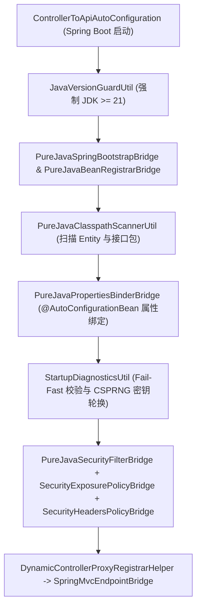

# Spring-NWVMC `v0.0.2` — 技术参考手册（中文）

> **其他语言**: [English](GUIDE_EN.md) | [Tiếng Việt](GUIDE_VI.md) | [日本語](GUIDE_JA.md)  
> **制品坐标**: `com.github.NatswarChuan:Spring-NWVMC:v0.0.2` (`https://jitpack.io`) | `io.github.natswarchuan:controller-to-api-framework:0.0.2`  
> **运行环境**: Java 21 LTS 或更高版本 (`JavaVersionGuardUtil`)、Spring Boot 3.3.5、Jakarta EE 10

---

## 1. 纯 Java 核心架构与底层机制

`controller-to-api-framework/src/main/java` 下全部 **503** 个源文件在编译期零 `import org.springframework.*` 静态引用。框架自动装配、Bean 注册、配置属性绑定、WebMVC 路由映射与 Spring Security 过滤链组装均在启动期通过动态反射桥接完成。

### 1.1 运行时动态桥接启动流程



1. **编译期零 Spring 强耦合**: `PureJavaSpringBootstrapBridge`、`PureJavaBeanRegistrarBridge`、`PureJavaPropertiesBinderBridge`、`PureJavaSecurityFilterBridge`、`SecurityFilterChainBridge`、`SecurityHeadersPolicyBridge`、`SecurityExposurePolicyBridge` 与 `SpringMvcEndpointBridge` 将核心逻辑与 Spring 次版本 API 变动隔离。
2. **L1 无锁并发反射缓存 (`ReflectionMetadataCacheUtil` / `ReflectionCacheConstant`)**: 启动及首次解析后将元信息缓存至 `ConcurrentHashMap`：类型缓存 `CLASS_CACHE` (`256`)、方法缓存 `METHOD_CACHE` (`1024`)、构造器 `CONSTRUCTOR_CACHE` (`256`)、字段字典 `DECLARED_FIELDS_CACHE` 与 `FIELD_BY_NAME_CACHE` (`256`)、`PropertyDescriptor` (`PROPERTY_DESCRIPTOR_CACHE`, `256`)、注解字段 (`ANNOTATED_FIELDS_CACHE`, `512`)、唯一键 (`UNIQUE_FIELDS_CACHE`, `256`)、路径段 (`KEBAB_CASE_CACHE` 与 `REST_ENDPOINT_PATH_CACHE`, `256`)、包扫描 (`PACKAGE_CLASS_NAMES_CACHE`, `64`) 及反反射句柄 `MethodHandle` (`READ_METHOD_HANDLE_CACHE` 与 `WRITE_METHOD_HANDLE_CACHE`, `1024`)。
3. **架构权衡与虚拟线程调优**:
   - *JDK 动态代理与 `MethodHandle`*: 避免为每个实体生成 CGLIB 子类（显著降低 Metaspace 占用与启动内存分配），完成首次 `MethodHandle` 转换后热点执行接近原生直接调用性能。
   - *虚拟线程 + `open-in-view=false` + HikariCP*: Java 21 虚拟线程可在阻塞等待 I/O 时无感挂起而不消耗操作系统平台线程；配合关闭 OSIV (`spring.jpa.open-in-view=false`) 并启用 `app.framework.eager-fetch-singular-relations=true`，查询结束即刻归还连接至有界 HikariCP 连接池（例如 `maximum-pool-size: 30`），防止连接池耗尽。

---

## 2. 快速接入与严格双目录规范

业务工程只需维护 **两个领域目录**：`entity/`（JPA 实体、参数校验与声明式注解）和 `controller/`（继承 `AutoApiController<E>` 的标记接口）。非标准 CRUD 的复杂业务流程拆分为 `Service` 接口与 `@AutoService` / `@AutoComponent` `public final class` `Helper` Bean（零 `private` 方法、零 `static` 辅助方法）。

### 2.1 Maven 依赖声明 (`pom.xml`)

```xml
<properties>
  <java.version>21</java.version>
</properties>

<repositories>
  <repository>
    <id>jitpack.io</id>
    <url>https://jitpack.io</url>
  </repository>
</repositories>

<dependencies>
  <dependency>
    <groupId>com.github.NatswarChuan</groupId>
    <artifactId>Spring-NWVMC</artifactId>
    <version>v0.0.2</version>
  </dependency>
</dependencies>
```

### 2.2 实体声明示例 (`entity/CommercialProduct.java`)

```java
package com.example.app.entity;

import io.github.natswarchuan.common.constant.RoleConstant;
import io.github.natswarchuan.common.entity.BaseAuditEntity;
import io.github.natswarchuan.core.annotation.AutoCode;
import io.github.natswarchuan.core.annotation.EntitySecurity;
import io.github.natswarchuan.core.annotation.FieldSecurity;
import io.github.natswarchuan.core.annotation.StateMachine;
import io.github.natswarchuan.core.annotation.UniqueField;
import jakarta.persistence.Column;
import jakarta.persistence.Entity;
import jakarta.persistence.Table;
import jakarta.validation.constraints.DecimalMin;
import jakarta.validation.constraints.NotBlank;
import jakarta.validation.constraints.NotNull;
import java.math.BigDecimal;
import lombok.AllArgsConstructor;
import lombok.Getter;
import lombok.NoArgsConstructor;
import lombok.Setter;
import lombok.experimental.SuperBuilder;

@Entity
@Table(name = "tbl_commercial_products")
@Getter
@Setter
@NoArgsConstructor
@AllArgsConstructor
@SuperBuilder(toBuilder = true)
@EntitySecurity(
    readRoles = {RoleConstant.ROLE_USER, RoleConstant.ROLE_ADMIN},
    writeRoles = {RoleConstant.ROLE_ADMIN},
    deleteRoles = {RoleConstant.ROLE_ADMIN}
)
public class CommercialProduct extends BaseAuditEntity {

  @UniqueField
  @AutoCode(prefix = "PRD-")
  @Column(name = "product_code", nullable = false, length = 32)
  private String productCode;

  @NotBlank
  @Column(name = "name", nullable = false, length = 200)
  private String name;

  @NotNull
  @DecimalMin("0.00")
  @Column(name = "price", precision = 12, scale = 2)
  private BigDecimal price;

  @FieldSecurity(viewRoles = {RoleConstant.ROLE_ADMIN}, maskPattern = "PROTECTED_DATA")
  @Column(name = "cost_price", precision = 12, scale = 2)
  private BigDecimal costPrice;

  @StateMachine(
      initial = "DRAFT",
      transitions = {"DRAFT:ACTIVE,DISCONTINUED", "ACTIVE:SUSPENDED,DISCONTINUED"},
      deletableStates = {"DRAFT", "DISCONTINUED"}
  )
  @Column(name = "status", nullable = false, length = 32)
  private String status;
}
```

### 2.3 控制器标记接口 (`controller/CommercialProductController.java`)

```java
package com.example.app.controller;

import com.example.app.entity.CommercialProduct;
import io.github.natswarchuan.core.annotation.AutoRestController;
import io.github.natswarchuan.core.controller.AutoApiController;

@AutoRestController(
    path = "/api/v1/commercial-products",
    disabledEndpoints = {"batchChunked", "importCsv"}
)
public interface CommercialProductController extends AutoApiController<CommercialProduct> {
}
```

> `EndpointFeatureFilterHelper` 对 `enabledEndpoints` / `disabledEndpoints` 条目进行大小写不敏感匹配：可直接填接口方法名（如 `getPage`、`deleteById`、`batchChunked`、`exportCsv`、`importCsv`），也可填功能分组标识（`READ`、`WRITE`、`DELETE`、`BATCH`、`ANALYTICS`、`EXPORT`、`AI`、`STREAM`、`SCHEMA`、`SUB_RESOURCE`）。

### 2.4 端到端 HTTP 请求流程

```bash
# 1. 获取管理员 JWT（需启用 app.framework.studio.demo-token-endpoint-enabled=true）
TOKEN=$(curl -s -X POST http://localhost:8080/api/v1/auth/token \
  -H "Content-Type: application/json" \
  -d '{"username":"admin","roles":["ROLE_ADMIN"]}' | jq -r '.data.token')

# 2. 创建实体记录（自动生成 PRD-... 业务编码与 UUIDv7 主键）
curl -s -X POST http://localhost:8080/api/v1/commercial-products \
  -H "Authorization: Bearer $TOKEN" \
  -H "Content-Type: application/json" \
  -d '{"name":"Enterprise Server X1","price":4999.00,"costPrice":3200.00}'

# 3. 组合动态过滤、O(1) Keyset 游标分页与稀疏字段集裁剪
curl -s "http://localhost:8080/api/v1/commercial-products/keyset?price.gte=1000&fields=id,productCode,name,price&size=20" \
  -H "Authorization: Bearer $TOKEN"
```

---

## 3. 38 个 `@Auto*` REST 接口契约与内置子系统

`AutoApiController<E>` 继承自 `AutoApiReadController<E>`（15 读）与 `AutoApiEnterpriseController<E>`（12 企业特性），并新增 11 个写入方法，共声明 **38 个 `@Auto*` 端点契约**（Swagger 与 Studio 默认展示 **36** 个：`streamEvents` 标注 `@Hidden`，而 `navigateSubResources` `/{id}/**` 需按需开启 `enableNestedSubResources = true` 或全局开启 `app.framework.sub-resource.enabled-by-default=true`）。

### 3.1 读取、统计、流式导出与 Schema (`AutoApiReadController<E>` — 15 项)

| # | HTTP | 路径 | 方法名 | 技术行为 |
| :-: | :--- | :--- | :--- | :--- |
| 1 | `GET` | `/` | `getPage` | 偏移分页 (`page`, `size`)、`sort`、`dir`、`search`、`searchFields`、`include`、`fields` 及 13 种过滤操作符 |
| 2 | `GET` | `/keyset` | `getKeysetPage` | 利用 UUIDv7 单调有序 B-Tree 索引的 $O(1)$ 游标分页 (`afterId`) |
| 3 | `GET` | `/all` | `getAll` | 按动态条件返回完整匹配集合 |
| 4 | `GET` | `/count` | `count` | 统计满足过滤条件的记录总数 |
| 5 | `GET` | `/exists` | `exists` | 判断匹配记录是否存在（返回布尔值） |
| 6 | `GET` | `/aggregate` | `aggregate` | 对指定 `field` 执行 `COUNT`, `SUM`, `AVG`, `MIN`, `MAX` 聚合 |
| 7 | `GET` | `/distinct` | `findDistinctValues` | 查询 `field` 的去重标量列表 |
| 8 | `GET` | `/top` | `findTopRecords` | 按 `sort`, `dir`, `limit` 提取前 N 条记录 |
| 9 | `GET` | `/group-by` | `groupByAnalytics` | 按 `groupField` 对 `valueField` 分组聚合 |
| 10 | `GET` | `/export/csv` | `exportCsv` | O(1) 内存流式分段导出 RFC-4180 CSV |
| 11 | `GET` | `/export/jsonl` | `exportJsonl` | O(1) 内存流式导出 JSON Lines (NDJSON) |
| 12 | `GET` | `/metadata` | `getMetadata` | 输出实体字段元数据与状态机结构图 |
| 13 | `GET` | `/schema/typescript` | `generateTypeScript` | 根据 JPA 元数据导出 TypeScript `interface` |
| 14 | `GET` | `/schema/json` | `getJsonSchema` | 生成 JSON Schema Draft-07 规范描述 |
| 15 | `GET` | `/{id}` | `getById` | 按 UUIDv7 查询详情，支持 `include` 预加载与 `@FieldSecurity` 脱敏 |

### 3.2 写入、Upsert 与分片批处理 (`AutoApiController<E>` — 11 项)

| # | HTTP | 路径 | 方法名 | 技术行为 |
| :-: | :--- | :--- | :--- | :--- |
| 16 | `POST` | `/` | `create` | 单条创建并触发 `@Valid`、`@UniqueField`、`@AutoCode`、`@AutoSlug`、`@ComputedField` |
| 17 | `POST` | `/batch` | `createBatch` | 单事务批量写入列表 |
| 18 | `POST` | `/upsert` | `upsert` | 基于 `@UniqueField` 判断唯一键存在则更新、否则插入 |
| 19 | `POST` | `/upsert-batch` | `upsertBatch` | 批量 Upsert 入库 |
| 20 | `POST` | `/batch-chunked` | `batchChunked` | 按 `chunkSize`（默认 `100`）分块提交大数据批处理 |
| 21 | `PATCH` | `/{id}/increment` | `adjustNumericField` | 数值字段原子级增减（`?field=...&delta=...`） |
| 22 | `PATCH` | `/batch-update` | `updateBatchByFilter` | 对符合过滤条件的记录集批量局部更新 |
| 23 | `PUT` | `/{id}` | `update` | 按 UUIDv7 全量覆盖更新 |
| 24 | `PATCH` | `/{id}` | `patch` | 仅更新请求体显式提供的字段 |
| 25 | `DELETE` | `/{id}` | `deleteById` | 受 `@StateMachine.deletableStates` 保护的逻辑软删除 |
| 26 | `POST` | `/{id}/restore` | `restoreById` | 恢复已软删除记录 |

### 3.3 状态机、AI、导入、差分与子资源 (`AutoApiEnterpriseController<E>` — 12 项)

| # | HTTP | 路径 | 方法名 | 技术行为 |
| :-: | :--- | :--- | :--- | :--- |
| 27 | `POST` | `/{id}/transition` | `transitionState` | 按 `?targetState=...` 执行状态跃迁（非法流转返回 HTTP `422`） |
| 28 | `POST` | `/{id}/clone` | `cloneEntity` | 分配新 UUIDv7 并重算 `@AutoCode` 克隆新实体 |
| 29 | `GET` | `/events` | `streamEvents` | 实时 SSE 事件流（`@Hidden` 不在 Swagger UI 展示） |
| 30 | `GET` | `/ai/context` | `getAiContext` | 导出适配 Spring AI `ChatClient` 的实体上下文定义 |
| 31 | `POST` | `/ai/query` | `queryAi` | 将自然语言检索编译为安全 Criteria 查询 (`AiQueryRequestDto`) |
| 32 | `GET` | `/human-policy` | `getPolicySummary` | 返回生效的 `@HumanPolicy` / YAML 策略摘要 |
| 33 | `GET` | `/health` | `getEntityHealth` | 实体级熔断器健康状态监控 |
| 34 | `POST` | `/import/csv` | `importCsv` | 流式读取 RFC-4180 CSV 批量导入 |
| 35 | `POST` | `/import/jsonl` | `importJsonl` | 流式解析 NDJSON 批量导入 |
| 36 | `PATCH` | `/{id}/patch-rfc6902` | `patchRfc6902` | 应用符合 RFC 6902 规范的 JSON Patch 指令 (`add`/`replace`/`remove`) |
| 37 | `GET` | `/{id}/diff` | `compareEntityDiff` | 与 `?targetId={uuid}` 比对字段变更（`MODIFIED`, `ADDED`, `REMOVED`） |
| 38 | `GET` | `/{id}/**` | `navigateSubResources` | 递归关联导航（需开启 `enableNestedSubResources=true` 或 `@EnableNestedSubResource`） |

### 3.4 13 种动态查询过滤运算符 (`FilterOperatorConstant`)

格式：`field.op=value` 或嵌套关联 `relation.field.op=value`：
`eq`, `ne`, `like`, `gt`, `gte`, `lt`, `lte`, `in`, `notIn`, `between` (`min,max`), `null` (`true`/`false`), `startsWith`, `endsWith`.

### 3.5 内置平台级控制器模块

| 控制器类 | 端点路径 | 职能 |
| :--- | :--- | :--- |
| `FileStorageController` | `POST /api/v1/storage/upload`, `GET /api/v1/storage/download/{fileId}`, `GET /api/v1/storage/metadata/{fileId}`, `DELETE /api/v1/storage/{fileId}`, `POST /api/v1/storage/presigned-url`, `GET /api/v1/storage/exists/{fileId}` | 多云文件存储（`LOCAL`、AWS S3 SigV4、GCS），内置 `StoragePathSanitizerHelper` 路径消毒 |
| `GraphQLDynamicApiController` | `POST /api/v1/graphql`, `GET /api/v1/graphql/schema`, `GET /api/v1/graphql/explorer` (`@Hidden`) | 自动生成 GraphQL SDL (`get*`, `list*`, `count*`) 与 GraphiQL 调试器 |
| `DevStudioController` | `GET /system/studio` (`@Hidden`) | 支持 20 种语言的 Live API Studio（需开启 `app.framework.studio.enabled=true`） |
| `AuthController` | `POST /api/v1/auth/token` | 开发测试 JWT 签发端点（需开启 `app.framework.studio.demo-token-endpoint-enabled=true`） |
| `TimeTravelDynamicApiController` | `GET /api/v1/system/time-travel/{entityName}/{id}?timestamp=...` | 基于 CDC 审计差异逆向重放还原历史时刻实体快照 ($O(K)$) |
| `CustomizerTelemetryApiController` | `GET /api/v1/system/customizers` | 查询已注册的 SPI 自定义器 Bean 状态 |
| `CircuitBreakerTelemetryApiController` | `GET /api/v1/system/resilience/circuit-breakers` | 暴露实体熔断器状态与跳闸指标 |
| `MultiDatabaseHealthCheckController` | `GET /api/v1/system/databases/health` | 主从／多数据源连接池状态检查 |
| `TraceContextSystemApiController` | `GET /api/v1/system/trace-context` | 输出当前请求 MDC 中的 W3C `traceparent` 与 UUIDv7 `X-Request-ID` |
| `CustomContainerErrorController` | `GET/POST /error` (`@Hidden`) | 接管 Tomcat 容器级错误（`400`, `404`, `405`, `413`, `431`, `500`）并输出标准 `ApiResponse<Void>` |

---

## 4. 配置属性完全对照表 (`application.yml`)

| 配置键 | 绑定配置类 | 默认值 | 说明 |
| :--- | :--- | :--- | :--- |
| `app.framework.base-path-prefix` | `ControllerToApiProperties` | `/api/v1` | 自动生成接口的统一 URI 前缀 |
| `app.framework.default-page-size` | `ControllerToApiProperties` | `20` | 分页默认大小 (`1..200`) |
| `app.framework.max-page-size` | `ControllerToApiProperties` | `200` | 单页最大记录数上限 (`@Max(200)`) |
| `app.framework.eager-fetch-singular-relations` | `ControllerToApiProperties` | `true` | 对 `@ManyToOne` / `@OneToOne` 自动预加载 JOIN FETCH |
| `app.framework.security.enabled` | `SecurityPolicyProperties` | `true` | 开关无状态 JWT 与 RBAC 鉴权 |
| `app.framework.security.data-masking-enabled` | `SecurityPolicyProperties` | `true` | 开关 `@FieldSecurity` 响应脱敏 |
| `app.framework.security.row-level-security-enabled` | `SecurityPolicyProperties` | `true` | 开关多租户／行级数据隔离 |
| `app.framework.security.jwt-secret` | `SecurityPolicyProperties` | 开发默认值 | HS512 签名密钥（要求 >= 32 字节 UTF-8） |
| `app.framework.security.jwt-expiration-seconds` | `SecurityPolicyProperties` | `315360000` | JWT 有效时长秒数 (`> 0`) |
| `app.framework.security.fail-fast-weak-jwt-secret` | `SecurityPolicyProperties` | `true` | 若自定义密钥不足 32 字节则在启动阶段阻断失败 |
| `app.framework.studio.enabled` | `DevStudioProperties` | `false` | 开关 `/system/studio` 及 `/system/**`（关闭时返回 `404`） |
| `app.framework.studio.demo-token-endpoint-enabled` | `DevStudioProperties` | `false` | 开关 `POST /api/v1/auth/token`（关闭时返回 `404`） |
| `app.framework.studio.show-i18n-diagnostics` | `DevStudioProperties` | `false` | 在 Studio 显示缺失键诊断条 `#studioI18nDiagBar` |
| `app.framework.studio.hide-framework-fingerprint` | `DevStudioProperties` | `true` | 隐藏框架版本及内部特征指纹 |
| `app.framework.i18n.default-locale` | `I18nLocalizationProperties` | `en` | 兜底 BCP-47 语言标签 |
| `app.framework.i18n.supported-locales` | `I18nLocalizationProperties` | 20 种语言 | 允许解析的语言白名单 |
| `app.framework.i18n.cache-seconds` | `I18nLocalizationProperties` | `3600` | `ReloadableResourceBundleMessageSource` 缓存有效秒数 |
| `app.framework.cache.type` | `CacheEngineProperties` | `CAFFEINE` | 缓存驱动类型 (`CAFFEINE`, `REDIS`, `TWO_TIER`, `NONE`) |
| `app.framework.ai.enabled` | `AiEngineProperties` | `true` | 启用 `/ai/context` 与 Spring AI 模块 |
| `app.framework.ai.natural-language-query-enabled` | `AiEngineProperties` | `true` | 启用 `POST /ai/query` 自然语言检索 |
| `app.framework.realtime.sse-enabled` | `RealtimeStreamingProperties` | `true` | 启用 SSE 实时事件流 |
| `app.framework.realtime.heartbeat-seconds` | `RealtimeStreamingProperties` | `15` | SSE 心跳保活周期 (`> 0`) |
| `app.framework.realtime.max-emitters-per-entity` | `RealtimeStreamingProperties` | `1000` | 单实体最大并发 SSE 连接限制 |
| `app.framework.sub-resource.enabled-by-default` | `SubResourceRoutingProperties` | `false` | 全局开关 `/{id}/**` 深层子资源导航 |
| `app.framework.date-time.default-timezone` | `DateTimeFormatProperties` | `UTC` | ISO-8601 时间序列化的默认时区 |
| `app.framework.storage.enabled` | `FileStorageProperties` | `true` | 开关 `/api/v1/storage/*` 文件服务 |
| `app.framework.storage.provider` | `FileStorageProperties` | `LOCAL` | 当前存储驱动 (`LOCAL`, `S3`, `GCS`) |
| `app.framework.storage.max-file-size` | `FileStorageProperties` | `52428800` | 上传体积上限（50 MB） |
| `spring-nwvmc.human-policies.<Entity>` | `HumanPolicyConfigurationProperties` | `{}` | 通过 YAML 覆写 `lifecycle`, `security`, `masking` 策略 |

---

## 5. 多语言国际化 (`i18n`)、`/system/studio` 与宿主应用扩展

### 5.1 支持的 20 种语言与解析优先级

框架资源包 (`classpath:i18n/messages*.properties`) 内置 **20 种语言**：`en`, `zh`, `hi`, `es`, `fr`, `ar`, `bn`, `pt`, `ru`, `ur`, `id`, `de`, `ja`, `vi`, `ko`, `tr`, `it`, `th`, `fa`, `pl`。选择阿拉伯语 (`ar`)、乌尔都语 (`ur`) 或波斯语 (`fa`) 时，`/system/studio` 自动激活 `dir="rtl"` 从右至左布局。

`LocaleResolutionUtil.resolveBestMatchLocale` 按以下固定优先级确定请求语言：
1. 查询参数 `?lang=zh` (`I18nContextConstant.PARAM_LANG`)
2. 自定义请求头 `X-Language: zh`
3. Cookie `NWVMC_LANG=zh`
4. 标准请求头 `Accept-Language: zh,en;q=0.9` (`MAX_ACCEPT_HEADER_LENGTH=256`, `MAX_ACCEPT_RANGES=8`)
5. 配置默认值 `app.framework.i18n.default-locale` (`en`)

### 5.2 路径遍历防护与有界缓存 (`MessageHelper` & `DevStudioDiagnosticsUtil`)

- **消息键合规校验 (`LocaleResolutionUtil.isSafeMessageKey`)**: 拦截 null/空键、超过 `128` 字符 (`MAX_MESSAGE_CODE_LENGTH`)、包含 `..` 序列及不符合 `^[A-Za-z0-9._-]+$` 的输入。包含目录穿越负载（例如 `?lang=../../etc/passwd`）的参数会被安全丢弃并回退为 `en`。
- **内存与诊断边界**: 翻译缓存最大容量为 `8192` 条 (`MAX_TRANSLATION_CACHE_SIZE`)；未命中键值记录上限为 `128` 条 (`MAX_MISSING_KEY_RECORDS`)，当 `app.framework.studio.show-i18n-diagnostics=true` 时在 Studio 顶部 `#studioI18nDiagBar` 展示。

### 5.3 在宿主应用扩展翻译词条

1. 在宿主项目的 `src/main/resources/i18n/messages_{lang}.properties` 中追加或覆盖键值（覆盖 `/system/studio` 文本、`error.*` 错误码及校验注解 `{validation...}`）。
2. 如需挂载独立的多基名 Spring `MessageSource`，可在自定义 Helper 中使用 `new MessageHelper(hostMessageSource)`，未命中键会自动回退至框架内置 `ResourceBundle`。

---

## 6. 安全加固与对抗自动化 AI 扫描矩阵

| 安全风险 / 自动化 AI 探测 | 执行组件 | 技术防御措施 |
| :--- | :--- | :--- |
| **管理面板与系统接口枚举** | `DevStudioController`, `SecurityExposurePolicyBridge`, `DevStudioProperties` | 默认 `studio.enabled=false`，将 `/system/**` 移出放行列表并统一返回 `404` |
| **生产环境滥用演示 Token 接口** | `AuthController`, `StartupDiagnosticsUtil` | 默认 `demo-token-endpoint-enabled=false` 对 `/api/v1/auth/token` 返回 `404`，并将内置测试密钥自动轮换为 64 字节 CSPRNG 随机密钥 |
| **时间侧信道攻击 (Timing Attack)** | `ConstantTimeComparisonUtil` | 基于 `MessageDigest.isEqual` 对 `@Idempotent` 请求哈希及 `@EntityWebhook` HMAC-SHA256 签名执行恒定时间比对 (`WebhookHmacSignerHelper`) |
| **暴力枚举与高频模糊测试** | `RateLimitingFilter` | 基于 `10,000` 上限 Caffeine 滑动窗口限流：普通路径 `1,000 req/s`，`/api/v1/auth/**` 收紧为 `20 req/s`（支持 `@RateLimit`） |
| **动态过滤 SQLi / XSS 与深度耗尽** | `QueryFilterParameterUtil` | 拦截 SQL 注入及 XSS 脚本特征（抛出 `error.security.malicious.query`），限制最大过滤条件数 `MAX_DYNAMIC_FILTERS=30` 与关联排序最大深度 `MAX_SORT_RELATION_DEPTH=4` |
| **存储路径穿越 (`CWE-22`)** | `StoragePathSanitizerHelper` | 清理空字节 (`\0`) 并强制目标文件限定于合法存储根目录下 |
| **点击劫持与跨站注入响应头** | `SecurityHeadersPolicyBridge` | 强制输出 `X-Frame-Options: DENY`、`Content-Security-Policy`、`Permissions-Policy`、`Referrer-Policy` 与 HSTS |
| **容器级异常堆栈泄漏** | `GlobalExceptionHandler`, `ServletFilterExceptionHandler`, `CustomContainerErrorController` | 关闭 Whitelabel 页面，将 `400`, `404`, `405`, `413`, `431`, `500` 统一规范化为携带 UUIDv7 `traceId` 的 `ApiResponse<Void>` |

---

## 7. Fail-Fast 启动自检错误对照表

| 异常类 | 错误码 / 校验位置 | 触发条件 | 修复措施 |
| :--- | :--- | :--- | :--- |
| `UnsupportedJavaVersionException` | `JavaVersionGuardUtil` (`HTTP 500`) | 当前 JVM 主版本 `< 21` | 切换至 JDK 21 LTS 或更高版本 |
| `InvalidConfigurationException` | `error.configuration.jwt` | 开启 `fail-fast-weak-jwt-secret=true` 且自定义密钥少于 32 UTF-8 字节或为空 | 将 `${JWT_SECRET}` / `jwt-secret` 设为至少 32 字符强密钥 |
| `InvalidConfigurationException` | `StartupDiagnosticsUtil.validateAndHardenProperties` | `defaultPageSize <= 0` 或 `defaultPageSize > maxPageSize` | 调整 `default-page-size <= max-page-size` (`1..200`) |
| `InvalidConfigurationException` | `StartupDiagnosticsUtil.validateAndHardenProperties` | `jwtExpirationSeconds <= 0` 或 `heartbeatSeconds <= 0` | 为 JWT 过期时间和 SSE 心跳配置正整数秒 |
| `InvalidConfigurationException` | `error.configuration.entity` (`DevExConstant.ERR_ENTITY_CONFIGURATION`) | 实体缺少 `@Id` 字段或缺少无参构造器 | 添加 `@Id`（或继承 `BaseAuditEntity`）并添加 `@NoArgsConstructor` |
| `InvalidConfigurationException` | 存储配置校验 (`FileStorageProperties`) | 存储根目录或云凭据参数无效 | 检查并补全 `local`、`s3` 或 `gcs` 配置节点 |

---

## 8. 8 大 SPI 自定义接口与外部 HTTP 集成

### 8.1 `io.github.natswarchuan.customization.customizer.*` (8 个接口)

所有接口均提供向后兼容的 `default` 方法，注册为 Spring Bean 后可通过 `GET /api/v1/system/customizers` 实时盘点：

1. `SpringCoreCustomizer` (`CoreCustomizerContextDto`) — 核心容器、任务执行器与调度扩展
2. `PlatformAiCustomizer` (`PlatformAiCustomizerContextDto`) — Spring AI `ChatClient` 提示词与向量检索扩展
3. `SecurityIdentityCustomizer` (`SecurityCustomizerContextDto`) — 自定义 RBAC 校验、OAuth2 声明映射与脱敏扩展
4. `DataAccessCustomizer` (`DataCustomizerContextDto`) — Criteria 过滤条件、多数据源路由与多租户扩展
5. `SpringCloudCustomizer` (`CloudCustomizerContextDto`) — 分布式锁、熔断器、重试策略与 CloudEvents
6. `MessagingIntegrationCustomizer` (`MessagingCustomizerContextDto`) — Webhook 签名、WebSocket STOMP 与出站拦截
7. `ArchitectureExtensionCustomizer` (`ArchitectureCustomizerContextDto`) — 自定义端点、GraphQL 模式与 i18n 扩展
8. `StorageCustomizer` (`StorageCustomizerContextDto`) — 存储桶策略、预签名 URL 与上传大小控制

### 8.2 `@CustomEndpoint` 与 `ThirdPartyRestClientHelper`

- **`@CustomEndpoint`**: 标注在 `AutoApiController<E>` 接口方法上，通过 `delegateBean` 与 `delegateMethod` 将自定义子路径分派给专业领域 Bean。
- **`ThirdPartyRestClientHelper`**: 通过反射委托 Spring 6 `RestClient`（缺失时自动降级为 Java 21 `HttpClient`）发起出站 HTTP 请求，并透传 `X-Request-ID` 与 W3C `traceparent`。

---

## 9. `v0.0.2` 验证与压测实测数据

| 验证维度 | 执行方式 / 范围 | 实测结果 |
| :--- | :--- | :--- |
| **核心框架单元测试** | `mvn clean install -f controller-to-api-framework/pom.xml` | **473 / 473 PASS** (`0 Failures, 0 Errors, 0 Skipped`) |
| **参考实现集成测试 (JitPack `v0.0.2`)** | `mvn clean verify -U -f controller-to-api-implementation/pom.xml` | **140 / 140 PASS** (`0 Failures, 0 Errors, 0 Skipped`) |
| **Apache JMeter 并发压测** | `implementation_load_test.jmx` | **2,000 次请求**，**0 失败 (`0.0%` 错误率)**，吞吐量 **151.0 req/s**，平均响应 **91 ms** (最小 **3 ms**, 最大 **2,107 ms**) |
| **Chrome DevTools 浏览器验证** | `/system/studio` & `/swagger-ui/index.html` | **0 前端 JS 异常**；已验证 20 国语言切换、阿拉伯语 `ar` RTL (`dir="rtl"`)、`NWVMC_LANG`、`?lang=../../etc/passwd` 回退、`#studioI18nDiagBar`、Swagger `743` 个动态路径与 `@Hidden` 隐藏策略 |
